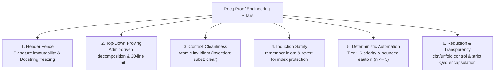
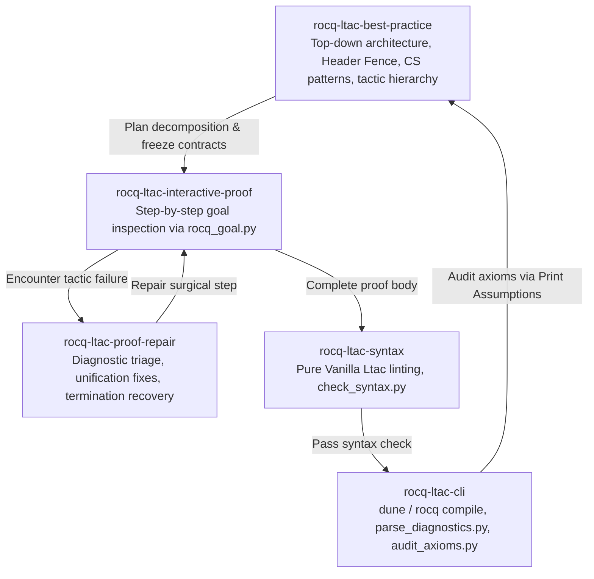

# Rocq Ltac Best Practice & Proof Engineering Guide

This skill provides an authoritative methodology, architectural design patterns, and contract enforcement tools (`scripts/lint_proof_contract.py`) for formal software verification, programming language semantics, and computer science theorems in Rocq (formerly Coq) using **Pure Vanilla Ltac**.

---

## 0. Environment & Version Compatibility

| Component            | Target / Supported              | Notes                                                                                        |
| :------------------- | :------------------------------ | :------------------------------------------------------------------------------------------- |
| **Rocq Prover**      | `9.0+` (Default target)         | Modern standard libraries split into `Corelib` and `Stdlib`. Unified `rocq` CLI.             |
| **Coq (Legacy)**     | `8.20` (Compatibility baseline) | Uses `From Coq Require Import ...`. Versions $\le 8.17$ are unsupported.                     |
| **Language Dialect** | **Pure Vanilla Ltac 100%**      | **SSReflect/MathComp syntax is strictly prohibited.** Dynamic Ltac2 generation is forbidden. |
| **Contract Linter**  | `lint_proof_contract.py`        | Zero-dependency Python 3.10+ script verifying Header Fence and docstring immutability.       |
| **Soundness Gate**   | `audit_axioms.py`               | Audits axioms via `Print Assumptions` to ensure `Closed under the global context`.           |

> **Script Path Resolution Note**:
> Tool scripts (`lint_proof_contract.py`, `check_syntax.py`, `rocq_goal.py`, `audit_axioms.py`) reside in their respective skill subdirectories (e.g. `skills/rocq-ltac-best-practice/scripts/lint_proof_contract.py`).
> When invoked from a workspace root without top-level symlinks, use their explicit skill paths or create workspace symlinks: `mkdir -p scripts && ln -sf ../skills/*/scripts/*.py scripts/`.

---

## 1. The Six Pillars of Rocq Proof Engineering

Every robust, maintainable, and sound formal proof in Rocq rests on six architectural pillars:

1. **Contract Invariance (Header Fence & Model Fence) & Model Sorts**: Theorem declarations across all 8 standard keywords (`Theorem`, `Lemma`, `Fact`, `Remark`, `Corollary`, `Proposition`, `Property`, `Example`), type signatures, bracketed attributes (`#[...]`), model definitions (`Record`, `Inductive`, `Fixpoint`, `Definition`), and specification/model comments (`(** [SPEC] ... *)`, `(** [MODEL] ... *)`) are **immutable contracts**. Never alter a theorem statement, weaken conclusions, add artificial premises (such as `False ->`), or introduce unapproved axioms. In multi-commit incremental developments where new lemmas or models are added, pass `--allow-new-specs` to the contract linter. When defining specification records or relations containing informative terms (`u8`, `usize`, `nat`, `slice`, or items in `Type` / `Set`), define them as `Record ... : Type := ...` (not `: Prop`) to ensure projections are generated.
2. **Top-Down (Admit-Driven) Proving**: Decompose complex proofs into modular standalone lemmas. Keep individual proof blocks under 30 lines (maximum 50 lines). Use temporary `admit.` during high-level architectural design, and eliminate all admits before submission.
3. **Context Cleanliness (`inv` Idiom)**: Never leave bare `inversion H.` unmanaged. Always execute `inversion H; subst; clear H.` (the `inv H` macro) to eliminate redundant equation hypotheses, substitute variables, and keep the local context minimal.
4. **Induction Safety (`remember` Idiom)**: When inducting over relations with compound indices (e.g., `step (EApp e1 e2) e'`), direct `induction` loses structural index constraints. Always apply `remember <term> as x eqn:Heqx` and `revert` dependent hypotheses before `induction`.
5. **Deterministic Automation Hierarchy**: Prioritize fast decision procedures (`reflexivity`, `discriminate`, `congruence`, `lia`, `tauto`) over speculative search. Bound backtracking depth explicitly (`eauto 3`, max `eauto 5`). Never use unconstrained `eauto` or non-deterministic `firstorder`.
6. **Controlled Reduction & Transparency**: Avoid unconstrained `compute` or bare `simpl` that explode symbolic terms into massive lambda expressions. Use `cbn [f g]` or explicit `unfold`. Seal all lemmas with `Qed` (reserving `Defined` strictly for computational definitions).

---

## 2. Fast Prover & Architect Checklist

Before starting, while structuring, and before completing any proof task, verify against this checklist:

### Stage A: Planning & Top-Down Decomposition

- [ ] **Contract Frozen**: Have original theorem signatures, model definitions, and `(** [SPEC] ... *)` / `(** [MODEL] ... *)` docstrings been recorded and protected from edits?
- [ ] **Record Sort Verified**: If defining relation or specification records with data fields (`u8`, `usize`, `nat`, `slice` in `Type` / `Set`), is `Record ... : Type := ...` used instead of `: Prop`? (Prevents `[cannot-define-projection,records,default]`).
- [ ] **Decomposition Planned**: If the expected proof script exceeds 30 lines or branches into $\ge 3$ non-trivial cases, have auxiliary lemmas (`Lemma aux_...`) been extracted top-down?
- [ ] **Idiom Identified**: Does the problem match a standard CS verification pattern (Progress, Preservation, Substitution, Determinism, RTC Invariant Induction, Simulation Diagrams, Separation Logic, Data Structure Representation Invariants)? -> Consult [`references/cs_verification_idioms.md`](references/cs_verification_idioms.md).
- [ ] **Indices Checked**: Is the induction applied to a predicate with compound indices? If so, prepare the `remember ... as ... eqn:...` pattern. -> Consult [`references/induction_patterns.md`](references/induction_patterns.md).

### Stage B: Tactic & Context Discipline

- [ ] **Destruction Managed**: Is every inversion cleaned up with `inv H` (`inversion H; subst; clear H.`)?
- [ ] **Subgoals Structured**: Are all branching subgoals strictly focused with bullets (`-`, `+`, `*`) or scoped within `{ ... }`?
- [ ] **Safe Reduction Used**: Are definitions unfolded selectively via `unfold` or `cbn [f]` instead of blind `compute` or speculative `simpl`? -> Consult [`references/reduction_transparency.md`](references/reduction_transparency.md).
- [ ] **Automation Bounded**: Are `eauto` calls depth-bounded ($n \le 5$)? Is `lia` used for integer/natural arithmetic (with `zify` or case splits for subtraction)? -> Consult [`references/tactic_hierarchy.md`](references/tactic_hierarchy.md).
- [ ] **Encapsulation**: Are completed lemmas closed with `Qed` rather than `Defined`?

### Stage C: Soundness & Final Contract Audit

- [ ] **Contract Linter**: Run `python3 skills/rocq-ltac-best-practice/scripts/lint_proof_contract.py --file <file.v> --strict` (or `--original <orig.v> --modified <mod.v>`; append `--allow-new-specs` if adding new lemmas/models/specifications incrementally) to verify signature and model invariance and complete admit elimination against git HEAD.
- [ ] **Syntax Linter**: Run `python3 skills/rocq-ltac-syntax/scripts/check_syntax.py <file.v>` to ensure zero SSReflect dialect mixing or lexical flaws.
- [ ] **Build & Fast File Gate**: Run `python3 skills/rocq-ltac-cli/scripts/run_build.py -- rocq compile -color no <file.v>` to produce a valid `.vo` binary.
- [ ] **Soundness Gate**: Run `python3 skills/rocq-ltac-cli/scripts/audit_axioms.py --module <Module> --theorem <Thm>` to confirm `Closed under the global context` with no illegal axioms.

---

## 3. Progressive Reference Guides

Consult the specialized reference guides below for in-depth principles, concrete code skeletons, and antipattern corrections:

| Guide                                                                 | Core Topics & Techniques                                                                       | When to Read                                                                    |
| :-------------------------------------------------------------------- | :--------------------------------------------------------------------------------------------- | :------------------------------------------------------------------------------ |
| [`proof_architecture.md`](references/proof_architecture.md)           | Top-down proof structuring, 30-line limit, `admit` lifecycle, `assert` vs `enough`.            | When designing large proofs, decomposing lemmas, or structuring proofs.         |
| [`header_fence.md`](references/header_fence.md)                       | Contract immutability, 8 declaration keywords, attributes BNF, Docstring Rules A/B/C.          | When receiving tasks, writing auxiliary lemmas, or preparing final submission.  |
| [`cs_verification_idioms.md`](references/cs_verification_idioms.md)   | Progress, Preservation, Substitution lemmas, Invariant RTC induction, Simulation, Termination. | When proving type safety, operational semantics, interpreters, or transitions.  |
| [`induction_patterns.md`](references/induction_patterns.md)           | `remember` idiom, `revert` / `generalize dependent`, mutual induction, well-founded recursion. | When inducting on indexed inductive types or complex step relations.            |
| [`tactic_hierarchy.md`](references/tactic_hierarchy.md)               | 6-tier automation hierarchy, `default_search_depth = 5`, `lia` subtraction caveats, `HintDb`.  | When selecting tactics, optimizing proof steps, or bounding automated searches. |
| [`reduction_transparency.md`](references/reduction_transparency.md)   | `cbn [f]` TransparentState, `simpl` progress heuristics, `compute` OOM, `Qed` vs `Defined`.    | When goals explode into huge expressions or typechecking slows down.            |
| [`proof_style_and_golfing.md`](references/proof_style_and_golfing.md) | Bullet hierarchies, `now`, `all: try solve`, `progress`, infinite loop hazards in `repeat`.    | When polishing proof readability, organizing subgoals, or avoiding regressions. |

---

## 4. Synergy with Rocq Skills Ecosystem

`rocq-ltac-best-practice` provides architectural guidance and proof contracts, coordinating with the other four specialized skills:

- **Before Proving**: Snapshot original signatures and verify contracts using [`scripts/lint_proof_contract.py`](scripts/lint_proof_contract.py). Plan top-down decomposition following [`references/proof_architecture.md`](references/proof_architecture.md).
- **During Proving**: Use `rocq-ltac-interactive-proof` (`skills/rocq-ltac-interactive-proof/scripts/rocq_goal.py`) to inspect live subgoals at each step.
- **When Stuck**: If tactics fail or types mismatch, switch to `rocq-ltac-proof-repair` for targeted triage.
- **Before Submission**: Enforce syntax cleanliness with `rocq-ltac-syntax` (`skills/rocq-ltac-syntax/scripts/check_syntax.py`), verify batch builds and audit axioms with `rocq-ltac-cli` (`skills/rocq-ltac-cli/scripts/run_build.py` & `skills/rocq-ltac-cli/scripts/audit_axioms.py`), and run `lint_proof_contract.py --strict` (with `--allow-new-specs` if adding new lemmas/specifications incrementally).
