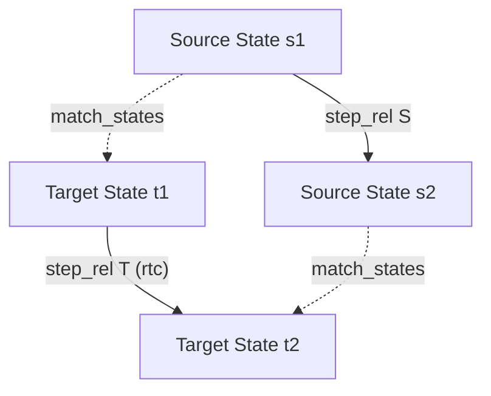

# Computer Science Verification Idioms

This reference provides implementation-grounded skeletons and proof patterns for the core domains of computer science verification in Rocq: programming language semantics, state transition systems, compiler correctness, and well-founded termination.

---

## 1. Programming Language Semantics: Progress & Preservation

Type soundness in operational semantics is established by the dual theorems of **Progress** and **Preservation** (Subject Reduction).

```coq
Ltac inv H := inversion H; subst; clear H.
```

### Pattern 1: Progress Theorem

Progress states that every well-typed closed term is either a final value or can take an evaluation step:

```coq
Theorem progress : forall t T,
  has_type empty t T ->
  value t \/ exists t', step t t'.
Proof.
  intros t T Ht.
  remember empty as Gamma eqn:HeqGamma.
  induction Ht; subst.
  - (* T_Var: Variables cannot be typed in an empty context *)
    discriminate HeqGamma.
  - (* T_Abs: Abstractions are immediate values *)
    left. constructor.
  - (* T_App: Function application *)
    right.
    (* Destruct induction hypothesis for function position *)
    destruct (IHHt1 eq_refl) as [Hval1 | [t1' Hstep1]].
    + (* t1 is a value: check argument t2 *)
      destruct (IHHt2 eq_refl) as [Hval2 | [t2' Hstep2]].
      * (* Canonical Forms: value of arrow type must be an abstraction *)
        inv Hval1; try solve [ inv Ht1 ].
        eexists. apply step_beta; eauto 2.
      * (* t2 takes a step *)
        eexists. apply step_app2; eauto 2.
    + (* t1 takes a step *)
      eexists. apply step_app1; eauto 2.
Qed.
```

### Pattern 2: Preservation Theorem & Context Generalization

Preservation states that evaluation steps preserve the type of an expression.

#### Architectural Rules for Preservation:

1. **Induction on Typing Derivation**: Always perform induction on the typing derivation `has_type empty t T` rather than the evaluation step `step t t'`. Inducting on evaluation requires reconstructing typing derivations for subexpressions through inversion lemmas across all cases.
2. **Mandatory Step Generalization**: You **must** execute `generalize dependent t'` before `induction Ht`. Otherwise, the induction hypothesis `IHHt` binds to a specific target term `t'`, destroying the ability to instantiate it for subexpression transitions.

```coq
Theorem preservation : forall t t' T,
  has_type empty t T ->
  step t t' ->
  has_type empty t' T.
Proof.
  intros t t' T Ht.
  generalize dependent t'.
  remember empty as Gamma eqn:HeqGamma.
  induction Ht; intros t' Hstep; subst; try solve [ inv Hstep ].
  - (* T_App *)
    inv Hstep.
    + (* step_beta: apply substitution lemma *)
      inv Ht1.
      eapply substitution_preserves_typing; eauto.
    + (* step_app1: apply IH on first term *)
      eapply T_App; eauto.
    + (* step_app2: apply IH on second term *)
      eapply T_App; eauto.
Qed.
```

### Pattern 3: Generalized Contexts in the Substitution Lemma

The Substitution Lemma states that substituting a closed well-typed value `s : S` into a term `t : T` preserves typing.

#### Architectural Mandate:

Because variable binders (abstractions) extend the local typing context, you **must** generalize both the context `Gamma` and the target type `T` before structural induction on term `t`:

```coq
Lemma substitution_preserves_typing : forall Gamma x s t S T,
  has_type (update Gamma x S) t T ->
  has_type empty s S ->
  has_type Gamma (subst x s t) T.
Proof.
  intros Gamma x s t S T Ht.
  generalize dependent Gamma.
  generalize dependent T.
  induction t; intros T Gamma Ht Hs;
    inv Ht; simpl; eauto.
  - (* Variable case: split on identifier equality *)
    destruct (String.eqb_spec x0 x); subst.
    + (* x0 = x: target variable matches; invoke weakening on Hs *)
      rewrite update_eq in H1. injection H1 as ->; subst.
      apply weakening_empty; assumption.
    + (* x0 <> x: context update exchange *)
      rewrite update_neq in H1; [| assumption ].
      constructor. assumption.
Qed.
```

### Pattern 4: Determinism via Cross-Inversion

Determinism states that single-step evaluation produces a unique successor:

```coq
Theorem step_deterministic : forall t t1 t2,
  step t t1 ->
  step t t2 ->
  t1 = t2.
Proof.
  intros t t1 t2 Hstep1.
  generalize dependent t2.
  induction Hstep1; intros t2 Hstep2; inv Hstep2; try reflexivity.
  - (* Conflicting step vs value: contradiction via irreducibility lemma *)
    exfalso. eapply value_cannot_step; eauto.
  - (* Congruence step: apply induction hypothesis *)
    apply IHHstep1 in H3. subst. reflexivity.
Qed.
```

---

## 2. State Transition Systems & Invariant Preservation

Verifying reactive systems, protocols, and abstract machines requires reasoning over the **reflexive transitive closure (RTC)** of a transition relation.

### Definition: Head-Stepping vs Binary Transitivity

Always define RTC using a **left-associative head-stepping constructor** (`rtc_step`) rather than a symmetric binary transitivity constructor (`rtc_trans : rtc R x y -> rtc R y z -> rtc R x z`):

```coq
Inductive rtc {A : Type} (R : A -> A -> Prop) : A -> A -> Prop :=
| rtc_refl : forall x, rtc R x x
| rtc_step : forall x y z, R x y -> rtc R y z -> rtc R x z.
```

#### Why Head-Stepping is Architecturally Superior:

- When applying `induction` to an `rtc` term, head-stepping makes the induction isomorphic to natural number induction on execution trace length.
- A binary `rtc_trans` constructor creates unconstrained existential intermediate states $y$ at each induction step, blowing up the search space and causing induction hypotheses to become too weak to close the goal.

### The Three Prerequisite RTC Lemmas

Before proving high-level system theorems, always establish these three prerequisite lemmas:

```coq
(** 1. Single-step embedding *)
Lemma rtc_R : forall {A : Type} (R : A -> A -> Prop) (x y : A),
  R x y -> rtc R x y.
Proof.
  intros A R x y H.
  eapply rtc_step; [eassumption | constructor].
Qed.

(** 2. Transitivity lemma *)
Lemma rtc_trans : forall {A : Type} (R : A -> A -> Prop) (x y z : A),
  rtc R x y -> rtc R y z -> rtc R x z.
Proof.
  intros A R x y z H1 H2.
  induction H1 as [| x1 x2 x3 HR Hrest IH].
  - assumption.
  - eapply rtc_step; [eassumption | apply IH; assumption].
Qed.

(** 3. Universal Invariant Preservation Lifting *)
Theorem rtc_invariant : forall {A : Type} (R : A -> A -> Prop) (P : A -> Prop) (x y : A),
  (forall s s', P s -> R s s' -> P s') ->
  P x ->
  rtc R x y ->
  P y.
Proof.
  intros A R P x y Hstep Hinit Hreach.
  induction Hreach as [s | s1 s2 s3 Htrans Hrest IH].
  - assumption.
  - apply IH.
    eapply Hstep; [apply Hinit | apply Htrans].
Qed.
```

---

## 3. Separation Logic & Heap Predicate Verification

When verifying programs that manipulate pointers, mutable state, or distributed resources, proof terms easily explode if heap equalities are rewritten manually.

### Core Separation Logic Monoid Skeletons

```coq
Parameter loc : Type.
Parameter val : Type.

Definition heap : Type := loc -> option val.
Definition hprop : Type := heap -> Prop.

Parameter hempty : hprop.
Parameter hsingle : loc -> val -> hprop.
Parameter hstar : hprop -> hprop -> hprop.
Parameter himpl : hprop -> hprop -> Prop.

Notation "\[]" := hempty (at level 0) : heap_scope.
Notation "p '~~>' v" := (hsingle p v) (at level 32) : heap_scope.
Notation "H1 '\*' H2" := (hstar H1 H2) (at level 41, right associativity) : heap_scope.
Notation "H1 '==>' H2" := (himpl H1 H2) (at level 55) : heap_scope.
```

### Two-Phase Automated Normalization (`xsimpl`)

Never attempt manual rewriting with associativity and commutativity lemmas for $\star$. Design an automated, non-diverging two-phase Ltac macro:

```coq
Axiom hstar_assoc : forall H1 H2 H3, (H1 \* H2) \* H3 ==> H1 \* (H2 \* H3).
Axiom hstar_comm  : forall H1 H2, H1 \* H2 ==> H2 \* H1.
Axiom hstar_empty_l : forall H, \[] \* H ==> H.
Axiom himpl_refl  : forall H, H ==> H.
Axiom hstar_congr_l : forall H1 H2 H3, H2 ==> H3 -> H1 \* H2 ==> H1 \* H3.

(** Phase 1: Structural Canonicalization & Phase 2: Term Cancellation *)
Ltac xsimpl_step :=
  match goal with
  | |- (?H1 \* ?H2) ==> (?H1 \* ?H3) =>
      (* Cancel identical head predicates (Frame cancellation) *)
      apply hstar_congr_l
  | |- (_ \* _) \* _ ==> _ =>
      (* Re-associate to right-associative normal form *)
      eapply himpl_trans; [apply hstar_assoc |]
  | |- \[] \* ?H ==> ?H =>
      apply hstar_empty_l
  | |- ?H ==> ?H =>
      apply himpl_refl
  end.

Ltac xsimpl :=
  repeat progress xsimpl_step.
```

### Frame Rule & Evar Discipline

When applying a Hoare triple with a frame rule:

1. Generate an existential variable (Evar `?Frame`) for the unmodified residue of the heap.
2. Immediately invoke `xsimpl` to unify `?Frame` against the remaining conjuncts.
3. **Mandatory Discipline**: Never leave `?Frame` uninstantiated across branching subgoals. If an Evar remains unresolved, subsequent tactics across sibling goals can constrain it incompatibly, causing proof paralysis.

---

## 4. Data Structure Invariants & Functional Correctness

When verifying algorithms (e.g., search trees, heaps, sorting), conflating representation invariants with functional correctness leads to intractable, monolithic inductions.

### Principle 1: Strict Orthogonality of Representation & Specification

Separate structural well-formedness from input/output input relations:

```coq
Inductive tree : Type :=
| E : tree
| T : tree -> nat -> nat -> tree -> tree.

Fixpoint forall_tree (P : nat -> Prop) (t : tree) : Prop :=
  match t with
  | E => True
  | T l k v r => P k /\ forall_tree P l /\ forall_tree P r
  end.

(** Representation Invariant: Binary Search Tree *)
Inductive BST : tree -> Prop :=
| BST_E : BST E
| BST_T : forall l k v r,
    BST l ->
    BST r ->
    forall_tree (fun k' => k' < k) l ->
    forall_tree (fun k' => k' > k) r ->
    BST (T l k v r).

Parameter insert : nat -> nat -> tree -> tree.
Parameter lookup : nat -> tree -> option nat.

(** Theorem 1: Representation Invariant Preservation (Proven Independently) *)
Theorem insert_BST : forall k v t,
  BST t -> BST (insert k v t).
Proof.
  (* Structural induction on t without mixing lookup logic *)
Admitted.

(** Theorem 2: Functional Correctness (Assumes Invariant as Precondition) *)
Theorem lookup_insert_eq : forall k v t,
  BST t -> lookup k (insert k v t) = Some v.
Proof.
  (* Leverages insert_BST to guarantee BST preservation at each step *)
Admitted.
```

### Principle 2: Sorting Correctness via Decoupled Relations

Always decouple sorting verification into two orthogonal properties:

1. **Permutation Equivalence**: Elements are neither created nor destroyed (`Permutation al (sort al)`).
2. **Sortedness**: Output elements satisfy the ordering relation (`Sorted (sort al)`).

```coq
Definition is_correct_sorting (sort : list nat -> list nat) : Prop :=
  forall al, Permutation al (sort al) /\ Sorted (sort al).
```

### Principle 3: Branch Analysis via Boolean Reflection (`bdestruct`)

**Anti-Pattern**: Bare `destruct (x =? y)` drops the connection between the condition and the branched subgoals, leaving `x =? y = true` without propositional equalities `x = y`.

**Prescription**: Use boolean reflection (`reflect`) to introduce propositional equalities into hypotheses:

```coq
From Stdlib Require Import Arith Lia.

(** Macro reflecting boolean comparison into propositional equality / inequality *)
Ltac bdestruct X :=
  let H := fresh "H" in
  destruct X eqn:H;
  [ apply Nat.eqb_eq in H
  | apply Nat.eqb_neq in H ].
```

With `bdestruct (x =? y)`, the branches immediately introduce `H : x = y` and `H : x <> y` into hypotheses, enabling `subst` and `lia` to discharge arithmetic constraints automatically.

---

## 5. Compiler Correctness: Forward Simulation Diagrams

Compiler correctness proofs establish that target code executions simulate source code executions according to a state matching relation:



### Forward Simulation Skeleton

```coq
Theorem simulation_step : forall (S T : TransitionSystem) (match_states : state S -> state T -> Prop),
  (forall s t s',
     match_states s t ->
     step_rel S s s' ->
     exists t', step_rel T t t' /\ match_states s' t') ->
  forall s0 sn, rtc (step_rel S) s0 sn ->
  forall t0, match_states s0 t0 ->
  exists tn, rtc (step_rel T) t0 tn /\ match_states sn tn.
Proof.
  intros S T match_states Hstep_sim s0 sn Hreach.
  induction Hreach as [s | s1 s2 s3 Hstep_s Hreach_rest IH]; intros t0 Hmatch.
  - (* Base: zero steps *)
    exists t0. split; [constructor | assumption].
  - (* Inductive step: advance one simulation step *)
    edestruct Hstep_sim as [t1 [Hstep_t Hmatch1]]; eauto.
    edestruct IH as [tn [Hreach_t Hmatch_final]]; eauto.
    exists tn. split; [| assumption].
    econstructor; eauto.
Qed.
```

---

## 6. Well-Founded Termination with `Program Fixpoint`

When recursive functions do not decrease structurally on a single syntactic argument, use Rocq's `Program Fixpoint` with a `{measure ...}` clause:

```coq
From Stdlib Require Import Program.
From Stdlib Require Import Arith Lia.

(* Euclidean GCD: terminates because second argument strictly decreases *)
Program Fixpoint gcd_euclid (a b : nat) {measure b} : nat :=
  match b with
  | 0 => a
  | S _ => gcd_euclid b (a mod b)
  end.
Next Obligation.
  (* Discharge termination proof obligation *)
  apply Nat.mod_upper_bound.
  lia.
Qed.
```

### Multi-Argument Lexicographic Measure

For functions with multiple decreasing arguments (e.g., Ackermann function):

```coq
From Stdlib Require Import Program.
From Stdlib Require Import Arith Lia.

Program Fixpoint ackermann (m n : nat) {measure (m + n)} : nat :=
  match m, n with
  | 0, _ => S n
  | S m', 0 => ackermann m' 1
  | S m', S n' => ackermann m' (ackermann (S m') n')
  end.
Next Obligation.
  (* Ackermann nested calls require lexicographic pairs or well-founded recursion *)
Admitted.
```

---

## 7. Canonical Forms & Inversion Lemmas

In large operational semantics developments, direct inversion inside theorems causes excessive branching. Always formulate explicit **Canonical Forms Lemmas** for values:

```coq
(** Canonical Forms for Arrow Types *)
Lemma canonical_forms_arrow : forall t T1 T2,
  value t ->
  has_type empty t (TArrow T1 T2) ->
  exists x t', t = TAbs x t'.
Proof.
  intros t T1 T2 Hval Htype.
  inv Hval; inv Htype.
  eexists; reflexivity.
Qed.
```
