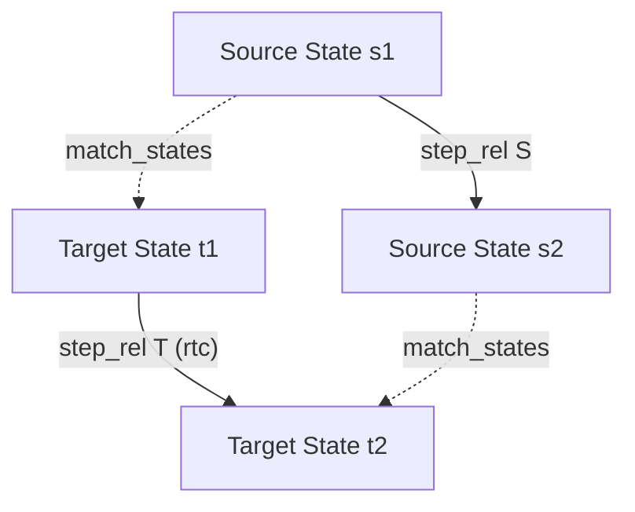

# Computer Science Verification Idioms

This reference provides implementation-grounded skeletons and proof patterns for the core domains of computer science verification in Rocq: programming language semantics, state transition systems, compiler correctness, and well-founded termination.

---

## 1. Programming Language Semantics: Progress & Preservation

Type soundness in operational semantics is established by the dual theorems of **Progress** and **Preservation** (Subject Reduction).

```coq
Ltac inv H := inversion H; subst; clear H.
```

### Pattern 1: Progress Theorem

Progress states that every well-typed closed term is either a final value or can take an evaluation step:

```coq
Theorem progress : forall t T,
  has_type empty t T ->
  value t \/ exists t', step t t'.
Proof.
  intros t T Ht.
  remember empty as Gamma eqn:HeqGamma.
  induction Ht; subst.
  - (* T_Var: Variables cannot be typed in an empty context *)
    discriminate HeqGamma.
  - (* T_Abs: Abstractions are immediate values *)
    left. constructor.
  - (* T_App: Function application *)
    right.
    (* Destruct induction hypothesis for function position *)
    destruct (IHHt1 eq_refl) as [Hval1 | [t1' Hstep1]].
    + (* t1 is a value: check argument t2 *)
      destruct (IHHt2 eq_refl) as [Hval2 | [t2' Hstep2]].
      * (* Canonical Forms: value of arrow type must be an abstraction *)
        inv Hval1; try solve [ inv Ht1 ].
        eexists. apply step_beta; eauto 2.
      * (* t2 takes a step *)
        eexists. apply step_app2; eauto 2.
    + (* t1 takes a step *)
      eexists. apply step_app1; eauto 2.
Qed.
```

### Pattern 2: Preservation Theorem

Preservation states that evaluation steps preserve the type of an expression. It critically depends on an external **Substitution Lemma**:

```coq
(** Prerequisite: Substitution Lemma (proven separately top-down) *)
Lemma substitution_preserves_typing : forall Gamma x s t S T,
  has_type (update Gamma x S) t T ->
  has_type empty s S ->
  has_type Gamma (subst x s t) T.
Proof.
  (* Standard proof by induction on typing derivation *)
Admitted.

Theorem preservation : forall t t' T,
  has_type empty t T ->
  step t t' ->
  has_type empty t' T.
Proof.
  intros t t' T Ht.
  generalize dependent t'.
  remember empty as Gamma eqn:HeqGamma.
  induction Ht; intros t' Hstep; subst; try solve [ inv Hstep ].
  - (* T_App *)
    inv Hstep.
    + (* step_beta: apply substitution lemma *)
      inv Ht1.
      eapply substitution_preserves_typing; eauto.
    + (* step_app1: apply IH on first term *)
      eapply T_App; eauto.
    + (* step_app2: apply IH on second term *)
      eapply T_App; eauto.
Qed.
```

---

## 2. State Transition Systems & Invariant Preservation

Verifying reactive systems, protocols, and abstract machines requires reasoning over the **reflexive transitive closure (RTC)** of a transition relation:

```coq
Inductive rtc {A : Type} (R : A -> A -> Prop) : A -> A -> Prop :=
| rtc_refl : forall x, rtc R x x
| rtc_step : forall x y z, R x y -> rtc R y z -> rtc R x z.
```

### Invariant Preservation Skeleton

```coq
Record TransitionSystem := {
  state : Type;
  initial_state : state -> Prop;
  step_rel : state -> state -> Prop
}.

Definition invariant (sys : TransitionSystem) (P : state sys -> Prop) : Prop :=
  (forall s, initial_state sys s -> P s) /\
  (forall s s', P s -> step_rel sys s s' -> P s').

Theorem reachability_preserves_invariant : forall sys P s0 sn,
  invariant sys P ->
  initial_state sys s0 ->
  rtc (step_rel sys) s0 sn ->
  P sn.
Proof.
  intros sys P s0 sn [Hinit Hstep] Hs0 Hreach.
  induction Hreach as [s | s1 s2 s3 Htrans Hrest IH].
  - (* Base: initial state *)
    apply Hinit. assumption.
  - (* Step: apply invariant preservation lemma *)
    apply IH.
    eapply Hstep; eauto.
Qed.
```

---

## 3. Compiler Correctness: Forward Simulation Diagrams

Compiler correctness proofs establish that target code executions simulate source code executions according to a state matching relation:



### Forward Simulation Skeleton

```coq
Theorem simulation_step : forall (S T : TransitionSystem) (match_states : state S -> state T -> Prop),
  (forall s t s',
     match_states s t ->
     step_rel S s s' ->
     exists t', step_rel T t t' /\ match_states s' t') ->
  forall s0 sn, rtc (step_rel S) s0 sn ->
  forall t0, match_states s0 t0 ->
  exists tn, rtc (step_rel T) t0 tn /\ match_states sn tn.
Proof.
  intros S T match_states Hstep_sim s0 sn Hreach.
  induction Hreach as [s | s1 s2 s3 Hstep_s Hreach_rest IH]; intros t0 Hmatch.
  - (* Base: zero steps *)
    exists t0. split; [constructor | assumption].
  - (* Inductive step: advance one simulation step *)
    edestruct Hstep_sim as [t1 [Hstep_t Hmatch1]]; eauto.
    edestruct IH as [tn [Hreach_t Hmatch_final]]; eauto.
    exists tn. split; [| assumption].
    econstructor; eauto.
Qed.
```

---

## 4. Well-Founded Termination with `Program Fixpoint`

When recursive functions do not decrease structurally on a single syntactic argument, use Rocq's `Program Fixpoint` with a `{measure ...}` clause:

```coq
From Stdlib Require Import Program.
From Stdlib Require Import Arith Lia.

(* Euclidean GCD: terminates because second argument strictly decreases *)
Program Fixpoint gcd_euclid (a b : nat) {measure b} : nat :=
  match b with
  | 0 => a
  | S _ => gcd_euclid b (a mod b)
  end.
Next Obligation.
  (* Discharge termination proof obligation *)
  apply Nat.mod_upper_bound.
  lia.
Qed.
```

### Multi-Argument Lexicographic Measure

For functions with multiple decreasing arguments (e.g., Ackermann function):

```coq
From Stdlib Require Import Program.
From Stdlib Require Import Arith Lia.

Program Fixpoint ackermann (m n : nat) {measure (m + n)} : nat :=
  match m, n with
  | 0, _ => S n
  | S m', 0 => ackermann m' 1
  | S m', S n' => ackermann m' (ackermann (S m') n')
  end.
Next Obligation.
  (* Ackermann nested calls require lexicographic pairs or well-founded recursion *)
Admitted.
```

---

## 5. Canonical Forms & Inversion Lemmas

In large operational semantics developments, direct inversion inside theorems causes excessive branching. Always formulate explicit **Canonical Forms Lemmas** for values:

```coq
(** Canonical Forms for Arrow Types *)
Lemma canonical_forms_arrow : forall t T1 T2,
  value t ->
  has_type empty t (TArrow T1 T2) ->
  exists x t', t = TAbs x t'.
Proof.
  intros t T1 T2 Hval Htype.
  inv Hval; inv Htype.
  eexists; reflexivity.
Qed.
```
