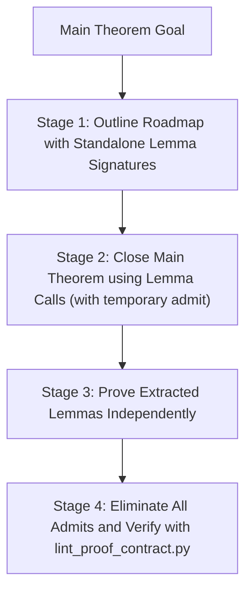

# Proof Architecture, Top-Down Decomposition & Lemma Lifecycle

This reference guides autonomous theorem proving agents in structuring scalable, modular, and maintainable proofs in Rocq (formerly Coq) using **Pure Vanilla Ltac**.

---

## 1. The Monolithic Proof Trap (The 30-Line Rule)

### The Anti-Pattern

Autonomous agents often attempt to prove high-level theorems inside a single, monolithic `Proof ... Qed.` block exceeding 100 lines. This inevitably causes:

1. **Context Window Saturation**: Sibling subgoals generate dozens of intermediate hypotheses, obscuring relevant premises.
2. **Attention Drift & Hallucination**: The model loses track of which branch it is solving, conflating induction hypotheses.
3. **Catastrophic Backtracking**: A broken tactic at line 85 requires re-evaluating the preceding 84 lines in every iteration.

### The Architectural Mandate

- **Strict Size Limit**: Keep individual proof blocks under **30 lines** (absolute maximum: 50 lines).
- **Branching Trigger**: If an `induction` or `destruct` creates $\ge 3$ branches where any single branch requires $\ge 15$ lines of non-trivial reasoning, immediately factor that branch out into an independent top-level `Lemma`.
- **Single Responsibility Principle**: Each lemma should establish exactly one semantic property (e.g., determinism of sequential execution, substitution preserves typing, or inversion of evaluation).

---

## 2. Top-Down (Admit-Driven) Architecture

Top-down proving designs the high-level roadmap first before sinking time into complex low-level subgoals.

### The 4-Stage Top-Down Workflow



### Step-by-Step Implementation

Given a complex evaluation determinism theorem:

```coq
(* Target Theorem *)
Theorem ceval_deterministic : forall c st st1 st2,
  ceval c st st1 ->
  ceval c st st2 ->
  st1 = st2.
```

#### Step 1: Identify and Declare Auxiliary Lemmas (with `admit`)

Before filling the induction details of `ceval_deterministic`, identify the hardest branch (e.g., sequence composition `E_Seq`):

```coq
(** [AUX] Helper lemma establishing intermediate state uniqueness for sequencing *)
Lemma ceval_seq_intermediate : forall c1 c2 st st1 st2 st1' st2',
  ceval c1 st st1 ->
  ceval c1 st st2 ->
  (st1 = st2 -> ceval c2 st1 st1' -> ceval c2 st2 st2' -> st1' = st2') ->
  ceval c2 st1 st1' ->
  ceval c2 st2 st2' ->
  st1' = st2'.
Proof.
  (* Temporarily admitted during Stage 1 *)
  admit.
Admitted.
```

#### Step 2: Assemble the Main Proof Skeleton

Close the primary theorem using helper calls and trivial case dispatch:

```coq
Ltac inv H := inversion H; subst; clear H.

Theorem ceval_deterministic : forall c st st1 st2,
  ceval c st st1 ->
  ceval c st st2 ->
  st1 = st2.
Proof.
  intros c st st1 st2 H1.
  generalize dependent st2.
  induction H1; intros st2 H2; inv H2.
  - (* E_Skip *) reflexivity.
  - (* E_Asgn *) reflexivity.
  - (* E_Seq *)
    eapply ceval_seq_intermediate; eauto.
  - (* E_IfTrue *) eapply IHceval; eauto.
  - (* E_IfFalse *) eapply IHceval; eauto.
  - (* E_WhileFalse *) reflexivity.
  - (* E_WhileTrue *) eapply IHceval2; eauto.
Qed.
```

#### Step 3: Implement and Discharge the Auxiliary Lemma

Return to `ceval_seq_intermediate` and prove it in isolation:

```coq
(** [AUX] Helper lemma establishing intermediate state uniqueness for sequencing *)
Lemma ceval_seq_intermediate : forall c1 c2 st st1 st2 st1' st2',
  ceval c1 st st1 ->
  ceval c1 st st2 ->
  (st1 = st2 -> ceval c2 st1 st1' -> ceval c2 st2 st2' -> st1' = st2') ->
  ceval c2 st1 st1' ->
  ceval c2 st2 st2' ->
  st1' = st2'.
Proof.
  intros c1 c2 st st1 st2 st1' st2' Hc1_1 Hc1_2 Hcont Hc2_1 Hc2_2.
  assert (Heq: st1 = st2).
  { (* Direct invocation or smaller property *)
    admit. (* Replace with concrete proof *) }
  apply (Hcont Heq Hc2_1 Hc2_2).
Admitted.
```

---

## 3. Local Lemmas: Choosing between `assert`, `enough`, and `pose proof`

When proof logic is small ($\le 10$ lines) and tightly coupled to the local context, use local assertion tactics rather than top-level lemmas:

| Tactic                  | Direction          | Local Transformation                                                | Best Use Case                                                  |
| :---------------------- | :----------------- | :------------------------------------------------------------------ | :------------------------------------------------------------- |
| `assert (H : P)`        | **Forward**        | Creates subgoal `⊢ P` first, then adds `H : P` to hypotheses        | Proving a known fact or intermediate equation before using it. |
| `assert (H : P) by tac` | **Inline Forward** | Solves `P` with `tac` immediately and adds `H : P` without subgoals | Quick arithmetic (`lia`), symmetry, or type deduction.         |
| `enough (H : P)`        | **Backward**       | Goal becomes `⊢ P -> Target`, followed by subgoal `⊢ P`             | Reframing goal in terms of a sufficient prerequisite.          |
| `pose proof term as H`  | **Instantiate**    | Adds existing lemma instantiated with local variables to hypotheses | Specializing a generic library theorem for local use.          |

---

## 4. Temporary `admit` / `Admitted` Lifecycle Management

To prevent reward hacking and unproven code leaks:

1. **Phase 1 (Exploration)**: `admit.` and `Admitted.` are permitted **only** during initial top-down skeleton drafting.
2. **Phase 2 (Proving)**: Replace every `admit.` with an actual proof. Never leave unresolved admits inside `{ ... }` blocks.
3. **Phase 3 (Submission Gate)**:
   - Run `python3 skills/rocq-ltac-best-practice/scripts/lint_proof_contract.py --original <orig.v> --modified <mod.v> --strict`
   - If ANY `admit` or `Admitted` remains, the linter exits with code `1` and aborts submission.
4. **Circular Assertion Trap**:
   ```coq
   (* FORBIDDEN CHEAT: Circular assert-admit trick *)
   Theorem fake_proof : forall P, P.
   Proof.
     intros P.
     assert (H: P). { admit. }
     apply H.
   Admitted. (* Rejected by strict linter! *)
   ```

---

## 5. Atomic Destruction Hygiene (`inv H`) & Inversion Mechanics

### A. The Non-Deterministic Numbering Trap in `inversion`

Bare `inversion H.` invokes internal fresh identifier generators (`fresh_id_in_env`), producing default names `H0`, `H1`, `H2`, ...:

- Because these index numbers depend on whatever identifiers currently reside in the local environment, subsequent tactic lines that reference `H0` or `H1` by name are brittle and fail when earlier proof steps change.
- Bare `inversion` leaves both the redundant generated equality hypotheses and the consumed original hypothesis `H` in the context, rapidly saturating memory.

### B. The Atomic Destruction Macro

Always define and use the atomic destruction idiom:

```coq
Ltac inv H := inversion H; subst; clear H.
```

Executing `inv H` guarantees:

1. All newly exposed equalities `x = e` are substituted throughout the goal and hypotheses via `subst`.
2. The obsolete hypothesis `H` is cleared immediately, keeping the local context minimal.

### C. Strict Failure Modes of `subst` & Alternative Idioms

When `subst` fails during `inv H`, it is almost always caused by one of three internal constraints:

1. **Occurs-Check Failure (`occur_var`)**: Variable `x` appears freely inside its substituted value `e` (e.g., $x = f(x)$). Substitution would trigger infinite expansion, throwing `Cannot remove x because it occurs in its value`.
2. **Dependency Topological Cycles**: Variable `x` is depended on by another hypothesis $H_i$, which in turn is depended on by the equation defining `x`.
3. **Dependent Inductive Indices**: The equality relates non-variable indices of dependent types, requiring heterogeneous equality (John Major's Equality) rather than standard Leibniz equality.

#### Prescriptions for Inversion Failures

- **For Dependent Inversions**: Switch to `dependent destruction H` (from `From Stdlib Require Import Program.Equality.`) or use the `remember ... as ... eqn:... in H` idiom before `destruct H`.
- **For Simple Injective Constructors**: Prefer `injection H as ->` or `injection H; intros; subst` over full `inversion` to avoid generating intermediate equations altogether.
