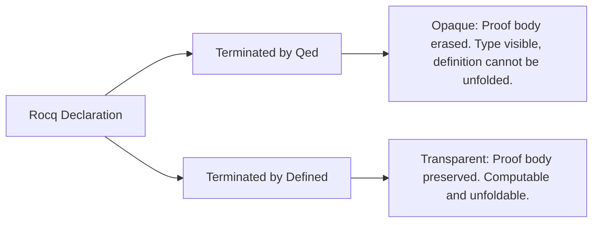

# Reduction Strategies & Transparency Management

This reference guides autonomous agents in controlling term reduction, avoiding proof term explosion, and enforcing transparency boundaries in Rocq using **Pure Vanilla Ltac**.

---

## 1. The Spectrum of Reduction Tactics

In Rocq, reduction tactics evaluate terms according to the rules of the Calculus of Inductive Constructions ($\beta, \iota, \zeta, \delta$-reductions). Choosing the wrong reduction tactic can expand definitions uncontrollably, generating megabyte-sized terms that exhaust memory and freeze the agent.

| Tactic            | Behavior & Red Flags                     | Scope & Targets                             | Risk Level        | Recommended Use Case                                                            |
| :---------------- | :--------------------------------------- | :------------------------------------------ | :---------------- | :------------------------------------------------------------------------------ |
| `cbn [f g]`       | White-list controlled $\delta$-reduction | Only expands listed symbols `f, g`          | **Very Low**      | **Standard first choice** for simplifying function applications.                |
| `cbn -[f g]`      | Black-list controlled $\delta$-reduction | Expands all definitions _except_ `f, g`     | **Low**           | Preserving specific abstract barrier functions while unfolding others.          |
| `unfold f`        | Explicit 1-step $\delta$-expansion       | Replaces `f` with its definition            | **Low**           | Exposing pattern matches or definitions for subsequent destruction.             |
| `change t with u` | Definitional replacement                 | Replaces `t` with definitionally equal `u`  | **Low**           | Surgical rewriting of subterms without altering surrounding context.            |
| `simpl`           | Speculative heuristic reduction          | Reduces pattern matches and fixpoints       | **Medium / High** | Simplifying constructors. Risk of speculative term explosion on records.        |
| `compute`         | Unconstrained full normalization         | Expands all definitions to head normal form | **EXTREME**       | **Prohibited** on open/symbolic terms. Permitted ONLY on closed concrete terms. |
| `vm_compute`      | Virtual-machine normalization            | Fast execution via bytecode VM              | **High**          | Proof by reflection on large closed computational terms.                        |

---

## 2. Inner Mechanics: Why `cbn` Outperforms `simpl`

### A. The Precision of `cbn` Filtering

The `cbn` engine compiles filtering arguments into an internal `TransparentState.t` structure:

- When invoking `cbn [f g]` (whitelist), $\delta$-reduction (constant unfolding) is strictly masked to `{f, g}`.
- Crucially, $\beta$ (function application), $\iota$ (pattern matching / fixpoint simplification), and $\zeta$ (local `let-in` inlining) remain active.
- Unlisted definitions are never expanded, guaranteeing that complex record projections or recursive structures outside `{f, g}` stay completely folded.

### B. The Speculative Expansion Trap in `simpl`

The legacy `simpl` tactic relies on speculative progress heuristics:

1. When simplifying a `Fixpoint`, `simpl` checks whether the recursive argument reduces to a head constructor (`is_constructor_head`). If it remains an uninstantiated variable, `simpl` halts top-level unrolling.
2. **The Flaw**: `simpl` simultaneously attempts to eagerly simplify inside subterms (e.g., branches of nested pattern matches, arguments of higher-order abstractions, typeclass dictionaries).
3. If a goal contains large dependent records or typeclass instances, `simpl` traverses deep into dictionary fields, triggering uncontrolled $\beta/\zeta$ cascading reductions that bloat the goal exponentially.

---

## 3. The `compute` and `vm_compute` Hazards

### A. The Symbolic `compute` Catastrophe

Running bare `compute.` on a term containing free variables or abstract data types forces Rocq's standard OCaml evaluator to unroll definitions down to raw inductive trees:

```coq
Lemma lookup_bad : forall (k : string) (v : nat) (env : list (string * nat)),
  lookup k ((k, v) :: env) = Some v.
Proof.
  intros k v env.
  compute.
  (* DISASTER:
     The internal implementation of string comparison, Ascii booleans,
     and list recursors are fully unrolled into a 500-line unreadable redex.
     The model can no longer match or simplify the goal! *)
Abort.
```

Furthermore, `compute` operates on the pure OCaml heap. Deeply recursive symbolic terms trigger OCaml `Stack_overflow` or severe garbage collection stalls.

### B. The `vm_compute` Readback Stall

`vm_compute` compiles terms into bytecode executed on a fast virtual machine runtime. While execution is rapid:

1. **Axiom & Evar Stalls**: If evaluation encounters an opaque constant (`Axiom`) or an uninstantiated existential variable (`?X`), VM execution gets stuck immediately.
2. **Readback (Reification) Explosion**: When VM execution completes, the internal result value must be translated back into a Rocq AST term (`val_to_constr`). For huge structures (e.g., million-node trees), this readback phase allocates gigabytes of memory instantaneously, leading to Out of Memory (OOM) aborts.
3. **Rule**: Confine `vm_compute` strictly to boolean reflection verifiers on closed terms where the final result is small (`true` or `false`).

---

## 4. Controlled Simplification with `unfold` and `cbn [f]`

Always replace speculative simplifications with targeted unrolling:

```coq
Lemma lookup_good : forall (k : string) (v : nat) (env : list (string * nat)),
  lookup k ((k, v) :: env) = Some v.
Proof.
  intros k v env.
  unfold lookup.
  cbn [String.eqb].
  rewrite String.eqb_refl.
  reflexivity.
Qed.
```

---

## 5. Strict Transparency Management: `Qed` vs `Defined`

Every declaration in Rocq is either **opaque** or **transparent**:



### The Architectural Mandate

1. **The 100% `Qed` Rule for Proofs**: Every `Theorem`, `Lemma`, `Fact`, `Remark`, `Corollary`, `Proposition`, `Property`, and `Example` must terminate with **`Qed.`**.
2. **Reserving `Defined` for Computations**: Terminate with `Defined.` **only** when writing executable programs, inductive data deciders, or dependent types whose proof terms must compute inside other functions:
   ```coq
   (* Permissible Defined: computational decider *)
   Definition nat_eq_dec (n m : nat) : {n = m} + {n <> m}.
   Proof.
     decide equality.
   Defined.
   ```
3. **The `Defined` Proof Term Explosion Hazard**: If a mathematical theorem is accidentally closed with `Defined.`, every subsequent theorem referencing it will attempt to typecheck its entire internal proof term during reduction. This leads to exponential slowdowns during `Qed` validation in downstream proofs.

---

## 6. Recovering from Typechecking Stalls

If the compiler hangs or consumes excessive memory during `Qed.` validation or `cbn`:

1. **Identify the Redex**: Inspect which function was unfolded right before the stall.
2. **Add Opaque Annotation**: Mark large auxiliary functions as opaque:
   ```coq
   #[local] Opaque my_heavy_function.
   ```
3. **Replace `simpl` with `change` or `cbn [f]`**: Replace vague reductions with explicit definitional rewrites:
   ```coq
   change (complex_lhs) with (simplified_rhs).
   ```
