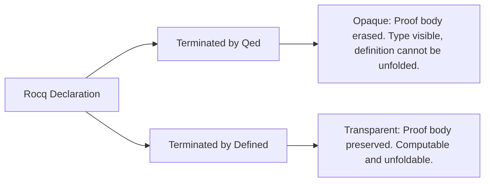

# Reduction Strategies & Transparency Management

This reference guides autonomous agents in controlling term reduction, avoiding proof term explosion, and enforcing transparency boundaries in Rocq using **Pure Vanilla Ltac**.

---

## 1. The Spectrum of Reduction Tactics

In Rocq, reduction tactics evaluate terms according to the rules of the Calculus of Inductive Constructions ($\beta, \iota, \zeta, \delta$-reductions). Choosing the wrong reduction tactic can expand definitions uncontrollably, generating megabyte-sized terms that exhaust memory and freeze the agent.

| Tactic            | Behavior                                | Scope & Targets                             | Risk Level   | Recommended Use Case                                                            |
| :---------------- | :-------------------------------------- | :------------------------------------------ | :----------- | :------------------------------------------------------------------------------ |
| `cbn [f g]`       | Controlled $\beta\iota\delta$-reduction | Only expands listed symbols `f, g`          | **Very Low** | **Standard first choice** for simplifying function applications.                |
| `unfold f`        | Explicit 1-step $\delta$-expansion      | Replaces `f` with its definition            | **Low**      | Exposing pattern matches or definitions for subsequent `inv` / `destruct`.      |
| `change t with u` | Definitional replacement                | Replaces `t` with definitionally equal `u`  | **Low**      | Fast surgical rewriting of subterms without altering surrounding context.       |
| `simpl`           | Heuristic reduction                     | Reduces pattern matches and fixpoints       | **Medium**   | Simplifying inductive constructors. Can unfold unexpected opaque definitions.   |
| `compute`         | Unconstrained full normalization        | Expands all definitions to head normal form | **EXTREME**  | **Prohibited** on open/symbolic terms. Permitted ONLY on closed concrete terms. |
| `vm_compute`      | Virtual-machine normalization           | Fast execution via bytecode VM              | **High**     | Proof by reflection on large closed computational terms.                        |

---

## 2. The Symbolic `compute` Catastrophe

Running bare `compute.` on a term containing free variables or abstract data types forces Rocq to unroll standard library implementations (e.g., Peano arithmetic, string comparison trees, dictionary encodings) into thousands of raw lambda applications:

### ❌ Catastrophic `compute`

```coq
Lemma lookup_bad : forall (k : string) (v : nat) (env : list (string * nat)),
  lookup k ((k, v) :: env) = Some v.
Proof.
  intros k v env.
  compute.
  (* DISASTER:
     The internal implementation of string comparison, Ascii booleans,
     and list recursors are fully unrolled into a 500-line unreadable redex.
     The model can no longer match or simplify the goal! *)
Abort.
```

### ✅ Controlled Simplification with `unfold` and `cbn [f]`

```coq
Lemma lookup_good : forall (k : string) (v : nat) (env : list (string * nat)),
  lookup k ((k, v) :: env) = Some v.
Proof.
  intros k v env.
  unfold lookup.
  cbn [String.eqb].
  rewrite String.eqb_refl.
  reflexivity.
Qed.
```

---

## 3. Strict Transparency Management: `Qed` vs `Defined`

Every declaration in Rocq is either **opaque** or **transparent**:



### The Architectural Mandate

1. **The 100% `Qed` Rule for Proofs**: Every `Theorem`, `Lemma`, `Corollary`, `Proposition`, `Fact`, and `Remark` must terminate with **`Qed.`**.
2. **Reserving `Defined` for Computations**: Terminate with `Defined.` **only** when writing executable programs, inductive data deciders, or dependent types whose proof terms must compute inside other functions:
   ```coq
   (* Permissible Defined: computational decider *)
   Definition nat_eq_dec (n m : nat) : {n = m} + {n <> m}.
   Proof.
     decide equality.
   Defined.
   ```
3. **The `Defined` Proof Term Explosion Hazard**: If a mathematical theorem is accidentally closed with `Defined.`, every subsequent theorem referencing it will attempt to typecheck its entire internal proof term during reduction. This leads to exponential slowdowns during `Qed` validation in downstream proofs.

---

## 4. Recovering from Typechecking Stalls

If the compiler hangs or consumes excessive memory during `Qed.` validation or `cbn`:

1. **Identify the Redex**: Inspect which function was unfolded right before the stall.
2. **Add Opaque Annotation**: Mark large auxiliary functions as opaque:
   ```coq
   #[local] Opaque my_heavy_function.
   ```
3. **Replace `simpl` with `change` or `cbn [f]`**: Replace vague reductions with explicit definitional rewrites:
   ```coq
   change (complex_lhs) with (simplified_rhs).
   ```
