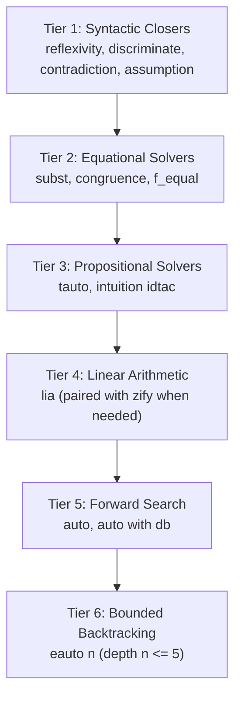

# Deterministic Tactic Hierarchy & Automation Discipline

This reference defines the deterministic tactic hierarchy, automation boundaries, and hint database rules for autonomous theorem proving in Rocq using **Pure Vanilla Ltac**.

---

## 1. The 6-Tier Tactic Automation Hierarchy

Autonomous agents must not guess automated tactics at random. Apply automation strictly according to the **6-Tier Priority Hierarchy**, progressing from deterministic syntactic checks to bounded searches:



### Hierarchy Breakdown

| Tier       | Tactics                                                            | Target Domain                                                                  | Performance      | Guarantees                                                                                 |
| :--------- | :----------------------------------------------------------------- | :----------------------------------------------------------------------------- | :--------------- | :----------------------------------------------------------------------------------------- |
| **Tier 1** | `reflexivity`<br>`discriminate`<br>`contradiction`<br>`assumption` | Definitional equality, constructor collision, absurd hypotheses                | $O(1)$ syntactic | Guaranteed to terminate instantly. Never pollutes context.                                 |
| **Tier 2** | `subst`<br>`congruence`<br>`f_equal`                               | Uninterpreted function symbols, equality elimination, transitive chains        | Polynomial       | Solves uninterpreted equational logic without unfolding definitions.                       |
| **Tier 3** | `tauto`<br>`intuition idtac`                                       | Intuitionistic propositional logic ($\land, \lor, \to, \neg, \leftrightarrow$) | Fast SAT         | Decides propositional validity. `intuition idtac` simplifies without expanding predicates. |
| **Tier 4** | `lia`                                                              | Presburger linear integer arithmetic ($\mathbb{Z}, \mathbb{N}$)                | Fast decision    | Completes linear relations. Beware of truncation subtraction on `nat`.                     |
| **Tier 5** | `auto`<br>`auto with db`                                           | Safe forward breadth-first derivation without metavariables                    | Linear / bounded | Applies registered hints up to default depth 5. Never creates existentials.                |
| **Tier 6** | `eauto n` ($n \le 5$)                                              | Backward backtracking search involving existential quantifiers                 | Exponential      | Allows `eapply`. MUST be bounded by an explicit depth parameter.                           |
| **BANNED** | `firstorder`<br>Unbounded `eauto`                                  | First-order predicate calculus, unconstrained unification                      | **Divergent**    | Causes catastrophic timeouts and metavariable leaks. Strictly forbidden.                   |

---

## 2. Inner Mechanics of `auto` and `eauto`

### A. Official Search Depth Constants

In Rocq's core engine, the default search depth limits are hardcoded:

- `default_search_depth = 5` (for `auto`)
- `default_eauto_depth = 5` (for `eauto`)

When invoked without an integer argument (`auto.` or `eauto.`), the search space is bounded by depth 5.

### B. Hint Priority & Cost Queueing

Registered hints are evaluated with an associated non-negative integer cost:

- `Hint Resolve`: Default cost is `1`.
- `Hint Extern`: Default cost is `10` (unless explicitly overridden, e.g., `Hint Extern 4 (...) => ...`).

Within each search depth level, candidate hints are queued and tried in ascending order of cost (lowest cost first). Ties are broken deterministically by database registration order.

### C. The Depth-6 Exponential Cliff in `eauto`

The `eauto` engine executes depth-bounded backtracking search. Crucially:

- **No Node-Count Limit**: There is no hard limit on the total number of explored proof tree nodes or execution time.
- **The Exponential Cliff**: At depth $d$, the potential search tree size scales as $\mathcal{O}(b^d)$, where $b$ is the branching factor of applicable hints. While $d \le 5$ explores tractable subtrees, setting $d \ge 6$ triggers an exponential explosion, frequently resulting in agent timeouts and thread freezing.
- **Rule**: Never invoke `eauto` with a depth parameter greater than 5 (`eauto 5`). If depth 5 fails, extract intermediate steps via `assert` or apply key lemmas explicitly (`eapply ...`).

### D. Metavariable (Evar) Preservation and Pruning

When `eauto` appears to close a goal, the engine invokes `Evd.has_undefined` to check whether any newly created existential metavariables (`?X`) remain uninstantiated:

- If uninstantiated evars remain, the engine treats that branch as a failure (`tclFAIL`), immediately triggering backtracking.
- If no alternative branch discharges all evars, `eauto` aborts without committing partial changes.

---

## 3. Linear Arithmetic (`lia`) Caveats & Truncation Subtraction

The `lia` tactic decides linear integer arithmetic for `nat` and `Z`. However, natural number subtraction is **truncated** ($n - m = 0$ when $n < m$).

### The Truncation Subtraction Trap

In `nat`, `a - b + b = a` is **false** if $a < b$ (since $0 + b = b \ne a$). `lia` fails when an equality relies on negative intermediate results.

### Prevention Protocol

1. **Precondition Case Splitting**: Destruct the comparison before invoking `lia`:
   ```coq
   destruct (Nat.le_ge_cases b a) as [Hle | Hgt].
   - (* Case b <= a: lia succeeds *) lia.
   - (* Case b > a: handle truncation explicitly *) lia.
   ```
2. **Lifting to $\mathbb{Z}$ via `zify`**: Run `zify.` before arithmetic simplification to convert `nat` terms into true mathematical integers:
   ```coq
   zify. lia.
   ```

---

## 4. Hint Database Discipline (`#[local] Hint Resolve`)

Hints registered into hint databases alter the behavior of `auto` and `eauto`. Unrestricted hints pollute downstream proofs.

### Strict Scoping Rules

1. **Always Use `#[local]`**: Never declare bare `Hint Resolve` or `Global Hint`. Always scope to the current module:
   ```coq
   #[local] Hint Resolve my_sound_step : core.
   #[local] Hint Constructors has_type : core.
   ```
2. **Dedicated Domain Databases**: For large theories, isolate hints in custom databases rather than polluting `core`:

   ```coq
   Create HintDb semantics_db.
   #[local] Hint Resolve step_app1 step_app2 : semantics_db.

   (* In proofs, invoke explicitly *)
   eauto with semantics_db.
   ```

3. **Avoid Transitivity in Hints**: Never add transitive lemmas (e.g., `rtc_step`, `le_trans`) to `Hint Resolve`. They create infinite cycles in `eauto` search trees.
