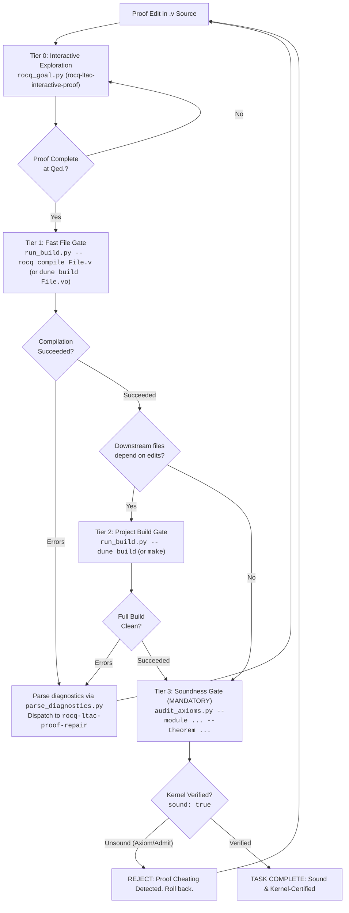

# Rocq CLI, Build Management & Verification Ladder

This skill provides the operational workflows, build system configurations, process controllers, and automated verification tools for formal proof development in Rocq (formerly Coq) using **Pure Vanilla Ltac**. It guides autonomous agents through fast single-file compilation, project-wide dependency builds (Dune and `_CoqProject`), structured diagnostic parsing, and kernel-level soundness audits (`Print Assumptions`).

---

## 0. Environment & Version Compatibility

| Component          | Target / Supported              | Notes                                                                                         |
| :----------------- | :------------------------------ | :-------------------------------------------------------------------------------------------- |
| **Rocq Prover**    | `9.0+` (Default target)         | Unified `rocq` CLI (`rocq compile`, `rocq repl`), `Corelib` / `Stdlib` standard libraries.    |
| **Coq (Legacy)**   | `8.20` (Compatibility baseline) | Dispersed binaries (`coqc`, `coqtop`, `coq_makefile`). Versions $\le 8.17$ are unsupported.   |
| **Build Systems**  | **Dune** / **`_CoqProject`**    | Dynamic resolution: prefer `dune` when `dune-project` exists, fallback to `_CoqProject`.      |
| **Soundness Gate** | `Print Assumptions <thm>.`      | Mandatory audit: must evaluate to `Closed under the global context` or approved whitelist.    |
| **Python**         | `>= 3.10`                       | Standard library only (`subprocess`, `re`, `json`, `pathlib`, `argparse`). Zero external pip. |

### Critical CLI & Build Adjustments (Rocq 9.0+)

- **Unified Dispatcher**: Standalone binaries are unified under `rocq`. Use `rocq compile` (alias `rocq c`), `rocq repl` (alias `rocq top`), `rocq makefile`, and `rocq check` (alias `rocqchk`). Legacy commands (`coqc`, `coqtop`) are supported via dynamic dispatch.
- **Environment Variables**: Use `ROCQPATH` and `ROCQLIB`. `COQPATH` triggers `deprecated-coq-env-var`.
- **Dune `Stdlib` Requirement**: In Rocq 9.0+, `(theories Stdlib)` is mandatory in `(coq.theory ...)` stanzas. Omitting it causes `Cannot find a physical path bound to logical path ... with prefix Stdlib`.
- **Quick Compilation (`.vos`) Prohibition**: Compiling with `-vos` skips opaque proof verification. Passing `.vos` does **NOT** prove a theorem. Only fully verified `.vo` files are admissible for verification.

---

## 1. Quick Reference: Common Commands

| Command                                                                                   | Purpose                                         | When to Use                                                                    |
| :---------------------------------------------------------------------------------------- | :---------------------------------------------- | :----------------------------------------------------------------------------- |
| `python3 scripts/run_build.py --timeout 30 -- rocq compile [FLAGS] <file.v>`              | Fast single-file batch compilation (Tier 1)     | Immediately after closing a proof with `Qed.` to generate `.vo`.               |
| `python3 scripts/run_build.py --timeout 30 -- dune build <theories/Path/File.vo>`         | Fast Dune single-module compilation (Tier 1)    | Fast compilation in Dune-managed projects without building unneeded targets.   |
| `python3 scripts/run_build.py --timeout 180 -- dune build`                                | Full workspace dependency verification (Tier 2) | When cross-file definitions or interfaces change, before final soundness gate. |
| `python3 scripts/run_build.py --timeout 180 -- make -f Makefile.coq`                      | Project build via `coq_makefile` (Tier 2)       | Full project check in legacy or `_CoqProject`-based repositories.              |
| `python3 scripts/audit_axioms.py --module <Logical.Path> --theorem <Thm> --project-dir .` | Independent soundness audit (Tier 3)            | **Mandatory final gate** before declaring any theorem complete.                |
| `python3 scripts/parse_diagnostics.py < build.log`                                        | Parse compiler/Dune logs into structured JSON   | When builds fail with syntax, unification, or path resolution errors.          |

---

## 2. Multi-Tier Verification Ladder

Autonomous agents must strictly follow the four verification tiers to balance rapid feedback with uncompromising mathematical soundness.



### Verification Tiers Overview

| **Tier**                   | **Action / Command**                                         | **Scope & Target Output**            | **Timeout** | **Pass Criteria**                                               |
| -------------------------- | ------------------------------------------------------------ | ------------------------------------ | ----------- | --------------------------------------------------------------- |
| **Tier 0: Per-Edit**       | `python3 rocq_goal.py <file.v> -l <line>`                    | Interactive REPL state in memory     | 5s          | Subgoals verified, no unhandled exceptions.                     |
| **Tier 1: Fast File Gate** | `python3 scripts/run_build.py -- rocq compile <file.v>`      | Generates `.vo` for target module    | 30s         | Exit code 0, complete `.vo` generated (never accept `.vos`).    |
| **Tier 2: Project Gate**   | `python3 scripts/run_build.py -- dune build` (or `make`)     | Workspace DAG dependency build       | 180s        | All transitive upstream/downstream modules compile cleanly.     |
| **Tier 3: Soundness Gate** | `python3 scripts/audit_axioms.py --module ... --theorem ...` | Independent REPL `Print Assumptions` | 30s         | `Closed under the global context` or approved whitelist axioms. |

### The Stale `.vo` Cache Trap (Fast File Gate)

When editing across multiple files:

- Directly running `rocq compile File.v` relies on existing upstream `.vo` binaries on disk.
- If upstream `.v` files were modified but not recompiled, Tier 1 will either falsely pass (reading stale signatures) or falsely fail (missing new upstream definitions).
- **Protocol**: If upstream files were edited in the current session, run `dune build theories/Upstream.vo` or rebuild the dependency before running Tier 1 on downstream files.

## 3. Bundled Scripts & Execution Toolchain

All bundled scripts run on standard Python 3.10+ without external packages.

### 3.1. Safe Build Runner (`scripts/run_build.py`)

Prevents runaway tactic automation (`lia`, `auto 10`, `eauto`) from hanging processes or creating zombie sub-processes. Executes commands within dedicated OS process groups and enforces deadline timeouts with `SIGKILL`.

```Bash
# General usage syntax
python3 scripts/run_build.py --timeout <seconds> --cwd <dir> -- <build_command...>

# Examples
python3 scripts/run_build.py --timeout 30 -- rocq compile -Q theories MyProject theories/Core.v
python3 scripts/run_build.py --timeout 60 -- dune build theories/Core.vo
```

- Returns JSON string containing `returncode`, `timed_out`, `stdout`, and `stderr`.
- Exits with status `124` on timeouts.

### 3.2. Diagnostic Parser (`scripts/parse_diagnostics.py`)

Strips ANSI sequences from `rocq compile`, `coqc`, or `dune` outputs, parsing multi-line errors, location character spans, and warning tags into structured JSON.

```Bash
# Pipe stderr directly from run_build.py or build execution
dune build 2>&1 | python3 scripts/parse_diagnostics.py

# Or parse saved log file
python3 scripts/parse_diagnostics.py build.log
```

#### JSON Output Schema

```JSON
{
  "diagnostics": [
    {
      "file": "theories/Semantics.v",
      "line_start": 45,
      "line_end": 45,
      "char_start": 2,
      "char_end": 18,
      "severity": "Error",
      "message": "In environment ... Unable to unify \"True\" with \"False\".",
      "warning_tags": []
    },
    {
      "file": "theories/Core.v",
      "line_start": 1,
      "line_end": 1,
      "char_start": 0,
      "char_end": 29,
      "severity": "Warning",
      "message": "\"From Coq\" has been replaced by \"From Stdlib\".",
      "warning_tags": ["deprecated-from-Coq", "deprecated-since-9.0"]
    }
  ],
  "total_errors": 1,
  "total_warnings": 1
}
```

### 3.3. Soundness & Axiom Auditor (`scripts/audit_axioms.py`)

Spawns an isolated `rocq repl` (or `coqtop`) sub-process, imports the target logical module, and queries `Print Assumptions <Theorem>.`.

```Bash
# Strict Mode: Zero external axioms allowed (purely constructive / closed proof)
python3 scripts/audit_axioms.py --module MyProject.Semantics --theorem progress_theorem --project-dir .

# Whitelist Mode: Allow standard mathematical axioms (Extensionality, Proof Irrelevance)
python3 scripts/audit_axioms.py --module MyProject.Semantics --theorem progress_theorem --project-dir . --allow-standard-axioms
```

- Returns exit code `0` (`sound: true`) ONLY when proof contains no unapproved axioms or residual holes.
- Returns exit code `1` (`sound: false`) if `Admitted.`, `admit.`, or undeclared axioms are detected.

## 4. Soundness Gate & Anti-Cheating Disciplines

The primary objective of this skill is ensuring absolute mathematical rigor. LLMs incentivized only by returncode 0 frequently attempt reward-hacking shortcuts. These are strictly forbidden.

### Prohibited Proof Cheating Patterns

1. **`Admitted.` and `admit.`**: Truncating proof obligations with `Admitted.` or leaving `admit.` tactics.
2. **Goal Drift (Header Modification)**: Altering theorem signatures, adding vacuous premises (e.g., `False ->`), or weakening conclusions.
3. **Axiom Smuggling**: Introducing unverified facts via `Axiom`, `Parameter`, or `Conjecture` declarations.
4. **Quick Compilation Deception**: Passing `-vos` and claiming proof completion without generating valid `.vo` artifacts.

### Approved Axiom Whitelist

When `--allow-standard-axioms` is enabled, only foundational, consistency-preserving axioms are accepted:

| **Axiom Identifier**                                                  | **Mathematical Role**                    | **Status**            |
| --------------------------------------------------------------------- | ---------------------------------------- | --------------------- |
| `Coq.Logic.FunctionalExtensionality.functional_extensionality_dep`    | Dependent functional extensionality      | **Permitted**         |
| `Stdlib.Logic.FunctionalExtensionality.functional_extensionality_dep` | Dependent functional extensionality      | **Permitted**         |
| `Coq.Logic.ProofIrrelevance.proof_irrelevance`                        | Proof irrelevance for `Prop`             | **Permitted**         |
| `Stdlib.Logic.ProofIrrelevance.proof_irrelevance`                     | Proof irrelevance for `Prop`             | **Permitted**         |
| `Coq.Logic.Classical_Prop.classic`                                    | Law of Excluded Middle ($P \lor \neg P$) | Project-conditional   |
| **Any custom user axiom or admitted stub**                            | Unsound assertion                        | **STRICTLY REJECTED** |

## 5. Build Systems & Logical Path Resolution

### 5.1. Dune Integration

Dune executes builds within `_build/default/` shadow trees, preventing source tree pollution.

- **Fast Single-Target Build**: Target the specific `.vo` destination path:
  ```Bash
  python3 scripts/run_build.py -- dune build theories/Logic/Core.vo
  ```
- **Dune Configuration (`dune`)**:
  ```Lisp
  (coq.theory
   (name MyProject)
   (package my-project)
   (theories Stdlib Corelib)
   (flags :standard -w -deprecated-from-Coq))
  ```

### 5.2. `_CoqProject` Integration

`_CoqProject` specifies the logical mapping between directory structures and module namespaces.

- **`-Q <physical_path> <LogicalPrefix>`**: Qualified binding (Mandatory modern standard; requires explicit `From LogicalPrefix Require Import Module.`).
- **`-R <physical_path> <LogicalPrefix>`**: Recursive binding (Allows unadorned `Require Import Module.`).
- **`-arg <opt>`**: Transmits compiler options (e.g., `-arg -w -arg -deprecated-from-Coq`).

When executing single-file compilation outside of `make`, extract project flags directly into compiler arguments:

```Bash
# Direct extraction and compilation via run_build.py
python3 scripts/run_build.py -- rocq compile -Q theories MyProject -w -deprecated-from-Coq theories/Core.v
```

## 6. Troubleshooting CLI & Build Failures

### 1. `Cannot find a physical path bound to logical path ...`

- **Cause**: Mismatch between directory layout, `-Q`/`-R` flags in `_CoqProject`, or missing `From <Prefix>` in the `.v` source.
- **Remedy**: Inspect `_CoqProject`. If `theories/` is mapped to `MyProject` via `-Q theories MyProject`, import using `From MyProject Require Import Core.`. Ensure execution occurs from project root.

### 2. `Cannot find a physical path bound to logical path ... with prefix Stdlib`

- **Cause**: Rocq 9.0+ Dune project is missing `Stdlib` dependency.
- **Remedy**: Add `(theories Stdlib)` to the `(coq.theory ...)` stanza in the relevant `dune` file.

### 3. Build Hangs or Exhausts Memory

- **Cause**: Unconstrained backtracking in `lia`, `eauto 10`, or complex `dependent destruction`.
- **Remedy**: Terminate process via `run_build.py` timeout. Use `rocq-ltac-interactive-proof` to step through the proof line-by-line and isolate the stalling tactic.

### 4. `Warning: "From Coq" has been replaced by "From Stdlib"` Treated as Error

- **Cause**: Compiler invoked with `-warn-error +default` or `-w +deprecated`.
- **Remedy**: Either migrate import statements to `From Stdlib Require Import ...` or temporarily mask the warning by passing `-w -deprecated-from-Coq` in `_CoqProject` / `dune`.

## 7. Fast Prover CLI Checklist

Before concluding any proof task or handing off deliverables, verify against this checklist:

### Stage A: Environment & Build Health

- [ ] Project root contains `_CoqProject` or `dune-project`.
- [ ] Toolchain resolves correctly via `rocq compile --version` or `coqc --version`.
- [ ] No stale `.vo` / `.glob` artifacts pollute source directories when using Dune (`dune clean` if needed).

### Stage B: Tier 1 Fast File Gate

- [ ] Target `.v` file compiled to `.vo` via `run_build.py -- rocq compile` or `dune build <File.vo>`.
- [ ] Zero reliance on `.vos` files for proof completion.
- [ ] Compiler diagnostics parsed via `parse_diagnostics.py` with 0 errors.

### Stage C: Tier 2 Project Build Gate

- [ ] Full workspace build passes cleanly (`dune build` or `make -f Makefile.coq`).
- [ ] All downstream dependent modules successfully typecheck against modified proofs.

### Stage D: Tier 3 Soundness Gate (Mandatory)

- [ ] `scripts/audit_axioms.py` executed against the target theorem identifier.
- [ ] Audit output confirms `Closed under the global context` (or strictly matches approved whitelist).
- [ ] Source inspection confirms zero occurrences of `admit.`, `Admitted.`, or unapproved `Axiom`.

## 8. Progressive Reference Guides

For deep technical specifications, edge-case triage, and build system configuration templates, consult the specialized references:

| **Topic**                      | **Key Focus & Capabilities**                                                  | **Reference Guide**                                                       |
| ------------------------------ | ----------------------------------------------------------------------------- | ------------------------------------------------------------------------- |
| **Build Systems & Configs**    | Dune `(coq.theory)` stanzas, `_CoqProject` parsing, `.vos` vs `.vo` mechanics | [build_systems.md](./references/build_systems.md)                         |
| **Soundness & Axiom Auditing** | `Print Assumptions` specification, anti-cheating triage, whitelist management | [soundness_and_axiom_audit.md](./references/soundness_and_axiom_audit.md) |
| **CLI & Path Troubleshooting** | Logical path bindings, stale cache traps, compiler flags, timeout handling    | [cli_troubleshooting.md](./references/cli_troubleshooting.md)             |
