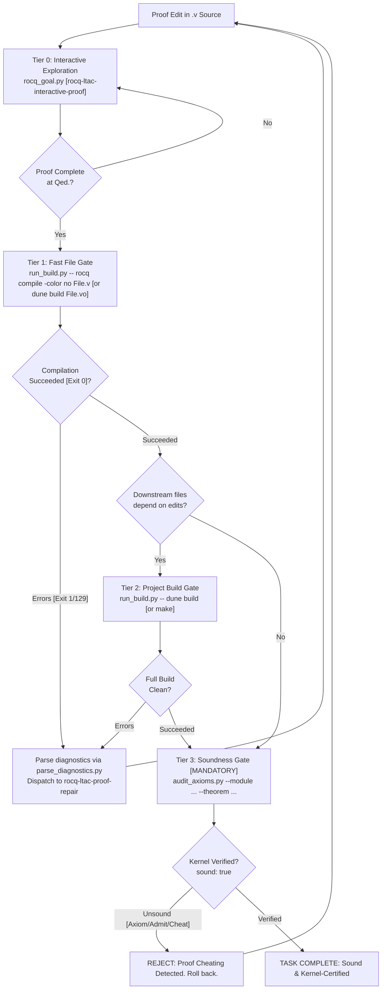

# Rocq CLI, Build Management & Verification Ladder

This skill provides operational workflows, build system configurations, process controllers, and automated verification tools for formal proof development in Rocq (formerly Coq) using **Pure Vanilla Ltac**. It guides autonomous agents through fast single-file compilation, project-wide dependency builds (Dune and `_CoqProject`), structured diagnostic parsing, and kernel-level soundness audits (`Print Assumptions` / `rocq check`).

---

## 0. Environment & Version Compatibility

| Component          | Target / Supported              | Notes                                                                                         |
| :----------------- | :------------------------------ | :-------------------------------------------------------------------------------------------- |
| **Rocq Prover**    | `9.0+` (Default target)         | Unified `rocq` CLI (`compile`, `repl`, `check`, `makefile`), `Corelib` / `Stdlib` split.      |
| **Coq (Legacy)**   | `8.20` (Compatibility baseline) | Dispersed binaries (`coqc`, `coqtop`, `coq_makefile`). Versions $\le 8.17$ are unsupported.   |
| **Build Systems**  | **Dune** / **`_CoqProject`**    | Dynamic resolution: prefer `dune` when `dune-project` exists, fallback to `_CoqProject`.      |
| **Soundness Gate** | `Print Assumptions` / `rocqchk` | Mandatory audit: must evaluate to `Axioms: <none>` (`CONTEXT SUMMARY`) or global context.     |
| **Python**         | `>= 3.10`                       | Standard library only (`subprocess`, `re`, `json`, `pathlib`, `argparse`). Zero external pip. |

### Critical CLI & Build Adjustments (Rocq 9.0+ Official Specifications)

- **Unified Dispatcher & Subcommands**: Standalone binaries are unified under the `rocq` dispatcher (`topbin/rocq.ml`). Supported subcommands include:
  - `compile` (alias `c`): Compile single `.v` source files into `.vo`.
  - `repl` (alias `top`): Interactive Read-Eval-Print Loop / batch execution.
  - `repl-with-drop` (alias `top-with-drop`): REPL with OCaml drop command.
  - `check` (alias `rocqchk`): Standalone checker of compiled `.vo` libraries.
  - `makefile`: Generate a Makefile from `_CoqProject`.
  - `dep`: Compute file dependencies for compilation.
  - `find`: Query load-path information for Rocq findlib packages.
  - `doc`, `wc`, `workmgr`, `tex`: Documentation, metrics, and parallel worker tools.
- **Single File Compilation Invariant**: `rocq compile` accepts exactly **one** `.v` target per execution (`toplevel/coqcargs.ml`). Passing multiple `.v` files triggers `More than one file to compile: <first> and <second>` and immediately aborts with exit code `1`.
- **Deterministic Diagnostic Output**: Always pass `-color no` (or `--color=no`) to `rocq compile`, `rocq repl`, and `rocq check` in automated pipelines to prevent ANSI color codes from contaminating log buffers.
- **Exit Code Conventions**:
  - `0`: Successful completion.
  - `1`: Standard syntax errors, type errors, or CLI usage violations.
  - `124`: Timed-out processes wrapped and killed with `SIGKILL` by `scripts/run_build.py`.
  - `129`: Kernel anomaly (`cErrors.ml`) or unexpected internal exception.
- **Dune `Stdlib` Requirement**: In Rocq 9.0+, `(theories Stdlib Corelib)` is mandatory in `(coq.theory ...)` stanzas. Omitting it triggers `Cannot find a physical path bound to logical path ... with prefix Stdlib`.
- **Quick Compilation (`.vos`) Prohibition for Soundness**: Compiling with `-vos` checks only declarations, signatures, and transparent definitions (`Defined`), skipping verification of opaque proof bodies (`Qed`) via `check: false` (`ccompile.ml`). Executing `Print Assumptions` on `.vos` files cannot trace internal axioms. Passing `.vos` does **NOT** prove a theorem; only fully checked `.vo` (or verified `.vok`) files are admissible.

---

## 1. Quick Reference: Common Commands

| Command                                                                                   | Purpose                                         | When to Use                                                                    |
| :---------------------------------------------------------------------------------------- | :---------------------------------------------- | :----------------------------------------------------------------------------- |
| `python3 scripts/run_build.py --timeout 30 -- rocq compile -color no [FLAGS] <file.v>`    | Fast single-file batch compilation (Tier 1)     | Immediately after closing a proof with `Qed.` to generate `.vo`.               |
| `python3 scripts/run_build.py --timeout 30 -- dune build <theories/Path/File.vo>`         | Fast Dune single-module compilation (Tier 1)    | Fast compilation in Dune-managed projects without building unneeded targets.   |
| `python3 scripts/run_build.py --timeout 180 -- dune build`                                | Full workspace dependency verification (Tier 2) | When cross-file definitions or interfaces change, before final soundness gate. |
| `python3 scripts/run_build.py --timeout 180 -- make -f Makefile.coq`                      | Project build via `coq_makefile` (Tier 2)       | Full project check in legacy or `_CoqProject`-based repositories.              |
| `python3 scripts/audit_axioms.py --module <Logical.Path> --theorem <Thm> --project-dir .` | Independent soundness audit via REPL (Tier 3)   | **Mandatory final gate** before declaring any theorem complete.                |
| `rocq check -o -silent -norec <Logical.Path>`                                             | Standalone kernel soundness check (Tier 3)      | Independent binary verification of compiled `.vo` artifacts.                   |
| `python3 scripts/parse_diagnostics.py < build.log`                                        | Parse compiler/Dune logs into structured JSON   | When builds fail with syntax, unification, or path resolution errors.          |

---

## 2. Multi-Tier Verification Ladder

Autonomous agents must strictly follow the four verification tiers to balance rapid feedback with uncompromising mathematical soundness.



### Verification Tiers Overview

| Tier                       | Action / Command                                               | Scope & Target Output                    | Timeout | Pass Criteria                                                          |
| :------------------------- | :------------------------------------------------------------- | :--------------------------------------- | :------ | :--------------------------------------------------------------------- |
| **Tier 0: Per-Edit**       | `python3 rocq_goal.py <file.v> -l <line>`                      | Interactive REPL state in memory         | 5s      | Subgoals verified, no unhandled exceptions.                            |
| **Tier 1: Fast File Gate** | `python3 scripts/run_build.py -- rocq compile -color no <f.v>` | Generates single `.vo` for target module | 30s     | Exit code 0, complete `.vo` generated (never accept `.vos`).           |
| **Tier 2: Project Gate**   | `python3 scripts/run_build.py -- dune build` (or `make`)       | Workspace DAG dependency build           | 180s    | All transitive upstream/downstream modules compile cleanly.            |
| **Tier 3: Soundness Gate** | `python3 scripts/audit_axioms.py --module ... --theorem ...`   | Independent REPL `Print Assumptions`     | 30s     | `Axioms: <none>` & all safety checks `<none>` (or approved whitelist). |

### The Stale `.vo` Cache Trap (Fast File Gate)

When editing across multiple files:

- Directly running `rocq compile File.v` relies on existing upstream `.vo` binaries on disk.
- If upstream `.v` files were modified but not recompiled, Tier 1 will either falsely pass (reading stale signatures) or falsely fail (missing new upstream definitions).
- **Protocol**: If upstream files were edited in the current session, run `dune build theories/Upstream.vo` or recompile upstream dependencies via Tier 1 before verifying downstream files.

---

## 3. Bundled Scripts & Execution Toolchain

All bundled scripts run on standard Python 3.10+ without external packages.

### 3.1. Safe Build Runner (`scripts/run_build.py`)

Prevents runaway tactic automation (`lia`, `auto 10`, `eauto`) from hanging processes or creating zombie sub-processes. Executes commands within dedicated OS process groups (`start_new_session=True` on POSIX, `CREATE_NEW_PROCESS_GROUP` on Windows) and enforces deadline timeouts with `SIGKILL`.

```bash
# General usage syntax
python3 scripts/run_build.py --timeout <seconds> --cwd <dir> -- <build_command...>

# Examples
python3 scripts/run_build.py --timeout 30 -- rocq compile -color no -Q theories MyProject theories/Core.v
python3 scripts/run_build.py --timeout 60 -- dune build theories/Core.vo
```

- Returns structured JSON containing `command`, `returncode`, `timed_out`, `stdout`, and `stderr`.
- Exits with status `124` on timeouts. Pass `--raw` to bypass JSON formatting when piping directly.

### 3.2. Diagnostic Parser (`scripts/parse_diagnostics.py`)

Strips ANSI sequences from `rocq compile`, `coqc`, or `dune` outputs, parsing both single-line (`line X, characters Y-Z:`) and multi-line (`lines X-Y, characters Z-W:`) error locations, severity levels (`Error`, `Warning`, `Anomaly`), messages, and warning tags (e.g., `[deprecated-from-Coq]`, `[deprecated-since-9.0]`) into structured JSON.

```bash
# Pipe stderr directly from run_build.py or build execution
dune build 2>&1 | python3 scripts/parse_diagnostics.py

# Or parse saved log file
python3 scripts/parse_diagnostics.py build.log
```

#### JSON Output Schema

```json
{
  "diagnostics": [
    {
      "file": "theories/Semantics.v",
      "line_start": 45,
      "line_end": 45,
      "char_start": 2,
      "char_end": 18,
      "severity": "Error",
      "message": "In environment ... Unable to unify \"True\" with \"False\".",
      "warning_tags": []
    },
    {
      "file": "theories/Core.v",
      "line_start": 1,
      "line_end": 2,
      "char_start": 0,
      "char_end": 29,
      "severity": "Warning",
      "message": "\"From Coq\" has been replaced by \"From Stdlib\".",
      "warning_tags": ["deprecated-from-Coq", "deprecated-since-9.0"]
    }
  ],
  "total_errors": 1,
  "total_warnings": 1
}
```

### 3.3. Soundness & Axiom Auditor (`scripts/audit_axioms.py`)

Spawns an isolated `rocq repl -batch -quiet -color no` (or `coqtop -batch -quiet -color no`) sub-process, automatically loads `-Q` / `-R` / `-arg` bindings from `_CoqProject`, imports the target logical module, and queries `Print Assumptions <Theorem>.`.

```bash
# Strict Mode: Zero external axioms allowed (purely constructive / closed proof)
python3 scripts/audit_axioms.py --module MyProject.Semantics --theorem progress_theorem --project-dir .

# Whitelist Mode: Allow standard mathematical axioms (Extensionality, Proof Irrelevance, Excluded Middle)
python3 scripts/audit_axioms.py --module MyProject.Semantics --theorem progress_theorem --project-dir . --allow-standard-axioms
```

- Returns exit code `0` (`sound: true`) ONLY when proof contains no unapproved axioms or residual holes.
- Returns exit code `1` (`sound: false`) if `Admitted.`, `admit.`, or undeclared axioms are detected.

---

## 4. Soundness Gate & Anti-Cheating Disciplines

The primary objective of this skill is ensuring absolute mathematical rigor. LLMs incentivized only by return code 0 frequently attempt reward-hacking shortcuts. These are strictly forbidden.

### 4.1. Kernel Specification of `Print Assumptions` (`CONTEXT SUMMARY`)

In modern Rocq (v9.0+), executing `Print Assumptions <Theorem>.` produces a structured `CONTEXT SUMMARY` report generated by `checker/check_stat.ml`:

```text
CONTEXT SUMMARY
===============

* Theory: Set is predicative
* Theory: Rewrite rules are not allowed
* Axioms: <none>
* Constants/Inductives relying on type-in-type: <none>
* Constants/Inductives relying on unsafe (co)fixpoints: <none>
* Inductives whose positivity is assumed: <none>
* Inductives relying on indices not mattering: <none>
```

#### Deterministic Soundness Criteria

A proof is mechanically certified as sound if and only if:

1. **Axioms**: Evaluates to `* Axioms: <none>` (or in legacy Coq 8.20, `Closed under the global context`). If axioms exist, every listed identifier must match the approved whitelist.
2. **Type-in-Type**: `* Constants/Inductives relying on type-in-type: <none>` (ensures universe consistency was not bypassed with `-type-in-type`).
3. **Guardedness**: `* Constants/Inductives relying on unsafe (co)fixpoints: <none>` (ensures termination checker was not disabled via `Unset Guard Checking`).
4. **Positivity**: `* Inductives whose positivity is assumed: <none>` (ensures strict positivity was enforced).
5. **Indices**: `* Inductives relying on indices not mattering: <none>`.
6. **Sort Eliminations**: `* Constants/Inductives relying on unchecked sort eliminations:` **MUST NOT APPEAR** (in `check_stat.ml`, this section is omitted entirely when empty; appearance indicates unchecked eliminations).

If `Admitted.` or `admit.` was used anywhere in the proof, the Rocq kernel treats the incomplete theorem as an unproven constant and explicitly lists it under `* Axioms:`.

### 4.2. Prohibited Proof Cheating Patterns

1. **`Admitted.` and `admit.`**: Truncating proof obligations with `Admitted.` or leaving `admit.` tactics.
2. **Goal Drift (Header Modification)**: Altering theorem signatures, adding vacuous premises (e.g., `False ->`), or weakening conclusions.
3. **Axiom Smuggling**: Introducing unverified facts via `Axiom`, `Parameter`, or `Conjecture` declarations.
4. **Quick Compilation Deception**: Passing `-vos` and claiming proof completion without generating valid `.vo` artifacts.

### 4.3. Approved Axiom Whitelist

When `--allow-standard-axioms` is enabled, only foundational, consistency-preserving axioms are accepted:

| Axiom Identifier                                                      | Mathematical Role                               | Status                |
| :-------------------------------------------------------------------- | :---------------------------------------------- | :-------------------- |
| `Coq.Logic.FunctionalExtensionality.functional_extensionality_dep`    | Dependent functional extensionality             | **Permitted**         |
| `Stdlib.Logic.FunctionalExtensionality.functional_extensionality_dep` | Dependent functional extensionality (Rocq 9.0+) | **Permitted**         |
| `Coq.Logic.ProofIrrelevance.proof_irrelevance`                        | Proof irrelevance for `Prop`                    | **Permitted**         |
| `Stdlib.Logic.ProofIrrelevance.proof_irrelevance`                     | Proof irrelevance for `Prop` (Rocq 9.0+)        | **Permitted**         |
| `Coq.Logic.Classical_Prop.classic`                                    | Law of Excluded Middle ($P \lor \neg P$)        | Project-conditional   |
| `Stdlib.Logic.Classical_Prop.classic`                                 | Law of Excluded Middle (Rocq 9.0+)              | Project-conditional   |
| **Any custom user axiom or admitted stub**                            | Unsound assertion                               | **STRICTLY REJECTED** |

---

## 5. Build Systems & Logical Path Resolution

### 5.1. Dune Integration

Dune executes builds within `_build/default/` shadow trees, preventing source tree pollution.

- **Fast Single-Target Build**: Target the specific `.vo` destination path:
  ```bash
  python3 scripts/run_build.py -- dune build theories/Logic/Core.vo
  ```
- **Dune Configuration (`dune`)**:
  ```lisp
  (coq.theory
   (name MyProject)
   (package my-project)
   (theories Stdlib Corelib)
   (flags :standard -w -deprecated-from-Coq -color no))
  ```

### 5.2. `_CoqProject` Parsing & Tokenization Specifications

`_CoqProject` specifies the logical mapping between directory structures and module namespaces (`lib/coqProject_file.ml`).

- **`-Q <physical_path> <LogicalPrefix>`**: Qualified binding (Mandatory modern standard; requires explicit `From LogicalPrefix Require Import Module.`).
- **`-R <physical_path> <LogicalPrefix>`**: Recursive binding (Allows unadorned `Require Import Module.`).
- **`-I <physical_path>`**: Includes directory for ML/OCaml plugins and object files.
- **`-package <pkg>`**: Declares external findlib package dependencies.
- **`-arg <opt>`**: Transmits compiler options. Supports double quotes and shell-style single quotes (`'...'`) via `process_extra_args`. Unpaired single quotes trigger `Parsing_error ("Invalid value for -arg, unpaired single quote...")`.
- **`-f <file>`**: Includes another project file recursively.
- **`-docroot <dir>`**: Specifies root directory for HTML documentation.
- **Comments**: Lines starting with `#` are treated as comments and ignored.

When executing single-file compilation outside of `make`, extract project flags directly into compiler arguments:

```bash
# Direct extraction and compilation via run_build.py
python3 scripts/run_build.py -- rocq compile -color no -Q theories MyProject -w -deprecated-from-Coq theories/Core.v
```

---

## 6. Troubleshooting CLI & Build Failures

### 1. `More than one file to compile: ... and ...`

- **Cause**: Multiple `.v` files passed to a single `rocq compile` command (`coqcargs.ml`).
- **Remedy**: Compile exactly one file per invocation (`rocq compile -color no [FLAGS] target.v`). For multi-file batches, use `dune build` or `make -f Makefile.coq`.

### 2. `Cannot find a physical path bound to logical path ...`

- **Cause**: Mismatch between directory layout, `-Q`/`-R` flags in `_CoqProject`, or missing `From <Prefix>` in the `.v` source.
- **Remedy**: Inspect `_CoqProject`. If `theories/` is mapped to `MyProject` via `-Q theories MyProject`, import using `From MyProject Require Import Core.`. Ensure execution occurs from the project root.

### 3. `Cannot find a physical path bound to logical path ... with prefix Stdlib`

- **Cause**: Rocq 9.0+ Dune project is missing `Stdlib` dependency.
- **Remedy**: Add `(theories Stdlib Corelib)` to the `(coq.theory ...)` stanza in the relevant `dune` file.

### 4. Build Hangs or Returns Exit Code `124`

- **Cause**: Unconstrained backtracking in `lia`, `eauto 10`, or complex `dependent destruction` exceeded deadline.
- **Remedy**: `run_build.py` automatically terminates hung processes with `SIGKILL`. Use `rocq-ltac-interactive-proof` to step through the proof line-by-line and isolate the stalling tactic.

### 5. Compiler Anomaly (Exit Code `129`)

- **Cause**: Kernel anomaly, unhandled internal exception, or stack overflow (`cErrors.ml`).
- **Remedy**: Check memory limits and stack size (`ulimit -s unlimited`). Minimize reproducing proof script and eliminate circular tactics.

### 6. `Warning: "From Coq" has been replaced by "From Stdlib"` Treated as Error

- **Cause**: Compiler invoked with `-warn-error +default` or `-w +deprecated`.
- **Remedy**: Either migrate import statements to `From Stdlib Require Import ...` or pass `-w -deprecated-from-Coq` in `_CoqProject` / `dune`.

---

## 7. Fast Prover CLI Checklist

Before concluding any proof task or handing off deliverables, verify against this checklist:

### Stage A: Environment & Build Health

- [ ] Project root contains `_CoqProject` or `dune-project`.
- [ ] Toolchain resolves correctly via `rocq compile --version` or `coqc --version`.
- [ ] CLI invocations include `-color no` to ensure clean diagnostic capture.
- [ ] No stale `.vo` / `.glob` artifacts pollute source directories when using Dune (`dune clean` if needed).

### Stage B: Tier 1 Fast File Gate

- [ ] Target `.v` file compiled to `.vo` via `run_build.py -- rocq compile -color no` or `dune build <File.vo>`.
- [ ] Exactly one `.v` file passed to `rocq compile` (avoids `More than one file to compile`).
- [ ] Zero reliance on `.vos` files for proof completion.
- [ ] Compiler diagnostics parsed via `parse_diagnostics.py` with 0 errors.

### Stage C: Tier 2 Project Build Gate

- [ ] Full workspace build passes cleanly (`dune build` or `make -f Makefile.coq`).
- [ ] All downstream dependent modules successfully typecheck against modified proofs.

### Stage D: Tier 3 Soundness Gate (Mandatory)

- [ ] `scripts/audit_axioms.py` executed against target theorem identifier.
- [ ] Audit output confirms `Axioms: <none>` under `CONTEXT SUMMARY` (or strictly matches approved whitelist).
- [ ] All safety items (`type-in-type`, `unsafe (co)fixpoints`, `positivity`) verified as `<none>`.
- [ ] `unchecked sort eliminations` section does not appear in output.
- [ ] Source inspection confirms zero occurrences of `admit.`, `Admitted.`, or unapproved `Axiom`.

---

## 8. Progressive Reference Guides

For deep technical specifications, edge-case triage, and build system configuration templates, consult the specialized references:

| **Topic**                      | **Key Focus & Capabilities**                                                              | **Reference Guide**                                                     |
| :----------------------------- | :---------------------------------------------------------------------------------------- | :---------------------------------------------------------------------- |
| **Build Systems & Configs**    | Dune `(coq.theory)` stanzas, `_CoqProject` parsing, `.vos` vs `.vo` mechanics             | [build_systems.md](references/build_systems.md)                         |
| **Soundness & Axiom Auditing** | `CONTEXT SUMMARY` / `Print Assumptions` specification, whitelist management, `rocq check` | [soundness_and_axiom_audit.md](references/soundness_and_axiom_audit.md) |
| **CLI & Path Troubleshooting** | Logical path bindings, stale cache traps, compiler flags, timeout handling                | [cli_troubleshooting.md](references/cli_troubleshooting.md)             |
