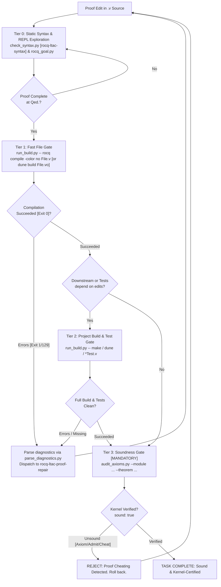

# Rocq CLI, Build Management & Verification Ladder

This skill provides operational workflows, build system configurations, process controllers, and automated verification tools for formal proof development in Rocq (formerly Coq) using **Pure Vanilla Ltac**. It guides autonomous agents through fast single-file compilation, project-wide dependency builds (Dune and Software Foundations `_CoqProject` / Makefiles), structured diagnostic parsing, static signature validation (`check_type`), kernel-level soundness audits (`Print Assumptions` / `rocq check`), property testing (QuickChick), and dual-stage code extraction pipelines.

---

## 0. Environment & Version Compatibility

| Component          | Target / Supported              | Notes                                                                                         |
| :----------------- | :------------------------------ | :-------------------------------------------------------------------------------------------- |
| **Rocq Prover**    | `9.0+` (Default target)         | Unified `rocq` CLI (`compile`, `repl`, `check`, `makefile`), `Corelib` / `Stdlib` split.      |
| **Coq (Legacy)**   | `8.20` (Compatibility baseline) | Dispersed binaries (`coqc`, `coqtop`, `coq_makefile`). Versions $\le 8.17$ are unsupported.   |
| **Build Systems**  | **Dune** / **`_CoqProject`**    | Dynamic resolution: prefer `dune` when `dune-project` exists, fallback to `_CoqProject`.      |
| **SF Ecosystem**   | **LF, PLF, VFA, QC, SLF, etc.** | Standard wrapper Makefiles, multi-volume path mappings, warning suppression, and autograders. |
| **Soundness Gate** | `Print Assumptions` / `rocqchk` | Mandatory audit: must evaluate to `Axioms: <none>` (`CONTEXT SUMMARY`) or global context.     |
| **Python**         | `>= 3.10`                       | Standard library only (`subprocess`, `re`, `json`, `pathlib`, `argparse`). Zero external pip. |

### Critical CLI & Build Adjustments (Rocq 9.0+ & SF Ecosystem)

- **Unified Dispatcher & Subcommands**: Standalone binaries are unified under the `rocq` dispatcher (`topbin/rocq.ml`). Supported subcommands include:
  - `compile` (alias `c`): Compile single `.v` source files into `.vo`.
  - `repl` (alias `top`): Interactive Read-Eval-Print Loop / batch execution.
  - `check` (alias `rocqchk`): Standalone checker of compiled `.vo` libraries.
  - `makefile`: Generate a Makefile from `_CoqProject`.
  - `dep`: Compute file dependencies for compilation.
- **Single File Compilation Invariant**: `rocq compile` accepts exactly **one** `.v` target per execution (`toplevel/coqcargs.ml`). Passing multiple `.v` files triggers `More than one file to compile: <first> and <second>` and immediately aborts with exit code `1`.
- **Deterministic Diagnostic Output**: Always pass `-color no` (or `--color=no`) to `rocq compile`, `rocq repl`, and `rocq check` in automated pipelines to prevent ANSI color codes from contaminating log buffers.
- **Exit Code Conventions**:
  - `0`: Successful completion.
  - `1`: Standard syntax errors, type errors, CLI usage violations, or QuickChick counterexample found.
  - `124`: Timed-out processes wrapped and killed with `SIGKILL` by `scripts/run_build.py`.
  - `129`: Kernel anomaly (`cErrors.ml`) or unexpected internal exception.
- **Dune `Stdlib` Requirement**: In Rocq 9.0+, `(theories Stdlib Corelib)` is mandatory in `(coq.theory ...)` stanzas. Omitting it triggers `Cannot find a physical path bound to logical path ... with prefix Stdlib`.
- **Quick Compilation (`.vos`) Prohibition for Soundness**: Compiling with `-vos` checks only declarations, signatures, and transparent definitions (`Defined`), skipping verification of opaque proof bodies (`Qed`) via `check: false` (`ccompile.ml`). Executing `Print Assumptions` on `.vos` files cannot trace internal axioms. Passing `.vos` does **NOT** prove a theorem; only fully checked `.vo` (or verified `.vok`) files are admissible.

---

## 1. Quick Reference: Common Commands

| Command                                                                                   | Purpose                                         | When to Use                                                                    |
| :---------------------------------------------------------------------------------------- | :---------------------------------------------- | :----------------------------------------------------------------------------- |
| `python3 scripts/run_build.py --timeout 30 -- rocq compile -color no [FLAGS] <file.v>`    | Fast single-file batch compilation (Tier 1)     | Immediately after closing a proof with `Qed.` to generate `.vo`.               |
| `python3 scripts/run_build.py --timeout 30 -- dune build <theories/Path/File.vo>`         | Fast Dune single-module compilation (Tier 1)    | Fast compilation in Dune-managed projects without building unneeded targets.   |
| `python3 scripts/run_build.py --timeout 180 -- dune build`                                | Full workspace dependency verification (Tier 2) | When cross-file definitions or interfaces change, before final soundness gate. |
| `python3 scripts/run_build.py --timeout 180 -- make -f Makefile.coq`                      | Project build via `coq_makefile` (Tier 2)       | Full project check in legacy or `_CoqProject`-based repositories (SF style).   |
| `python3 scripts/audit_axioms.py --module <Logical.Path> --theorem <Thm> --project-dir .` | Independent soundness audit via REPL (Tier 3)   | **Mandatory final gate** before declaring any theorem complete.                |
| `rocq check -o -silent -norec <Logical.Path>`                                             | Standalone kernel soundness check (Tier 3)      | Independent binary verification of compiled `.vo` artifacts.                   |
| `python3 scripts/parse_diagnostics.py < build.log`                                        | Parse compiler/Dune logs into structured JSON   | When builds fail with syntax, unification, or path resolution errors.          |
| `quickChick -color <File.v>` (or `coqc -Q . QC <Test.v>`)                                 | Run QuickChick property tests                   | In QC projects to falsify or validate conjectures with randomized tests.       |
| `ocamlfind ocamlopt -w -20 -w -26 -o driver driver.ml <extracted.ml>`                     | Compile extracted OCaml code & driver           | In VFA/LF extraction pipelines to test executable performance.                 |

---

## 2. Multi-Tier Verification Ladder

Autonomous agents must strictly follow the four verification tiers to balance rapid feedback with uncompromising mathematical soundness.



### Verification Tiers Overview

| Tier                       | Action / Command                                               | Scope & Target Output                    | Timeout | Pass Criteria                                                          |
| :------------------------- | :------------------------------------------------------------- | :--------------------------------------- | :------ | :--------------------------------------------------------------------- |
| **Tier 0: Static & Repl**  | `check_syntax.py <file.v>` / `rocq_goal.py <file.v> -l <line>` | Static rules & interactive proof state   | 5s      | Pure Vanilla Ltac valid, no unhandled exceptions.                      |
| **Tier 1: Fast File Gate** | `python3 scripts/run_build.py -- rocq compile -color no <f.v>` | Generates single `.vo` for target module | 30s     | Exit code 0, complete `.vo` generated (never accept `.vos`).           |
| **Tier 2: Project Gate**   | `python3 scripts/run_build.py -- make` (or `dune build`)       | Workspace DAG & `*Test.v` checks         | 180s    | All modules compile cleanly; `check_type` reports all types ok.        |
| **Tier 3: Soundness Gate** | `python3 scripts/audit_axioms.py --module ... --theorem ...`   | Independent REPL `Print Assumptions`     | 30s     | `Axioms: <none>` & all safety checks `<none>` (or approved whitelist). |

### The Stale `.vo` Cache Trap (Fast File Gate)

When editing across multiple files:

- Directly running `rocq compile File.v` relies on existing upstream `.vo` binaries on disk.
- If upstream `.v` files were modified but not recompiled, Tier 1 will either falsely pass (reading stale signatures) or falsely fail (missing new upstream definitions).
- **Protocol**: If upstream files were edited in the current session, run `dune build theories/Upstream.vo` or recompile upstream dependencies via Tier 1 before verifying downstream files.

---

## 3. Bundled Scripts & Execution Toolchain

All bundled scripts run on standard Python 3.10+ without external packages.

### 3.1. Safe Build Runner (`scripts/run_build.py`)

Prevents runaway tactic automation (`lia`, `auto 10`, `eauto`) from hanging processes or creating zombie sub-processes. Executes commands within dedicated OS process groups (`start_new_session=True` on POSIX, `CREATE_NEW_PROCESS_GROUP` on Windows) and enforces deadline timeouts with `SIGKILL`.

```bash
# General usage syntax
python3 scripts/run_build.py --timeout <seconds> --cwd <dir> -- <build_command...>

# Examples
python3 scripts/run_build.py --timeout 30 -- rocq compile -color no -Q . LF Basics.v
python3 scripts/run_build.py --timeout 60 -- dune build theories/Core.vo
```

- Returns structured JSON containing `command`, `returncode`, `timed_out`, `stdout`, and `stderr`.
- Exits with status `124` on timeouts. Pass `--raw` to bypass JSON formatting when piping directly.

### 3.2. Diagnostic Parser (`scripts/parse_diagnostics.py`)

Strips ANSI sequences from `rocq compile`, `coqc`, or `dune` outputs, parsing both single-line (`line X, characters Y-Z:`) and multi-line (`lines X-Y, characters Z-W:`) error locations, severity levels (`Error`, `Warning`, `Anomaly`), messages, and warning tags (e.g., `[deprecated-from-Coq]`, `[deprecated-since-9.0]`) into structured JSON.

```bash
# Pipe stderr directly from run_build.py or build execution
dune build 2>&1 | python3 scripts/parse_diagnostics.py

# Or parse saved log file
python3 scripts/parse_diagnostics.py build.log
```

### 3.3. Soundness & Axiom Auditor (`scripts/audit_axioms.py`)

Spawns an isolated `rocq repl -batch -quiet -color no` (or `coqtop -batch -quiet -color no`) sub-process, automatically loads `-Q` / `-R` / `-arg` bindings from `_CoqProject`, imports the target logical module, and queries `Print Assumptions <Theorem>.`.

```bash
# Strict Mode: Zero external axioms allowed (purely constructive / closed proof)
python3 scripts/audit_axioms.py --module LF.Basics --theorem mult_S_1 --project-dir .

# Whitelist Mode: Allow standard mathematical axioms (Extensionality, Proof Irrelevance, Excluded Middle)
python3 scripts/audit_axioms.py --module PLF.Equiv --theorem ceval_deterministic --project-dir . --allow-standard-axioms
```

- Returns exit code `0` (`sound: true`) ONLY when proof contains no unapproved axioms or residual holes.
- Returns exit code `1` (`sound: false`) if `Admitted.`, `admit.`, or undeclared axioms are detected.

---

## 4. Soundness Gate, Anti-Cheating & Software Foundations Audit

The primary objective of this skill is ensuring absolute mathematical rigor. LLMs incentivized only by return code 0 frequently attempt reward-hacking shortcuts. These are strictly forbidden.

### 4.1. The Two-Stage Verification Pattern in Software Foundations

Software Foundations enforces soundness via a two-stage verification strategy:

```
[Stage 1: Static Signature Verification]  -> check_type in *Test.v (Catches Goal Drift & Missing Stubs)
[Stage 2: Kernel Assumptions Audit]       -> Print Assumptions (Catches Admitted & Unauthorized Axioms)
```

#### Stage 1: Static Signature & Type Validation (`*Test.v`)

In SF exercises, `*Test.v` scripts verify that the student did not alter lemma signatures or omit declarations using `unify`:

```coq
Parameter MISSING: Type.

Module Check.
Ltac check_type A B :=
  match type of A with
  | context[MISSING] => idtac "Missing: " A
  | ?T => first [unify T B; idtac "Type: ok" | idtac "Type: wrong - expected " B]
  end.
End Check.

(* Verification calls *)
Goal True.
check_type @nandb (bool -> bool -> bool).
check_type @mult_S_1 (forall n m : nat, m = S n -> m * (1 + n) = m * m).
Abort.
```

- If `Type: wrong` appears, the theorem statement was illegally weakened or modified (Goal Drift).
- If `Missing:` appears, the required definition is missing or unresolved.

#### Stage 2: Kernel-Level Assumption Auditing (`Print Assumptions`)

Source code text matching (`grep admit`) is fundamentally unreliable because it yields false positives on comments/documentation and false negatives on obscured or indirect admit tactics.

**The Kernel Registration Rule**: When a proof is terminated with `Admitted.` or contains `admit.`, the Coq/Rocq kernel converts the incomplete lemma into an `Axiom` within the global environment named after the lemma itself (e.g., `Basics.mult_S_1` or `<Module>.<ident>.Admitted`). Therefore, querying `Print Assumptions <ident>.` exposes all unfinished goals deterministically:

1. **Rocq 9.0+ (`CONTEXT SUMMARY`)**:
   ```text
   CONTEXT SUMMARY
   ===============
   * Theory: Set is predicative
   * Theory: Rewrite rules are not allowed
   * Axioms: <none>
   * Constants/Inductives relying on type-in-type: <none>
   * Constants/Inductives relying on unsafe (co)fixpoints: <none>
   * Inductives whose positivity is assumed: <none>
   * Inductives relying on indices not mattering: <none>
   ```
2. **Coq 8.20 (Legacy Output)**:
   - Completely closed: `Closed under the global context`
   - Incomplete / Axiom-dependent:
     ```text
     Axioms:
     Basics.mult_S_1 : forall n m : nat, m = S n -> m * (1 + n) = m * m
     ```

### 4.2. Approved Axiom Whitelist (Standard & SF Extensions)

Under `--allow-standard-axioms`, only approved foundational axioms are accepted:

| Domain / Volume | Approved Axiom Identifier                                             | Mathematical Role                               | Status                |
| :-------------- | :-------------------------------------------------------------------- | :---------------------------------------------- | :-------------------- |
| **Standard/LF** | `Coq.Logic.FunctionalExtensionality.functional_extensionality_dep`    | Dependent functional extensionality             | **Permitted**         |
| **Rocq 9.0+**   | `Stdlib.Logic.FunctionalExtensionality.functional_extensionality_dep` | Dependent functional extensionality (Rocq 9.0+) | **Permitted**         |
| **Standard/LF** | `Coq.Logic.ProofIrrelevance.proof_irrelevance`                        | Proof irrelevance for `Prop`                    | **Permitted**         |
| **Rocq 9.0+**   | `Stdlib.Logic.ProofIrrelevance.proof_irrelevance`                     | Proof irrelevance for `Prop` (Rocq 9.0+)        | **Permitted**         |
| **PLF / Logic** | `Coq.Logic.Classical_Prop.classic`                                    | Law of Excluded Middle ($P \lor \neg P$)        | Project-conditional   |
| **SLF (TLC)**   | `LibAxioms.prop_ext` / `TLC.LibAxioms.classic`                        | TLC Propositional extensionality & classic      | Permitted in SLF only |
| **SLF (TLC)**   | `LibAxioms.fun_ext_dep` / `TLC.LibAxioms.indefinite_description`      | TLC Dependent function extensionality & choice  | Permitted in SLF only |
| **Any Custom**  | `Axiom cheat : ...` or self-referential `Admitted`                    | Unsound assertion / Unfinished proof            | **STRICTLY REJECTED** |

---

## 5. Build Systems & Logical Path Resolution

### 5.1. Dune Integration

- **Targeted Build**: Target specific `.vo` paths to avoid building entire workspaces:
  ```bash
  python3 scripts/run_build.py -- dune build theories/Logic/Core.vo
  ```
- **Dune Configuration (`dune`)**:
  ```lisp
  (coq.theory
   (name MyProject)
   (package my-project)
   (theories Stdlib Corelib)
   (flags :standard -w -deprecated-from-Coq -color no))
  ```

### 5.2. `_CoqProject` & Software Foundations Makefile Architecture

Software Foundations volumes (LF, PLF, VFA, QC, SLF, SECF, VC) standardize on a wrapper `Makefile` driving `coq_makefile` via `_CoqProject`.

#### Standard Wrapper `Makefile` Pattern

```makefile
KNOWNTARGETS := CoqMakefile.all CoqMakefile.clean CoqMakefile.html
KNOWNFILES   := Makefile _CoqProject

.DEFAULT_GOAL := default

default: CoqMakefile.all

CoqMakefile.all: CoqMakefile
	$(MAKE) -f CoqMakefile

CoqMakefile.clean: CoqMakefile
	$(MAKE) -f CoqMakefile clean
	rm -f CoqMakefile CoqMakefile.conf *.vo *.vok *.vos *.glob *.d

CoqMakefile: _CoqProject
	coq_makefile -f _CoqProject -o CoqMakefile

.PHONY: default clean html
```

#### Typical `_CoqProject` Configurations & Warning Suppressions

SF volumes define specific warning suppression flags via `-arg -w -arg <flag>`:

```text
# Logical Foundations (lf/_CoqProject)
-Q . LF
-arg -w -arg -notation-overridden
-arg -w -arg -redundant-canonical-projection
-arg -w -arg -deprecated-hint-without-locality

# Programming Language Foundations (plf/_CoqProject)
-Q . PLF
-Q ../lf LF
-arg -w -arg -notation-overridden
-arg -w -arg -deprecated-hint-without-locality

# Separation Logic Foundations (slf/_CoqProject)
-Q . SLF
-arg -w -arg -notation-overridden
-arg -w -arg -redundant-canonical-projection
-arg -w -arg -ambiguous-paths
```

- **`-w -notation-overridden`**: Suppresses warnings when standard library notations are redefined for pedagogical purposes.
- **`-w -redundant-canonical-projection`**: Suppresses redundant canonical structure declarations.
- **`-w -deprecated-hint-without-locality`**: Suppresses Coq 8.13+ locality requirement warnings for legacy hints.
- **`-w -ambiguous-paths`**: Suppresses typeclass/coercion ambiguity warnings when integrating external libraries (e.g., TLC in SLF).

#### Multi-Volume & External Library Path Resolution

- **Multi-Volume Monorepo**: In PLF, SECF, and VC, sibling volumes are bound via `-Q ../lf LF` and `-Q ../plf PLF`.
- **Dynamic External Library Fallback (SLF / TLC)**:
  ```makefile
  TLC_DIR ?= $(shell opam var coq-tlc:lib 2>/dev/null || echo "")
  ifeq ($(TLC_DIR),)
    TLC_INCLUDE = -Q ./tlc TLC
  else
    TLC_INCLUDE = -Q $(TLC_DIR) TLC
  endif
  COQFLAGS = -f _CoqProject $(TLC_INCLUDE)
  ```
- **External C Verification Frameworks (VC)**: Binds VST and CompCert via environment variables: `-Q $(VST_LOC) VST` and `-Q $(COMPCERT_LOC) compcert`.

---

## 6. Specialized Verification Pipelines: QuickChick & Code Extraction

### 6.1. QuickChick Property-Based Testing (QC Volume)

QuickChick enables randomized testing of Gallina definitions before or alongside formal proof.

1. **Plugin Declaration & Module Load**:
   - `_CoqProject` specifies `-Q . QC`.
   - `.v` files import: `From QuickChick Require Import QuickChick.`
2. **Compilation-Time Evaluation**:
   Adding `QuickCheck prop_reverse.` inside a `.v` file triggers randomized testing during `coqc` compilation.
   - **Pass Log**: `+++ Passed 10000 tests (0 discards)`
   - **Counterexample Log**: `*** Failed after 1 tests and 0 shrinks. [0, 1]`
   - If a test fails, `coqc` immediately terminates with exit code `1`.
3. **CLI Standalone Execution**:
   To test natively without recompiling full proof files:
   ```bash
   quickChick -color QuickCheck.v
   ```
   This automatically extracts generators and properties to OCaml and compiles them via `ocamlopt` for rapid execution.

### 6.2. Code Extraction & Dual-Stage OCaml Builds (LF & VFA)

In LF (`ImpCEvalFun.v`) and VFA (`Sort.v`, `SearchTree.v`), proven algorithms are extracted to functional programming languages and linked with benchmarking drivers.

#### Step 1: Extraction Directives in `.v`

```coq
Require Coq.extraction.Extraction.
Extraction Language OCaml.

(* Primitive Type Mappings *)
Extract Inductive bool => "bool" [ "true" "false" ].
Extract Inductive nat => "int"
  [ "0" "(fun x -> x + 1)" ]
  "(fun zero succ n -> if n=0 then zero () else succ (n-1))".

(* File Generation *)
Extraction "sort.ml" sort.
Extraction "searchtree.ml" empty_tree insert lookup.
```

Compiling `Extract.v` via `coqc -Q . VFA Extract.v` outputs `sort.ml`, `sort.mli`, `searchtree.ml`, and `searchtree.mli`.

#### Step 2: Native OCaml Compilation & Benchmarking

Extracted code must be compiled with OCaml warning suppressions (`-w -20` for unused arguments, `-w -26` for unused variables):

```makefile
OCAMLOPT := ocamlfind ocamlopt -package unix -w -20 -w -26

test_searchtree: searchtree.mli searchtree.ml test_searchtree.ml
	$(OCAMLOPT) -o test_searchtree searchtree.mli searchtree.ml test_searchtree.ml
	./test_searchtree
```

Agents managing extraction pipelines must ensure both the Coq stage (producing `.ml`) and the OCaml stage (linking with the test harness) succeed cleanly.

---

## 7. Troubleshooting CLI & Build Failures

### 1. `More than one file to compile: ... and ...`

- **Cause**: Multiple `.v` files passed to `rocq compile` (`coqcargs.ml`).
- **Remedy**: Pass exactly one `.v` file per `rocq compile` call. For projects, use `make` or `dune build`.

### 2. `Cannot find a physical path bound to logical path ...`

- **Cause**: Mismatch between directory layout, `-Q`/`-R` flags, or missing `From <Prefix>` in the `.v` source.
- **Remedy**: Check `_CoqProject`. If `-Q . LF` is configured, write `From LF Require Import Basics.`. For sibling volumes, verify `-Q ../lf LF` is present.

### 3. `Type: wrong` or `Missing: <ident>` in `*Test.v`

- **Cause**: The lemma name or signature was modified, or an exercise was omitted.
- **Remedy**: Restore original lemma statement exactly as given in the template (respect Header Fence).

### 4. Build Hangs or Returns Exit Code `124`

- **Cause**: Runaway automation (`lia`, `eauto 10`, `repeat`, or unconstrained search).
- **Remedy**: Terminated automatically by `run_build.py`. Step through interactively via `rocq-ltac-interactive-proof` to find the looping tactic.

### 5. QuickChick Test Fails (`*** Failed!`)

- **Cause**: Property has a genuine counterexample or generator produced invalid inputs.
- **Remedy**: Inspect counterexample trace printed in stdout, repair definition or precondition, and re-run.

### 6. OCaml Extraction Compilation Error (`Unbound value` / Warnings as Errors)

- **Cause**: Incompatible `Extract Inductive` mapping or missing OCaml compiler flags.
- **Remedy**: Ensure `ocamlc`/`ocamlopt` includes `-w -20 -w -26`. Verify that all dependencies are extracted together in the `Extraction "<file>.ml"` command.

---

## 8. Fast Prover CLI & Build Checklist

Before concluding any proof task or handing off deliverables, verify against this checklist:

### Stage A: Environment & Build Configuration

- [ ] `_CoqProject` or `dune-project` exists at project root.
- [ ] Warning flags configured (`-w -notation-overridden`, `-w -deprecated-hint-without-locality`, etc.).
- [ ] Sibling volume paths properly mapped (`-Q ../lf LF` when building PLF/VFA/SECF).
- [ ] CLI invocations include `-color no` to prevent ANSI escape sequences in logs.

### Stage B: Tier 1 Fast File Gate

- [ ] Target file compiled to full `.vo` artifact (`run_build.py -- rocq compile -color no <file.v>`).
- [ ] Exactly one `.v` file passed to `rocq compile`.
- [ ] Zero reliance on `.vos` files for proof completion.
- [ ] Compiler diagnostics parsed via `parse_diagnostics.py` with 0 errors.

### Stage C: Tier 2 Project Build & Test Gate

- [ ] Full workspace build passes cleanly (`make -f Makefile.coq` or `dune build`).
- [ ] All `*Test.v` test drivers pass with `Type: ok` and zero `Missing:` declarations.
- [ ] Any QuickChick tests pass with `+++ Passed 10000 tests`.
- [ ] Any extraction targets compile cleanly with OCaml toolchain.

### Stage D: Tier 3 Soundness Gate (Mandatory)

- [ ] `scripts/audit_axioms.py` executed against target theorem identifier.
- [ ] Audit output confirms `Axioms: <none>` under `CONTEXT SUMMARY` (or strictly matches approved whitelist).
- [ ] All safety items (`type-in-type`, `unsafe (co)fixpoints`, `positivity`) verified as `<none>`.
- [ ] `unchecked sort eliminations` section does not appear in output.
- [ ] Source inspection confirms zero occurrences of `admit.`, `Admitted.`, or unapproved `Axiom`.

---

## 9. Progressive Reference Guides

For deep technical specifications, edge-case triage, and build system configuration templates, consult the specialized references:

| **Topic**                      | **Key Focus & Capabilities**                                                              | **Reference Guide**                                                     |
| :----------------------------- | :---------------------------------------------------------------------------------------- | :---------------------------------------------------------------------- |
| **Build Systems & Configs**    | Dune `(coq.theory)` stanzas, `_CoqProject` parsing, `.vos` vs `.vo` mechanics             | [build_systems.md](references/build_systems.md)                         |
| **Soundness & Axiom Auditing** | `CONTEXT SUMMARY` / `Print Assumptions` specification, whitelist management, `rocq check` | [soundness_and_axiom_audit.md](references/soundness_and_axiom_audit.md) |
| **CLI & Path Troubleshooting** | Logical path bindings, stale cache traps, compiler flags, timeout handling                | [cli_troubleshooting.md](references/cli_troubleshooting.md)             |
