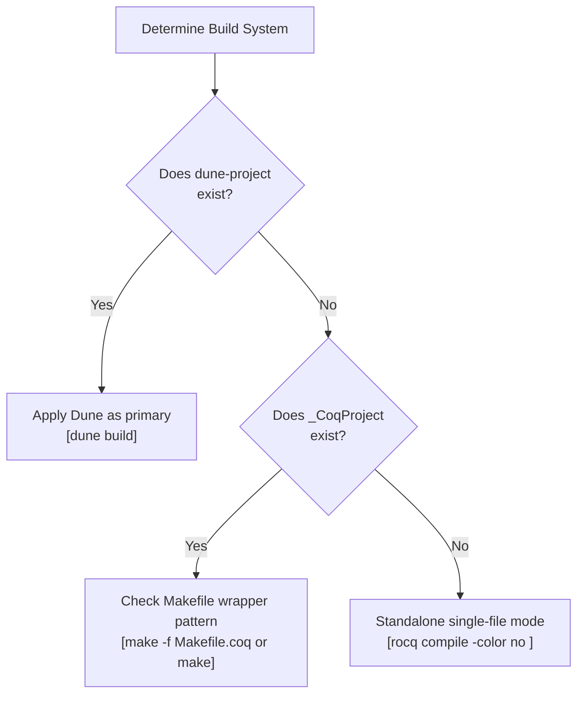

# Rocq Build Systems & Dependency Resolution Reference Guide

This document details the configuration specifications, logical path resolution mechanisms, and Quick Compilation (`.vos` / `.vok`) verification boundaries for **Dune**, **`_CoqProject` / `coq_makefile`**, and **Software Foundations (LF, PLF, VFA, QC, SLF, SECF, VC)** project ecosystems in Rocq (formerly Coq) 9.0+.

---

## 1. Build System Resolution Hierarchy

Autonomous agents dynamically resolve the appropriate build toolchain based on project root configuration files:



---

## 2. Workspace Management with Dune

In Dune 3.x+, Rocq formal verification is supported as a first-class build target.

### 2.1. Project Root Declaration (`dune-project`)

```lisp
(lang dune 3.8)
(using rocq 0.11) ; or (using coq 0.8)
(name my_project)
```

### 2.2. Theory Configuration (`dune`)

```lisp
(coq.theory
 (name MyProject)
 (package my-project)
 (theories Stdlib Corelib)
 (flags :standard -w -deprecated-from-Coq -color no))
```

- **Mandatory `(theories Stdlib Corelib)`**: In Rocq 9.0+, standard libraries are split into `Corelib` (minimal computational kernel) and `Stdlib` (general standard theories). Omitting `Stdlib` causes unresolved namespace errors:
  ```text
  Error: Cannot find a physical path bound to logical path Logic with prefix Stdlib.
  ```
- **Shadow Tree Builds**: Dune isolates all build artifacts inside `_build/default/`, keeping source trees clean of transient `.vo`, `.glob`, and `.vos` files.
- **Fast Single-Module Compilation**: Target the specific `.vo` output directly:
  ```bash
  dune build theories/Core.vo
  ```

---

## 3. `_CoqProject` Parsing Specifications & Tokenization

Based on the official Rocq parser implementation (`lib/coqProject_file.ml`), `_CoqProject` files are parsed according to strict tokenization rules.

### 3.1. Supported Directives

| Directive  | Syntax Example                   | Behavior and Scope                                                                                                  |
| :--------- | :------------------------------- | :------------------------------------------------------------------------------------------------------------------ |
| `-Q`       | `-Q theories MyProject`          | Maps physical directory to qualified logical prefix. Requires `From MyProject Require Import Core.` in source code. |
| `-R`       | `-R theories MyProject`          | Recursively maps directory tree to logical prefix. Allows unadorned `Require Import Core.`.                         |
| `-I`       | `-I plugins/`                    | Adds directory to OCaml/ML include search path.                                                                     |
| `-package` | `-package zarith`                | Declares dependency on external findlib packages.                                                                   |
| `-arg`     | `-arg "-w -deprecated-from-Coq"` | Passes command-line flags directly to the compiler (`rocq compile`).                                                |
| `-f`       | `-f base.project`                | Recursively includes another project configuration file.                                                            |
| `-docroot` | `-docroot html`                  | Sets root output directory for HTML documentation.                                                                  |
| `#`        | `# Comment line`                 | Line comment indicator. Text from `#` to end-of-line is ignored.                                                    |

### 3.2. Lexical & Tokenization Invariants

1. **Double Quotes (`"..."`)**: Groups whitespace-separated strings into a single token. Unclosed quotes raise `Parsing_error "unterminated string"`.
2. **Single Quotes (`'...'`) in `-arg` Expansion**:
   - Parsed by `process_extra_args` in `coqProject_file.ml`.
   - Single quotes keep whitespace together and preserve literal characters. Unquoted spaces split arguments.
   - Unpaired single quotes immediately abort with an exception:
     ```text
     Parsing_error ("Invalid value for -arg, unpaired single quote: ...")
     ```
3. **Disallowed Characters in File Paths**: File paths containing `\n`, `\r`, `\t`, `\`, `'`, `"`, spaces, `#`, `$`, or `%` trigger `Unsupported filename` exceptions.

---

## 4. Software Foundations Build Architecture

The Software Foundations (SF) curriculum establishes production-grade conventions for `_CoqProject` configuration, Makefile wrappers, and multi-volume dependencies across seven volumes:

- **LF**: Logical Foundations
- **PLF**: Programming Language Foundations
- **VFA**: Verified Functional Algorithms
- **QC**: QuickChick
- **SECF**: Security Foundations
- **SLF**: Separation Logic Foundations
- **VC**: Verified Components (Verifiable C)

### 4.1. The Standard SF Wrapper `Makefile` Pattern

Rather than invoking `coqc` manually or maintaining raw make rules, SF projects employ a canonical wrapper Makefile delegating to `coq_makefile`:

```makefile
KNOWNTARGETS := CoqMakefile.all CoqMakefile.clean CoqMakefile.html
KNOWNFILES   := Makefile _CoqProject

.DEFAULT_GOAL := default

default: CoqMakefile.all

CoqMakefile.all: CoqMakefile
	$(MAKE) -f CoqMakefile

CoqMakefile.clean: CoqMakefile
	$(MAKE) -f CoqMakefile clean
	rm -f CoqMakefile CoqMakefile.conf

CoqMakefile.html: CoqMakefile
	$(MAKE) -f CoqMakefile html

CoqMakefile: _CoqProject
	coq_makefile -f _CoqProject -o CoqMakefile

.PHONY: default clean html
```

- Automatically tracks changes to `_CoqProject` and regenerates `CoqMakefile`.
- Properly handles dependency calculation (`.d` files) and enables parallel builds (`make -j4`).

### 4.2. Volume Configurations & Compiler Warning Flags

SF volumes configure logical namespace bindings and suppress specific pedagogical warnings via `-arg -w -arg <flag>`:

```text
# 1. LF (Logical Foundations) - lf/_CoqProject
-Q . LF
-arg -w -arg -notation-overridden
-arg -w -arg -redundant-canonical-projection
-arg -w -arg -deprecated-hint-without-locality

# 2. PLF (Programming Language Foundations) - plf/_CoqProject
-Q . PLF
-Q ../lf LF
-arg -w -arg -notation-overridden
-arg -w -arg -redundant-canonical-projection
-arg -w -arg -deprecated-hint-without-locality

# 3. VFA (Verified Functional Algorithms) - vfa/_CoqProject
-Q . VFA
-Q ../lf LF
-arg -w -arg -notation-overridden
-arg -w -arg -redundant-canonical-projection

# 4. QC (QuickChick) - qc/_CoqProject
-Q . QC
-Q ../lf LF
-arg -w -arg -notation-overridden
-arg -w -arg -redundant-canonical-projection

# 5. SECF (Security Foundations) - secf/_CoqProject
-Q . SECF
-Q ../lf LF
-Q ../plf PLF
-arg -w -arg -notation-overridden

# 6. SLF (Separation Logic Foundations) - slf/_CoqProject
-Q . SLF
-arg -w -arg -notation-overridden
-arg -w -arg -redundant-canonical-projection
-arg -w -arg -ambiguous-paths

# 7. VC (Verified Components) - vc/_CoqProject
-Q . VC
-Q ../lf LF
-Q ../plf PLF
-Q $(VST_LOC) VST
-arg -w -arg -notation-overridden
```

#### Warning Flag Catalog

| Warning Flag                        | Purpose in Software Foundations                                                                                                |
| :---------------------------------- | :----------------------------------------------------------------------------------------------------------------------------- |
| `-notation-overridden`              | Suppresses warnings when textbook chapters redefine standard library notations (e.g., `+`, `*`, `::`, `[]`).                   |
| `-deprecated-hint-without-locality` | Suppresses warnings for legacy `Hint` declarations lacking `#[local]` / `#[global]` attributes in Coq 8.13+.                   |
| `-redundant-canonical-projection`   | Suppresses warnings when canonical structure projections are redeclared.                                                       |
| `-ambiguous-paths`                  | Suppresses coercion/typeclass resolution path warnings when external libraries (e.g., TLC in SLF) introduce overlapping paths. |
| `-custom-entry-overridden`          | Suppresses warnings when custom grammar parsing entries are overwritten.                                                       |
| `-variable-collision`               | Suppresses warnings when bound variable names match outer definitions.                                                         |

### 4.3. External Library Resolution & Fallbacks

#### TLC Dynamic Path Resolution (SLF)

SLF depends heavily on Arthur Charguéraud's TLC library (`LibTactics.v`, `LibSepReference.v`). SF implements a dynamic fallback in the Makefile:

```makefile
TLC_DIR ?= $(shell opam var coq-tlc:lib 2>/dev/null || echo "")

ifeq ($(TLC_DIR),)
  # Fallback to local bundled copy if opam package not installed
  TLC_INCLUDE = -Q ./tlc TLC
else
  TLC_INCLUDE = -Q $(TLC_DIR) TLC
endif

COQFLAGS = -f _CoqProject $(TLC_INCLUDE)
```

#### Verified Software Toolchain (VC)

VC relies on VST and CompCert, parameterized via environment variables `VST_LOC` and `COMPCERT_LOC` bound with `-R` or `-Q`:

```text
-R $(VST_LOC)/floyd VST.floyd
-R $(COMPCERT_LOC) compcert
-Q . VC
```

---

## 5. Dual-Stage Code Extraction Pipelines (LF & VFA)

In LF and VFA, verified algorithms are extracted to OCaml and linked against native execution harnesses and benchmark drivers.

### 5.1. Coq Extraction Stage

Vernacular files specify language target, type mappings, and destination files:

```coq
Require Coq.extraction.Extraction.
Extraction Language OCaml.

(* Map Coq inductive types to native OCaml types *)
Extract Inductive bool => "bool" [ "true" "false" ].
Extract Inductive nat => "int"
  [ "0" "(fun x -> x + 1)" ]
  "(fun zero succ n -> if n=0 then zero () else succ (n-1))".
Extract Inductive list => "list" [ "[]" "(::)" ].

(* Output destination *)
Extraction "sort.ml" sort.
Extraction "searchtree.ml" empty_tree insert lookup.
```

Executing `coqc -Q . VFA Extract.v` generates `sort.ml`, `sort.mli`, `searchtree.ml`, and `searchtree.mli`.

### 5.2. OCaml Compilation Stage

Extracted OCaml code produces harmless unused parameter/variable warnings due to Coq's erasure pass. Build rules must pass `-w -20 -w -26` to `ocamlc` / `ocamlopt`:

```makefile
OCAMLOPT := ocamlfind ocamlopt -package unix -w -20 -w -26

# Step 1: Coq extraction
Extract.vo: Sort.vo SearchTree.vo Extract.v
	coqc -Q . VFA Extract.v

sort.ml searchtree.ml: Extract.vo

# Step 2: Native compilation with driver
test_searchtree: searchtree.ml test_searchtree.ml
	$(OCAMLOPT) -o test_searchtree searchtree.ml test_searchtree.ml
	./test_searchtree
```

---

## 6. Quick Compilation (`-vos` / `.vok`) Mechanics & Boundaries

Rocq provides two-stage compilation modes to accelerate large development pipelines (`coqcargs.mli`, `ccompile.ml`).

### 6.1. Compilation Modes Comparison

| Mode / Output                    | CLI Flag  | Verified Scope                                                  | Skipped Scope                   | Purpose                                                    |
| :------------------------------- | :-------- | :-------------------------------------------------------------- | :------------------------------ | :--------------------------------------------------------- |
| **Complete (`.vo`)**             | (default) | Declarations, signatures, `Defined`, **all `Qed` proof bodies** | None                            | **Mandatory final deliverable for soundness verification** |
| **Interface-only (`.vos`)**      | `-vos`    | Declarations, signatures, transparent definitions (`Defined`)   | **Opaque proof bodies (`Qed`)** | Rapid typechecking of downstream dependencies              |
| **Full Check from Vos (`.vok`)** | `-vok`    | Loads upstream `.vos`, **verifies all `Qed` proof bodies**      | None (emits empty `.vok`)       | Distributed asynchronous CI validation                     |

### 6.2. Internal `-vos` Semantics (`ccompile.ml`)

- Compiling under `-vos` treats opaque proofs (`Proof. ... Qed.`) with `check: false`, skipping proof term generation and kernel validation.
- To prevent silent errors during batch builds, error resilience is disabled (`async_proofs_cmd_error_resilience = false`).

### 6.3. Soundness Gate Invariant

> [!CAUTION]
> **Invalidity of `Print Assumptions` on `.vos` Files**
> Because `.vos` files omit opaque proof terms, querying `Print Assumptions` against a `.vos` target cannot trace internal axioms or `admit` placeholders.
> **Never accept `.vos` artifacts as evidence of proof completion. All certified theorems require fully generated `.vo` files.**
