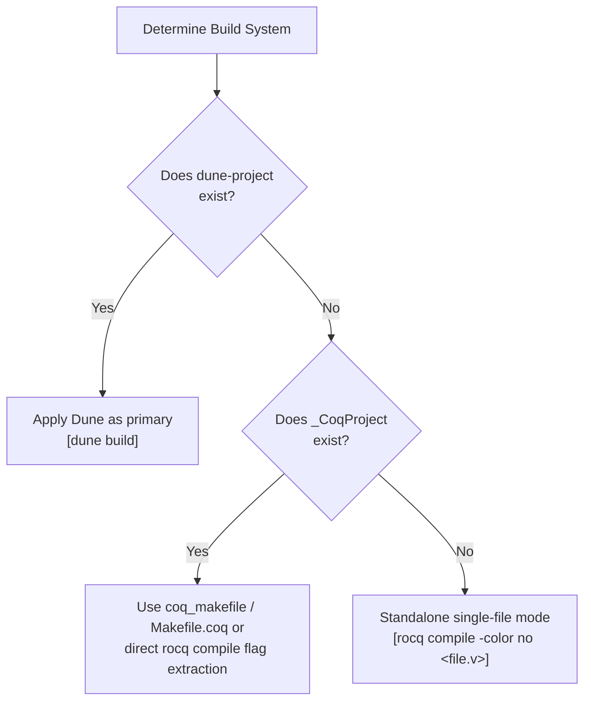

# Rocq Build Systems & Dependency Resolution Reference Guide

This document details the configuration specifications, logical path resolution mechanisms, and Quick Compilation (`.vos` / `.vok`) verification boundaries for **Dune** and **`_CoqProject` / `coq_makefile`** in Rocq (formerly Coq) 9.0+.

---

## 1. Build System Resolution Hierarchy

Autonomous agents dynamically resolve the appropriate build toolchain based on project root configuration files:



---

## 2. Workspace Management with Dune

In Dune 3.x+, Rocq formal verification is supported as a first-class build target.

### 2.1. Project Root Declaration (`dune-project`)

```lisp
(lang dune 3.8)
(using rocq 0.11) ; or (using coq 0.8)
(name my_project)
```

### 2.2. Theory Configuration (`dune`)

```lisp
(coq.theory
 (name MyProject)
 (package my-project)
 (theories Stdlib Corelib)
 (flags :standard -w -deprecated-from-Coq -color no))
```

- **Mandatory `(theories Stdlib Corelib)`**: In Rocq 9.0+, standard libraries are split into `Corelib` (minimal computational kernel) and `Stdlib` (general standard theories). Omitting `Stdlib` causes unresolved namespace errors:
  ```text
  Error: Cannot find a physical path bound to logical path Logic with prefix Stdlib.
  ```
- **Shadow Tree Builds**: Dune isolates all build artifacts inside `_build/default/`, keeping source trees clean of transient `.vo`, `.glob`, and `.vos` files.
- **Fast Single-Module Compilation**: Target the specific `.vo` output directly:
  ```bash
  dune build theories/Core.vo
  ```

---

## 3. `_CoqProject` Parsing Specifications & Tokenization

Based on the official Rocq parser implementation (`lib/coqProject_file.ml`), `_CoqProject` files are parsed according to strict tokenization rules.

### 3.1. Supported Directives

| Directive  | Syntax Example                   | Behavior and Scope                                                                                                  |
| :--------- | :------------------------------- | :------------------------------------------------------------------------------------------------------------------ |
| `-Q`       | `-Q theories MyProject`          | Maps physical directory to qualified logical prefix. Requires `From MyProject Require Import Core.` in source code. |
| `-R`       | `-R theories MyProject`          | Recursively maps directory tree to logical prefix. Allows unadorned `Require Import Core.`.                         |
| `-I`       | `-I plugins/`                    | Adds directory to OCaml/ML include search path.                                                                     |
| `-package` | `-package zarith`                | Declares dependency on external findlib packages.                                                                   |
| `-arg`     | `-arg "-w -deprecated-from-Coq"` | Passes command-line flags directly to the compiler (`rocq compile`).                                                |
| `-f`       | `-f base.project`                | Recursively includes another project configuration file.                                                            |
| `-docroot` | `-docroot html`                  | Sets root output directory for HTML documentation.                                                                  |
| `#`        | `# Comment line`                 | Line comment indicator. Text from `#` to end-of-line is ignored.                                                    |

### 3.2. Lexical & Tokenization Invariants

1. **Double Quotes (`"..."`)**: Groups whitespace-separated strings into a single token. Unclosed quotes raise `Parsing_error "unterminated string"`.
2. **Single Quotes (`'...'`) in `-arg` Expansion**:
   - Parsed by `process_extra_args` in `coqProject_file.ml`.
   - Single quotes keep whitespace together and preserve literal characters. Unquoted spaces split arguments.
   - Unpaired single quotes immediately abort with an exception:
     ```text
     Parsing_error ("Invalid value for -arg, unpaired single quote: ...")
     ```
3. **Disallowed Characters in File Paths**: File paths containing `\n`, `\r`, `\t`, `\`, `'`, `"`, spaces, `#`, `$`, or `%` trigger `Unsupported filename` exceptions.

---

## 4. Quick Compilation (`-vos` / `.vok`) Mechanics & Boundaries

Rocq provides two-stage compilation modes to accelerate large development pipelines (`coqcargs.mli`, `ccompile.ml`).

### 4.1. Compilation Modes Comparison

| Mode / Output                    | CLI Flag  | Verified Scope                                                  | Skipped Scope                   | Purpose                                                    |
| :------------------------------- | :-------- | :-------------------------------------------------------------- | :------------------------------ | :--------------------------------------------------------- |
| **Complete (`.vo`)**             | (default) | Declarations, signatures, `Defined`, **all `Qed` proof bodies** | None                            | **Mandatory final deliverable for soundness verification** |
| **Interface-only (`.vos`)**      | `-vos`    | Declarations, signatures, transparent definitions (`Defined`)   | **Opaque proof bodies (`Qed`)** | Rapid typechecking of downstream dependencies              |
| **Full Check from Vos (`.vok`)** | `-vok`    | Loads upstream `.vos`, **verifies all `Qed` proof bodies**      | None (emits empty `.vok`)       | Distributed asynchronous CI validation                     |

### 4.2. Internal `-vos` Semantics (`ccompile.ml`)

- Compiling under `-vos` treats opaque proofs (`Proof. ... Qed.`) with `check: false`, skipping proof term generation and kernel validation.
- To prevent silent errors during batch builds, error resilience is disabled (`async_proofs_cmd_error_resilience = false`).

### 4.3. Soundness Gate Invariant

> [!CAUTION]
> **Invalidity of `Print Assumptions` on `.vos` Files**
> Because `.vos` files omit opaque proof terms, querying `Print Assumptions` against a `.vos` target cannot trace internal axioms or `admit` placeholders.
> **Never accept `.vos` artifacts as evidence of proof completion. All certified theorems require fully generated `.vo` files.**
