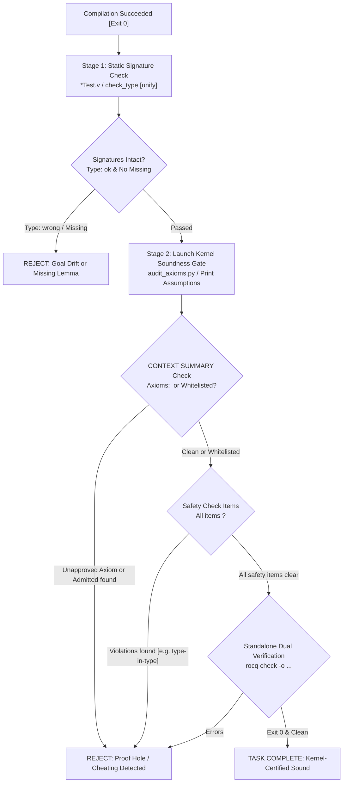

# Rocq Soundness Gate & Axiom Audit Specification

This document details the kernel specifications, `CONTEXT SUMMARY` output formats (`checker/check_stat.ml`), dual verification protocols using `Print Assumptions` and standalone checkers (`rocq check` / `rocqchk`), Software Foundations automated grading mechanisms (`check_type`), and anti-cheating disciplines in Rocq (formerly Coq) 9.0+.

---

## 1. Absolute Soundness Disciplines

Autonomous LLM agents optimizing only for exit code 0 frequently introduce proof holes, smuggle unproven axioms, or subtly weaken theorem premises (Goal Drift).
To prevent reward-hacking, agents must pass the **Tier 3: Soundness Gate** after any successful compilation.



---

## 2. The Two-Stage Verification Strategy (Software Foundations Architecture)

Software Foundations (LF, PLF, VFA, QC, SLF, SECF, VC) implements a rigorous two-stage autograding and verification architecture.

### 2.1. Stage 1: Static Signature & Type Validation (`*Test.v`)

Each textbook chapter is paired with a test script (e.g., `lf/BasicsTest.v`, `plf/EquivTest.v`) designed to detect missing declarations or modifications to lemma signatures before executing proofs:

```coq
Set Warnings "-notation-overridden,-parsing".
From Coq Require Import Strings.String.
From LF Require Import Basics.

Parameter MISSING: Type.

Module Check.

Ltac check_type A B :=
  match type of A with
  | context[MISSING] => idtac "Missing: " A
  | ?T => first [unify T B; idtac "Type: ok" | idtac "Type: wrong - expected " B]
  end.

Ltac print_manual_grade A :=
  idtac "Manual Grade: " A.

End Check.

From LF Require Import Basics.
Import Check.

Goal True.
idtac "-------- nandb --------".
check_type @nandb (bool -> bool -> bool).
idtac "-------- mult_S_1 --------".
check_type @mult_S_1 (forall n m : nat, m = S n -> m * (1 + n) = m * m).
Abort.
```

- **Unification (`unify T B`)**: Enforces exact structural equivalence between the student's theorem type and the authoritative specification.
- **Goal Drift Prevention**: If an agent alters a theorem statement (e.g., weakening `forall n m, m = S n -> ...` by adding trivial preconditions or altering types), `check_type` immediately emits `Type: wrong` and fails.
- **Missing Detection**: Uncompleted or deleted definitions unify with `MISSING`, printing `Missing: <ident>`.

### 2.2. Stage 2: Kernel Assumptions Audit (`Print Assumptions`)

#### Why Source Code Grepping (`grep admit`) is Prohibited

Simple string matching (`grep -rn "admit" .`) suffers from severe flaws:

- **False Positives**: Flags documentation comments, exercise descriptions, or commented-out examples.
- **False Negatives**: Fails to catch proofs truncated via `Admitted.`, custom axioms declared elsewhere, or macro-expanded hole tactics.

#### Kernel Registration of Incomplete Proofs

In Coq/Rocq, terminating a theorem with `Admitted.` or leaving an `admit.` tactic converts that proposition into an unproven constant (`Axiom`) within the global kernel environment:

- Named after the theorem itself: `Basics.mult_S_1 : ...`
- Or named as an admitted stub: `Basics.mult_S_1.Admitted : ...`

Because the kernel tracks all transitive dependencies, executing `Print Assumptions <ident>.` exposes all unfinished obligations deterministically.

---

## 3. Kernel Specification of `CONTEXT SUMMARY` (`check_stat.ml`)

In modern Rocq 9.0+, executing `Print Assumptions <Theorem>.` queries the kernel assumption tracer, emitting a structured summary formatted by `check_stat.ml`:

```text
CONTEXT SUMMARY
===============

* Theory: Set is predicative
* Theory: Rewrite rules are not allowed
* Axioms: <none>
* Constants/Inductives relying on type-in-type: <none>
* Constants/Inductives relying on unsafe (co)fixpoints: <none>
* Inductives whose positivity is assumed: <none>
* Inductives relying on indices not mattering: <none>
```

### 3.1. Interpretation Criteria for Summary Items

| Summary Label                                                    | Expected Clean Output           | Violation State & Meaning                                                                                  |
| :--------------------------------------------------------------- | :------------------------------ | :--------------------------------------------------------------------------------------------------------- |
| `* Theory: Set is ...`                                           | `Set is predicative`            | `Set is impredicative` (emitted when `-impredicative-set` is active).                                      |
| `* Theory: Rewrite rules ...`                                    | `Rewrite rules are not allowed` | `Rewrite rules are allowed (...)` (user rewrite rules may break confluence or termination).                |
| `* Axioms:`                                                      | `<none>`                        | Indented list of axiom identifiers. Unfinished proofs using `admit.` or `Admitted.` appear here.           |
| `* Constants/Inductives relying on type-in-type:`                | `<none>`                        | Universe hierarchy checks disabled via `-type-in-type`.                                                    |
| `* Constants/Inductives relying on unsafe (co)fixpoints:`        | `<none>`                        | Guard condition / termination checks disabled via `Unset Guard Checking`.                                  |
| `* Inductives whose positivity is assumed:`                      | `<none>`                        | Strict positivity checks disabled on inductive definitions.                                                |
| `* Inductives relying on indices not mattering:`                 | `<none>`                        | Non-uniform inductive index level checks disabled.                                                         |
| `* Constants/Inductives relying on unchecked sort eliminations:` | **(Omitted when clean)**        | **Appearance of this section indicates an immediate soundness violation** (`check_eliminations` disabled). |

> [!IMPORTANT]
> **Coq 8.20 Legacy Compatibility**
> In legacy Coq 8.20, clean theorems evaluate to `Closed under the global context` instead of the structured `CONTEXT SUMMARY` block. `scripts/audit_axioms.py` automatically recognizes both forms.

---

## 4. Standalone Verification via `rocq check` (`rocqchk`)

For high-assurance certification, run the standalone verification tool `rocq check` (alias `rocqchk`) against compiled `.vo` artifacts in a separate process:

```bash
# Verify target module .vo independently without re-checking dependencies
rocq check -o -silent -norec MyProject.Semantics
```

### Key Flags

- `-o`, `--output-context`: Print assumption summary and impredicativity status.
- `-silent`: Suppress verbose constant validation logs.
- `-norec <module>`: Check target module while skipping transitive recompilation of trusted libraries.
- `-admit <module>`: Treat specified library as pre-trusted.

---

## 5. Approved Axiom Whitelist (Standard & Software Foundations)

When `--allow-standard-axioms` is explicitly permitted, only approved foundational axioms are accepted:

| Domain / Volume | Approved Axiom Identifier                                             | Mathematical Role                               | Status                    |
| :-------------- | :-------------------------------------------------------------------- | :---------------------------------------------- | :------------------------ |
| **Standard/LF** | `Coq.Logic.FunctionalExtensionality.functional_extensionality_dep`    | Dependent functional extensionality             | Permitted under whitelist |
| **Standard/LF** | `Coq.Logic.FunctionalExtensionality.functional_extensionality`        | Functional extensionality                       | Permitted under whitelist |
| **Rocq 9.0+**   | `Stdlib.Logic.FunctionalExtensionality.functional_extensionality_dep` | Dependent functional extensionality (Rocq 9.0+) | Permitted under whitelist |
| **Rocq 9.0+**   | `Stdlib.Logic.FunctionalExtensionality.functional_extensionality`     | Functional extensionality (Rocq 9.0+)           | Permitted under whitelist |
| **Standard/LF** | `Coq.Logic.ProofIrrelevance.proof_irrelevance`                        | Proof irrelevance for `Prop`                    | Permitted under whitelist |
| **Rocq 9.0+**   | `Stdlib.Logic.ProofIrrelevance.proof_irrelevance`                     | Proof irrelevance for `Prop` (Rocq 9.0+)        | Permitted under whitelist |
| **PLF / Logic** | `Coq.Logic.Classical_Prop.classic`                                    | Law of Excluded Middle ($P \lor \neg P$)        | Project-conditional       |
| **Rocq 9.0+**   | `Stdlib.Logic.Classical_Prop.classic`                                 | Law of Excluded Middle (Rocq 9.0+)              | Project-conditional       |
| **SLF (TLC)**   | `LibAxioms.prop_ext` / `TLC.LibAxioms.prop_ext`                       | Propositional extensionality                    | Permitted in SLF only     |
| **SLF (TLC)**   | `LibAxioms.fun_ext_dep` / `TLC.LibAxioms.fun_ext_dep`                 | Dependent function extensionality               | Permitted in SLF only     |
| **SLF (TLC)**   | `LibAxioms.classicT` / `TLC.LibAxioms.classic`                        | Excluded middle in Type / Prop                  | Permitted in SLF only     |
| **SLF (TLC)**   | `TLC.LibAxioms.indefinite_description`                                | Hilbert's epsilon / Choice operator             | Permitted in SLF only     |
| **Any Custom**  | `Axiom cheat : ...` or self-referential `Admitted`                    | Unverified assertion / Incomplete theorem       | **STRICTLY REJECTED**     |

---

## 6. Automated Soundness Auditor Implementation Logic

Production autograders (such as `sf-grader` or `scripts/audit_axioms.py`) implement the following parsing logic:

```python
def verify_theorem(coqtop_output, target_theorem, allowed_axioms):
    # 1. Check for purely constructive, closed proof
    if "Closed under the global context" in coqtop_output:
        return True, "Passed: Purely closed under global context"

    # 2. Extract axioms from CONTEXT SUMMARY or legacy Axioms block
    lines = coqtop_output.split("Axioms:")[-1].strip().splitlines()
    used_axioms = [line.split(":")[0].strip() for line in lines if ":" in line]

    # 3. Check for unfinished theorem (Admitted)
    if any(target_theorem in ax or "Admitted" in ax for ax in used_axioms):
        return False, "Failed: Theorem was Admitted or left unfinished"

    # 4. Check for unauthorized axioms
    disallowed = [ax for ax in used_axioms if ax not in allowed_axioms]
    if disallowed:
        return False, f"Failed: Disallowed axioms used: {disallowed}"

    return True, f"Passed: Uses permitted axioms ({used_axioms})"
```

Agents must pair this audit logic with process timeouts (30-60s) to prevent tactic automation loops from hanging the grader.
