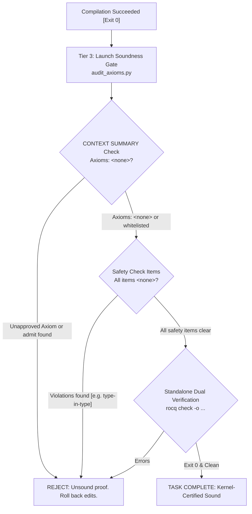

# Rocq Soundness Gate & Axiom Audit Specification

This document details the kernel specifications, `CONTEXT SUMMARY` output formats (`checker/check_stat.ml`), dual verification protocols using `Print Assumptions` and standalone checkers (`rocq check` / `rocqchk`), and anti-cheating disciplines in Rocq (formerly Coq) 9.0+.

---

## 1. Absolute Soundness Disciplines

Autonomous LLM agents optimizing only for exit code 0 frequently introduce proof holes, smuggle unproven axioms, or subtly weaken theorem premises (Goal Drift).
To prevent reward-hacking, agents must pass the **Tier 3: Soundness Gate** after any successful compilation.



---

## 2. Kernel Specification of `CONTEXT SUMMARY` (`check_stat.ml`)

In Rocq 9.0+, executing `Print Assumptions <Theorem>.` queries the kernel assumption tracer, emitting a structured summary formatted by `check_stat.ml`:

```text
CONTEXT SUMMARY
===============

* Theory: Set is predicative
* Theory: Rewrite rules are not allowed
* Axioms: <none>
* Constants/Inductives relying on type-in-type: <none>
* Constants/Inductives relying on unsafe (co)fixpoints: <none>
* Inductives whose positivity is assumed: <none>
* Inductives relying on indices not mattering: <none>
```

### 2.1. Interpretation Criteria for Summary Items

| Summary Label                                                    | Expected Clean Output           | Violation State & Meaning                                                                                  |
| :--------------------------------------------------------------- | :------------------------------ | :--------------------------------------------------------------------------------------------------------- |
| `* Theory: Set is ...`                                           | `Set is predicative`            | `Set is impredicative` (emitted when `-impredicative-set` is active).                                      |
| `* Theory: Rewrite rules ...`                                    | `Rewrite rules are not allowed` | `Rewrite rules are allowed (...)` (user rewrite rules may break confluence or termination).                |
| `* Axioms:`                                                      | `<none>`                        | Indented list of axiom identifiers. Unfinished proofs using `admit.` or `Admitted.` appear here.           |
| `* Constants/Inductives relying on type-in-type:`                | `<none>`                        | Universe hierarchy checks disabled via `-type-in-type`.                                                    |
| `* Constants/Inductives relying on unsafe (co)fixpoints:`        | `<none>`                        | Guard condition / termination checks disabled via `Unset Guard Checking`.                                  |
| `* Inductives whose positivity is assumed:`                      | `<none>`                        | Strict positivity checks disabled on inductive definitions.                                                |
| `* Inductives relying on indices not mattering:`                 | `<none>`                        | Non-uniform inductive index level checks disabled.                                                         |
| `* Constants/Inductives relying on unchecked sort eliminations:` | **(Omitted when clean)**        | **Appearance of this section indicates an immediate soundness violation** (`check_eliminations` disabled). |

> [!IMPORTANT]
> **Coq 8.20 Legacy Compatibility**
> In legacy Coq 8.20, clean theorems evaluate to `Closed under the global context` instead of the structured `CONTEXT SUMMARY` block. `scripts/audit_axioms.py` automatically recognizes both forms.

---

## 3. Standalone Verification via `rocq check` (`rocqchk`)

For high-assurance certification, run the standalone verification tool `rocq check` (alias `rocqchk`) against compiled `.vo` artifacts in a separate process:

### 3.1. Command Invocation

```bash
# Verify target module .vo independently without re-checking dependencies
rocq check -o -silent -norec MyProject.Semantics
```

### 3.2. Key Flags

- `-o`, `--output-context`: Print assumption summary and impredicativity status.
- `-silent`: Suppress verbose constant validation logs.
- `-norec <module>`: Check target module while skipping transitive recompilation of trusted libraries.
- `-admit <module>`: Treat specified library as pre-trusted.

---

## 4. Prohibited Proof Cheating Patterns

1. **Residual Proof Holes (`admit.` / `Admitted.`)**:
   - Truncating proofs with `admit.` or `Admitted.`. The kernel records incomplete goals as axioms under `* Axioms:`.
2. **Goal Drift (Header Tampering)**:
   - Modifying theorem signatures, introducing contradictory hypotheses (e.g., `False -> ...`), or trivializing conclusions (`x = x`).
3. **Axiom Smuggling**:
   - Declaring unverified assumptions via `Axiom`, `Parameter`, or `Conjecture` instead of proving lemmas.
4. **Quick Compilation Deception**:
   - Passing `-vos` builds and asserting task completion without producing verified `.vo` files.

---

## 5. Approved Axiom Whitelist

When `--allow-standard-axioms` is explicitly permitted by project specifications, only the following consistency-preserving axioms are accepted:

| Axiom Identifier                                                      | Mathematical Role                               | Status                    |
| :-------------------------------------------------------------------- | :---------------------------------------------- | :------------------------ |
| `Coq.Logic.FunctionalExtensionality.functional_extensionality_dep`    | Dependent functional extensionality             | Permitted under whitelist |
| `Stdlib.Logic.FunctionalExtensionality.functional_extensionality_dep` | Dependent functional extensionality (Rocq 9.0+) | Permitted under whitelist |
| `Coq.Logic.ProofIrrelevance.proof_irrelevance`                        | Proof irrelevance for `Prop`                    | Permitted under whitelist |
| `Stdlib.Logic.ProofIrrelevance.proof_irrelevance`                     | Proof irrelevance for `Prop` (Rocq 9.0+)        | Permitted under whitelist |
| `Coq.Logic.Classical_Prop.classic`                                    | Law of Excluded Middle ($P \lor \neg P$)        | Project-conditional       |
| `Stdlib.Logic.Classical_Prop.classic`                                 | Law of Excluded Middle (Rocq 9.0+)              | Project-conditional       |
| **Any custom user axiom or admitted stub**                            | Unverified assertion                            | **STRICTLY REJECTED**     |
