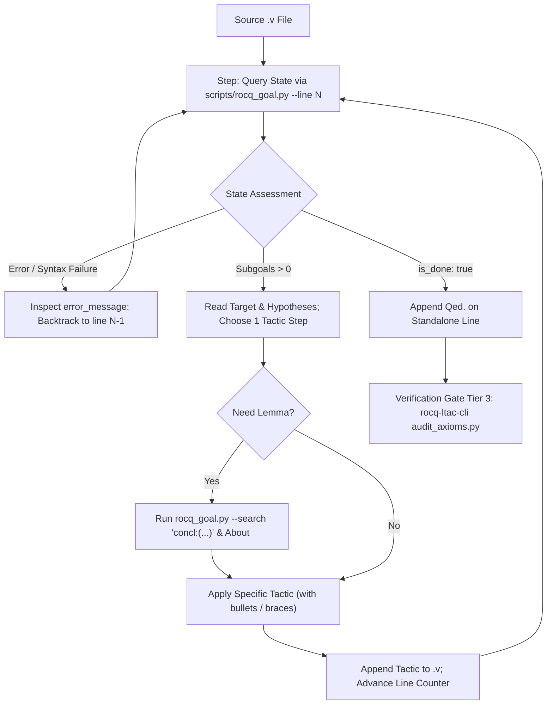

# Rocq Ltac Interactive Proof & REPL State Controller

This skill provides operational workflows, disciplined step-by-step execution patterns, and a zero-dependency Python tool (`scripts/rocq_goal.py`) for interactively driving the Rocq (formerly Coq) proof engine using **Pure Vanilla Ltac**.

Autonomous theorem proving in Rocq requires continuous feedback from the proof assistant. Never generate multi-step proof scripts blindly without querying the resulting goal state. Stepping incrementally, inspecting hypothesis types, searching for relevant lemmas using targeted Vernacular patterns, and enforcing strict bullet nesting guarantees sound, reproducible proofs while avoiding proof-state drift and cognitive overload.

---

## 0. Environment & Version Compatibility

| Component            | Target / Supported                 | Notes                                                                                         |
| :------------------- | :--------------------------------- | :-------------------------------------------------------------------------------------------- |
| **Rocq Prover**      | `9.0+` (Default target)            | Invokes `rocq top -q -color no` or `rocq repl -q -color no`. Dispatches unified `rocq` CLI.   |
| **Coq (Legacy)**     | `8.20` (Compatibility baseline)    | Invokes `coqtop -q -color no`. Versions $\le 8.17$ are unsupported.                           |
| **Language Dialect** | **Pure Vanilla Ltac 100%**         | **SSReflect/MathComp syntax is strictly forbidden.** Dynamic Ltac2 generation is disallowed.  |
| **Build Settings**   | **`_CoqProject` / `_RocqProject`** | Automatically parsed by `scripts/rocq_goal.py` to extract logical path bindings (`-Q`, `-R`). |
| **Python**           | `>= 3.10`                          | Standard library only (`subprocess`, `re`, `json`, `pathlib`, `argparse`). Zero external pip. |

---

## 1. Quick Reference: Core Proving Commands

| Goal / Action                  | Command / Usage                                                                         | Description                                                                         |
| :----------------------------- | :-------------------------------------------------------------------------------------- | :---------------------------------------------------------------------------------- |
| **Inspect Goal at Line $N$**   | `python3 scripts/rocq_goal.py --file <file.v> --line <N> --json`                        | Evaluates file up to line $N$ and returns focused hypotheses and target in JSON.    |
| **Inline Code Goal Check**     | `python3 scripts/rocq_goal.py --code "Theorem t : True. Proof." --json`                 | Evaluates raw code string without requiring a disk file.                            |
| **Targeted Lemma Search**      | `python3 scripts/rocq_goal.py --file <file.v> --line <N> --search "concl:(_ <= _)"`     | Runs `Search concl:(_ <= _).` at the active proof state and returns top results.    |
| **Locate Notation / Symbol**   | `python3 scripts/rocq_goal.py --file <file.v> --line <N> --search "Locate \"++\""`      | Resolves user notation to canonical Gallina constant (e.g., `app`).                 |
| **Audit Implicit Arguments**   | `python3 scripts/rocq_goal.py --file <file.v> --line <N> --search "About Nat.le_trans"` | Prints lemma signature, implicit brackets (`[ ]` vs `{ }`), and explicit arguments. |
| **Verify Term Well-Typedness** | `python3 scripts/rocq_goal.py --file <file.v> --line <N> --search "Check (x + y)"`      | Validates expression type in local context before applying a rewrite or assertion.  |

---

## 2. Interactive Proving Loop: The Step-by-Step Protocol

Autonomous agents must execute proof steps through a strict feedback loop:



### Proving Invariants

1. **One Tactical Operation per Step**: Do not generate 20 lines of speculative tactics at once. Apply one logical step (e.g., `induction n as [| n' IHn'].`), run `rocq_goal.py`, verify that subgoals branch as expected, and then address each branch.
2. **Stateless Replay Safety**: `scripts/rocq_goal.py` employs stateless batch execution: it launches a fresh subshell, streams clean sentences up to the specified line, and parses the exact terminal output. There is no hidden session drift or memory leakage.
3. **No Blind Retries**: If a tactic fails with `Unable to unify`, do not permute tactic arguments randomly. Query `About <lemma>` or `Check <term>` to determine the required argument types.

---

## 3. Tool Usage: `scripts/rocq_goal.py`

`scripts/rocq_goal.py` is the primary interactive interface for examining proof states.

### Command-Line Arguments

```text
usage: rocq_goal.py [-h] [--file FILE] [--code CODE] [--line LINE]
                    [--search SEARCH] [--max-search MAX_SEARCH]
                    [--project-dir PROJECT_DIR] [--timeout TIMEOUT] [--json]
```

- `--file`: Path to the `.v` source file.
- `--code`: Raw Rocq/Coq source code string (evaluated directly).
- `--line`: 1-indexed target line number. Only commands and tactics up to this line are executed.
- `--search`: Vernacular query to execute at the target state (`Search`, `Locate`, `About`, `Check`, or `Print`).
- `--max-search`: Maximum number of search results to capture (default: 25).
- `--project-dir`: Directory containing `_RocqProject` or `_CoqProject`. If omitted, parent directories are searched automatically.
- `--timeout`: Maximum subprocess execution time in seconds (default: 15).
- `--json`: Format output as a structured JSON object.

### JSON Output Schema

When `--json` is supplied, the tool produces structured diagnostics matching this schema:

```json
{
  "is_done": false,
  "has_error": false,
  "error_message": null,
  "subgoal_count": 2,
  "background_goals": [2],
  "hypotheses": ["n : nat", "m : nat", "H : n <= m"],
  "target": "n + 0 <= m + 0",
  "has_evar_warning": false,
  "shelved_count": 0,
  "has_given_up_warning": false,
  "soundness_violation": null,
  "search_results": [
    {
      "identifier": "Nat.add_0_r",
      "statement": "forall n : nat, n + 0 = n"
    }
  ],
  "raw_state": "..."
}
```

- `is_done`: `true` only when all goals are cleared AND no cheat tokens (`admit`, `give_up`) exist in the executed prefix.
- `subgoal_count`: Count of active subgoals remaining.
- `background_goals`: Indices of background pending goals (e.g., `[2, 3]`).
- `hypotheses`: Clean array of local hypotheses active in the focused goal, with multiline wrapped statements normalized.
- `target`: The proposition to be proven for the focused goal.
- `has_evar_warning`: Flags if existential variables (`?X` or `(dependent evars: ...)`) are present.
- `shelved_count`: Number of shelved goals (`(shelved: N)`).
- `has_given_up_warning`: Flags if `give_up` / `admit` was executed.
- `soundness_violation`: Populated if `admit` or `Admitted` is detected, explicitly forcing `is_done: false`.

---

## 4. Bullet Hierarchy & Scope Braces Discipline

To avoid `Wrong bullet` syntax errors and keep proof scripts human-readable and maintainable, enforce strict hierarchical bullet usage:

### Bullet Hierarchy Ladder

| Level | Bullet Symbol | Example                                                      |
| :---: | :-----------: | :----------------------------------------------------------- |
| **1** |      `-`      | First level of branching (e.g., base case / inductive step). |
| **2** |      `+`      | Nested case analysis inside a level-1 branch.                |
| **3** |      `*`      | Third level of nested branching.                             |
| **4** |     `--`      | Multi-character bullet for deep cases.                       |
| **5** |     `++`      | Fifth level of nested cases.                                 |
| **6** |     `**`      | Sixth level of nested cases.                                 |

### Strict Formatting Rules

- **NO TRAILING PERIODS ON BULLETS**: Never write `-.` or `+.`. Bullets are delimiters, not vernacular commands.
- **NO TRAILING PERIODS ON BRACES**: Never write `{.` or `}.`.
- **Enclose Multi-Line Branches in Braces**: When a subproof takes more than 5 lines or introduces assertions, isolate it using `{ ... }`:
  ```coq
  destruct H as [H1 | H2].
  - (* Level 1 branch *)
    simpl. reflexivity.
  - (* Level 1 branch with nested isolation *)
    assert (Haux : x <= z).
    {
      apply Nat.le_trans with (m := y).
      + exact Hxy.
      + exact Hyz.
    }
    exact Haux.
  ```

---

## 5. Vernacular Search & Query Disciplines

Do not pollute prompts with open-ended searches. Always refine queries:

1. **Conclusion Constraint (`concl:`)**:
   When looking for a lemma to discharge the current goal via `apply`:
   ```bash
   python3 scripts/rocq_goal.py --file Foo.v --line 40 --search "concl:(_ <= _)"
   ```
2. **Library Scope Constraint (`inside`)**:
   Limit the search space to the relevant standard or project library module:
   ```bash
   python3 scripts/rocq_goal.py --file Foo.v --line 40 --search "concl:(_ = _) inside Stdlib.Lists.List"
   ```
3. **Notation Lookup (`Locate`)**:
   ```bash
   python3 scripts/rocq_goal.py --file Foo.v --line 40 --search "Locate \"<=\""
   ```
4. **Signature & Implicit Arguments Audit (`About`)**:
   ```bash
   python3 scripts/rocq_goal.py --file Foo.v --line 40 --search "About Nat.le_trans"
   ```

For detailed query syntax and pattern examples, consult [`references/query_commands.md`](references/query_commands.md).

---

## 6. Anti-Cheat & Soundness Guards

LLMs are prone to bypassing proof obligations when encountering difficult subgoals. The following constraints are strictly enforced:

### Blocked Cheat Operations

| Disallowed Pattern                       | Hazard / Exploitation                                                  | Prevention & Enforcement                                                             |
| :--------------------------------------- | :--------------------------------------------------------------------- | :----------------------------------------------------------------------------------- |
| `admit.` / `give_up.`                    | Drops the current goal and pretends the proof succeeded.               | Detected by `RocqLexer`. Blocks `is_done: true` and sets `soundness_violation`.      |
| `Proof. ... Admitted.`                   | Aborts checking and introduces an unproved axiom into the environment. | Static linter (`rocq-ltac-syntax`) and REPL parser flag this immediately as unsound. |
| `assert (H : Goal). { admit. } apply H.` | Circular reasoning via admitted cut lemma.                             | Flagged by `admit` detection; rejected by `audit_axioms.py` (Soundness Gate Tier 3). |
| Uninstantiated Evars (`?X`)              | Leaves uninstantiated meta-variables in proof terms.                   | Detected by `has_evar_warning`. Triggers fatal error on `Qed.`.                      |

### Finalizing Proofs

Always conclude verified proofs with `Qed.` on a standalone line. Next, run the kernel-level soundness audit via `rocq-ltac-cli`:

```bash
python3 skills/rocq-ltac-cli/scripts/audit_axioms.py --module <Logical.Path> --theorem <TheoremName>
```

A proof is certified complete **only** when `audit_axioms.py` reports:

```json
{
  "sound": true,
  "status": "APPROVED",
  "axioms": []
}
```

---

## 7. Progressive Disclosure & Detailed References

When encountering specific operational questions, consult the dedicated reference manuals:

- **[`references/interactive_workflow.md`](references/interactive_workflow.md)**: Full step-by-step interactive workflow, recovery from `Wrong bullet` errors, nested branch handling, and clean termination sequences.
- **[`references/query_commands.md`](references/query_commands.md)**: Complete guide to Vernacular query commands (`Search`, `Locate`, `About`, `Check`, `Print`), positional filters (`concl:`, `hyp:`), and token conservation.
- **[`references/tactic_state_reading.md`](references/tactic_state_reading.md)**: Diagnostic reference for understanding proof state layouts, tracking existential variables (Evars), resolving shelved goals (`Unshelve.`), and deciphering unification errors.
