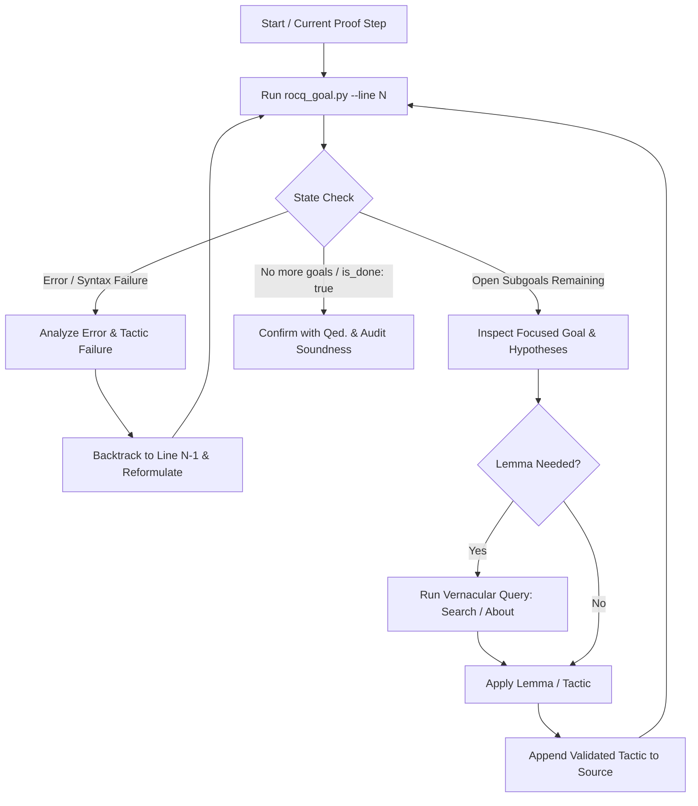

# Interactive Proving Workflow Protocol

This reference provides the operational discipline and step-by-step procedures for interactively driving the Rocq (formerly Coq) proof engine using **Pure Vanilla Ltac**.

---

## 1. The Standard Step-by-Step Proof Cycle

Autonomous proving in Rocq relies on tight, incremental feedback between tactic generation and proof state verification. Never generate full proofs blindly without validating intermediate proof states.



### Execution Protocol

1. **Inspect Proof State**: Query the current goal using `rocq_goal.py --file <file.v> --line <line>` before introducing new tactics.
2. **Select Single Tactic Unit**: Apply exactly one logical tactic step (or a small atomic idiom like `inversion H; subst; clear H.`).
3. **Validate Resulting Goal**: Re-run `rocq_goal.py` at the updated line to verify that:
   - The tactic executed without errors.
   - The target was either discharged or decomposed into manageable subgoals.
   - No unwanted existential variables (`?X`) or shelved goals were introduced.
4. **Advance Incrementally**: Commit the line to the proof script only after observing the resulting goal state.

---

## 2. Strict Bullet Disciplines and Nesting

Bullets (`-`, `+`, `*`, `--`, `++`, `**`) enforce proof structure by structuring branching proofs (such as cases from `destruct`, `induction`, or `split`).

### Golden Rules for Bullets

1. **Never Append Periods to Bullets**: Bullets are independent lexer tokens, NOT vernacular commands. Writing `-.` or `+.` causes immediate syntax errors:
   - ❌ **Broken**: `-. reflexivity.`
   - ✅ **Correct**: `- reflexivity.`
2. **Strict Hierarchy Ordering**: Do not mix bullet types at the same indentation level. Use the standard ascending hierarchy:
   - Level 1: `-`
   - Level 2: `+`
   - Level 3: `*`
   - Level 4: `--`
   - Level 5: `++`
   - Level 6: `**`
3. **Complete Open Subproofs Before Next Bullet**: You cannot switch to another branch until the current focused branch is fully solved or structured. Attempting to start the next branch triggers:
   ```text
   Wrong bullet +: Current bullet - is not finished.
   ```

### Well-Structured Example

```coq
Theorem add_comm : forall n m : nat, n + m = m + n.
Proof.
  intros n m.
  induction n as [| n' IHn'].
  - (* Base case: n = 0 *)
    simpl.
    rewrite <- plus_n_O.
    reflexivity.
  - (* Inductive step: n = S n' *)
    simpl.
    rewrite IHn'.
    rewrite Nat.add_succ_r.
    reflexivity.
Qed.
```

---

## 3. Scoping Focus Braces (`{ ... }`) for Goal Isolation

Curly braces `{ ... }` focus entirely on the first subgoal, hiding all other subgoals and hypotheses from other branches until the enclosed subproof is completed with closing `}`.

### When to Use Braces

- **Complex Subgoals**: When a branch requires more than 5-10 lines of non-trivial reasoning, wrap it in `{ ... }` to prevent context clutter.
- **Deep Nesting**: When nested induction produces more than 3 levels of branching, braces provide cleaner isolation than repeated multi-character bullets (`--`, `++`).
- **Intermediate Assertions**: When asserting a cut lemma (`assert (H : P)`), use braces to isolate the local proof:
  ```coq
  assert (H : x <= y).
  {
    apply Nat.le_trans with (m := z).
    - exact Hxz.
    - exact Hzy.
  }
  ```

### Rules for Braces

- Like bullets, braces `{` and `}` are delimiters and do **not** take trailing periods (never write `{.` or `}.`).
- The closing brace `}` must only be placed when all subgoals generated inside the brace are completely discharged (`No more goals`). Placing `}` prematurely causes `This subproof is complete, but there are some unfocused goals.` or `No more goals, but there are some unfocused subgoals`.

---

## 4. Recovery Protocols from `Wrong bullet` and Subgoal Mismatch

When Rocq encounters a bullet error or unexpected subgoals, follow this deterministic recovery protocol.

### Scenario A: `Wrong bullet [b2]: Current bullet [b1] is not finished.`

1. **Root Cause**: The tactics preceding the new bullet did not completely solve the current focused goal.
2. **Diagnosis**: Run `rocq_goal.py` at the line immediately before the failing bullet to see what subgoals remain open.
3. **Recovery Steps**:
   - **Case 1 (Trivial leftover)**: If the remaining goal is a simple arithmetic equality or hypothesis match, add `reflexivity.`, `lia.`, `easy.`, or `assumption.` before the next bullet.
   - **Case 2 (Unexpected branch)**: If the previous tactic generated multiple branches (e.g., `destruct` inside the branch), structure those nested branches with the next-level bullet (`+`) or enclose the inner proof in `{ ... }`.
   - **Never Cheat**: Do NOT insert `admit.` or `give_up.` to bypass the bullet mismatch.

### Scenario B: `No more subgoals but current bullet is not finished.`

1. **Root Cause**: A tactic (such as `lia.` or `auto.`) solved both the current goal and following subgoals at once, leaving the bullet with nothing to focus on.
2. **Recovery**: Remove the redundant bullet or collapse the branch handling using tactical combinators (e.g., `; try lia.`).

---

## 5. Proof Termination Sequence (`Qed.` / `Defined.`)

A proof is not complete until it has passed the formal termination checkpoint and soundness validation.

### Finalization Steps

1. **Verify Goal Clearance**: Ensure `rocq_goal.py` reports `is_done: true` and `subgoal_count: 0`.
2. **Place Delimiter on Standalone Line**:
   - Use `Qed.` for standard opaque theorems and propositions (`Prop`).
   - Use `Defined.` only for transparent computational definitions (`Type` or `Set`) whose bodies must compute via `simpl` or `vm_compute`.
   - Never write tactics on the same line as `Qed.` (e.g., `reflexivity. Qed.` is forbidden by syntax style).
3. **Soundness Audit (Verification Gate Tier 3)**:
   Immediately after closing a theorem with `Qed.`, verify that the proof is free of unapproved axioms using `scripts/audit_axioms.py` from `rocq-ltac-cli`:
   ```bash
   python3 skills/rocq-ltac-cli/scripts/audit_axioms.py --module <Logical.Path> --theorem <TheoremName>
   ```
   A valid proof must yield `Axioms: <none>` or depend only on whitelisted foundational axioms.
