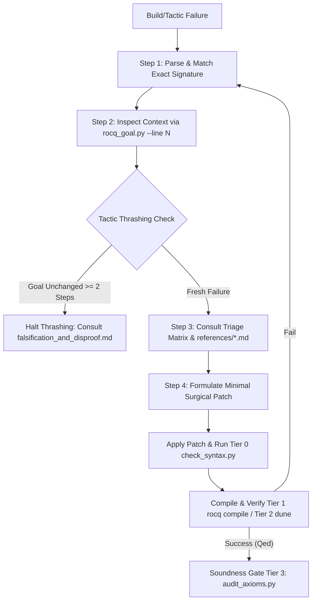

# Rocq Ltac Proof Repair & Error Triage

This skill provides a deterministic 4-step repair protocol, an implementation-grounded error triage matrix, and specialized domain prescriptions for diagnosing and repairing broken proofs in Rocq (formerly Coq) using **Pure Vanilla Ltac**.

Autonomous theorem proving agents must never engage in blind trial-and-error or speculative tactic thrashing. When a vernacular command, tactic, or elaboration step fails, follow this protocol to isolate the exact compiler error signature, inspect the active proof state, consult the corresponding domain reference, and apply a surgical, minimally invasive patch while strictly preserving the theorem signature and kernel soundness.

---

## 0. Environment & Version Compatibility

| Component            | Target / Supported              | Notes                                                                                        |
| :------------------- | :------------------------------ | :------------------------------------------------------------------------------------------- |
| **Rocq Prover**      | `9.0+` (Default target)         | Uses unified `rocq` CLI, `From Corelib` / `From Stdlib Require Import ...`.                  |
| **Coq (Legacy)**     | `8.20` (Compatibility baseline) | Uses `From Coq Require Import ...`. Versions $\le 8.17$ are unsupported.                     |
| **Language Dialect** | **Pure Vanilla Ltac 100%**      | **SSReflect/MathComp syntax is strictly prohibited.** Dynamic Ltac2 generation is forbidden. |
| **Diagnostics Tool** | `parse_diagnostics.py`          | Provided by `rocq-ltac-cli` (`scripts/parse_diagnostics.py`) to parse build logs into JSON.  |
| **REPL Goal Tool**   | `rocq_goal.py`                  | Provided by `rocq-ltac-interactive-proof` (`scripts/rocq_goal.py`) to inspect subgoals.      |
| **Soundness Gate**   | `audit_axioms.py`               | Provided by `rocq-ltac-cli` (`scripts/audit_axioms.py`) to verify `Print Assumptions`.       |

---

## 1. Deterministic 4-Step Repair Protocol



### Step 1: Parse & Match Error Signature

1. Run the build or extract the compiler error log via [`scripts/parse_diagnostics.py`](../rocq-ltac-cli/scripts/parse_diagnostics.py) in `rocq-ltac-cli`.
2. Extract:
   - The failing source file and exact line number ($N$).
   - The exact raw compiler error message and normalized error code.
3. Match against the **Core Triage Matrix** (Section 2).
   - In `Unable to unify "actual" with "expected".`, the left term is the term/lemma conclusion supplied by the tactic, while the right term is the active goal/expected type. Do not invert their polarity.
   - In `Found no subterm matching ... in ...`, the failure is purely syntactic; definitions in the target have not been unfolded to expose the pattern.
   - In `The reference ... was not found`, the identifier is unquoted; check missing imports or unopened notation scopes.

### Step 2: Context & Goal State Inspection

Before editing, query the exact proof state immediately prior to the failing command:

```bash
python3 skills/rocq-ltac-interactive-proof/scripts/rocq_goal.py --file <file.v> --line <N-1> --json
```

Examine:

- **Focused Target**: What term or equality must be established?
- **Hypotheses & Binders**: Are definitions transparent or folded? Are inductive indices specialized or abstracted?
- **Subgoal Stack**: Are sibling branches waiting? What is the current bullet level?

### Step 3: Reference Consultation

Read the specialized reference document mapped to the diagnosed category in `references/`:

- Do not guess speculative tactics.
- Apply the implementation-grounded Before / After prescription patterns.

### Step 4: Minimal Invasive Patching & Verification Ladder

1. **Surgical Patch**: Replace only the failing tactic or focused subproof block. Keep surrounding proofs intact.
2. **Tier 0 Syntax Gate**: Run `check_syntax.py` to ensure no dialect mixing, missing periods, or syntax errors were introduced.
3. **Tier 1 Fast File Gate**: Recompile the single file (`rocq compile -color no <file.v>` or `coqc`).
4. **Tier 3 Soundness Gate**: When `Qed` is reached, verify soundness using `audit_axioms.py` to ensure no unapproved axioms (e.g., Axiom K / `Eqdep.Eq_rect_eq.eq_rect_eq`) or `Admitted` proofs exist.

---

## 2. Core Triage Matrix

| Compiler Error Pattern (Regex)                                                                                           | Category            | Root Cause & Implementation Context                                                               | Immediate Vanilla Ltac Action                                                                     | Specialized Reference                                                                  |
| :----------------------------------------------------------------------------------------------------------------------- | :------------------ | :------------------------------------------------------------------------------------------------ | :------------------------------------------------------------------------------------------------ | :------------------------------------------------------------------------------------- |
| `^Unable to unify "(?P<actual>[\s\S]+)" with "(?P<expected>[\s\S]+)"`                                                    | Unification         | Definitional mismatch ($\beta\iota\zeta\delta$-reduction required); `Prop` vs `bool` confusion    | Run `cbn`, `unfold def in *`, `change`, or bridge via reflection lemma (`apply Nat.eqb_eq in H`)  | [`references/unification_and_types.md`](references/unification_and_types.md)           |
| `^The term "(?P<term>[\s\S]+)" has type "(?P<actual>[\s\S]+)" while it is expected to have type "(?P<expected>[\s\S]+)"` | Type Mismatch       | Mismatched sorts; failed implicit argument synthesis                                              | Explicitly supply type arguments with `@lemma` or cast using constructor reflection               | [`references/unification_and_types.md`](references/unification_and_types.md)           |
| `^Found no subterm matching "(?P<pat>[\s\S]+)" in (?P<target>the current goal\|[\s\S]+)`                                 | Rewrite Failure     | Subterm not syntactically or definitionally exposed in target                                     | `unfold` target symbols; use `setoid_rewrite`, or `change` / `replace` to expose matching redex   | [`references/unification_and_types.md`](references/unification_and_types.md)           |
| `^Cannot find a relation to rewrite`                                                                                     | Setoid Rewrite      | Equivalence relation (e.g., `Permutation`) missing `Proper` morphism instance under context       | Bridge via transitivity (`apply Permutation_trans with ...`) or constructor step (`perm_skip`)    | [`references/tactic_failures.md`](references/tactic_failures.md)                       |
| `^Cannot solve a goal with existential variables`                                                                        | Unresolved Evars    | `eapply` or `eauto` left intermediate witness (e.g. typing domain `?T`) unresolved at `Qed`       | Explicitly provide intermediate witnesses (`eapply Lemma with (var := val)`) or `instantiate`     | [`references/tactic_failures.md`](references/tactic_failures.md)                       |
| Goal term explodes into unreadable nested `match` clauses                                                                | Simplification      | Unconditional `simpl` unrolled recursive accumulator or fuel function aggressively                | Replace `simpl` with `cbn [fn]` or prove an explicit unroll lemma and rewrite                     | [`references/tactic_failures.md`](references/tactic_failures.md)                       |
| `^Cannot guess decreasing argument of fix`                                                                               | Termination         | Guard checker cannot find an inductive argument decreasing in all branches                        | Add explicit `{struct arg}` annotation; inspect left-to-right parameter scan order                | [`references/termination_and_wf.md`](references/termination_and_wf.md)                 |
| `^Recursive call to "(?P<fn>[^"]+)" has argument "(?P<arg>[^"]+)" which is not structurally smaller`                     | Termination         | Argument modified by function (`div`, `tail`, `fst`) before recursive call; not immediate subterm | Switch to well-founded recursion via `Program Fixpoint ... {measure ...}` or fuel parameter       | [`references/termination_and_wf.md`](references/termination_and_wf.md)                 |
| Context cluttered with `H0, H1, H2...` after `inversion`                                                                 | Inversion Explosion | Bare `inversion H.` derives redundant index equalities and pollutes context                       | Use `inversion H as [...]` or atomic pipeline `inversion H; subst; clear H.`                      | [`references/inversion_and_equality.md`](references/inversion_and_equality.md)         |
| `dependent destruction` introduced Axiom K                                                                               | Axiom Contamination | Dependent inversion quietly introduced `Eqdep.Eq_rect_eq.eq_rect_eq`                              | Replace with `remember ... as x eqn:E` + `revert` + `induction`, or `inj_pair2_eq_dec`            | [`references/inversion_and_equality.md`](references/inversion_and_equality.md)         |
| Induction on indexed type lost index values                                                                              | Induction Drift     | Applying `induction` directly on indexed inductive relations abstracts indices                    | Apply `remember <term> as x eqn:Heqx` and `revert` dependent variables before `induction`         | [`references/induction_and_remember.md`](references/induction_and_remember.md)         |
| Induction hypothesis too weak (variables fixed prematurely)                                                              | Weak IH             | Variables introduced via `intros` before `induction` became fixed in the generated IH             | Revert/generalize dependent variables (`generalize dependent x`) before `induction`               | [`references/induction_and_remember.md`](references/induction_and_remember.md)         |
| `^Cannot solve goal with lia`                                                                                            | Arithmetic Failure  | Natural number underflow (`a - b = 0`), $2^k$ case split blowup from `Z.max`, or non-linear terms | Case split on underflow (`destruct (Nat.le_gt_cases a b)`), run `zify` and manual split, or `nia` | [`references/tactic_failures.md`](references/tactic_failures.md)                       |
| `congruence failed` / `tauto failed`                                                                                     | Tactic Failure      | Constructor distinctness masked by definitions; unexpanded logical connectives                    | Use `destruct ... eqn:...`, `discriminate`, or `injection ... as ...`                             | [`references/tactic_failures.md`](references/tactic_failures.md)                       |
| `No matching clauses for match goal`                                                                                     | Ltac Automation     | Custom automation macro (`solve_by_inverts`, `bdestruct`) encountered unmatched goal form         | Increase search depth, check missing premises in context, or add fallback `\| _ => idtac`         | [`references/tactic_failures.md`](references/tactic_failures.md)                       |
| `^The reference (?P<ident>[a-zA-Z0-9_'.]+) was not found in the current environment`                                     | Namespace & Scope   | Rocq 9.0+ split (`Corelib`/`Stdlib`); missing `Require Import`; missing scope                     | Use `From Stdlib Require Import ...`; open required scope (`Open Scope Z_scope.`)                 | [`references/namespace_and_imports.md`](references/namespace_and_imports.md)           |
| `^Universe inconsistency: Cannot enforce (?P<c1>[^\s]+) <= (?P<c2>[^\s]+)`                                               | Universe            | Positive cycle in universe constraint graph; predicative `Set` self-reference                     | Promote sort to `Type`, declare `#[universes(polymorphic)]`, or stratify data representation      | [`references/universe_inconsistencies.md`](references/universe_inconsistencies.md)     |
| `^Wrong bullet (?P<got>[^\s:]+): Bullet (?P<expected>[^\s]+) is mandatory here`                                          | Bullet Depth        | Subgoal stack desynchronization; wrong bullet character or length                                 | Replace `<got>` bullet with exact `<expected>` bullet printed by the compiler                     | [`references/bullet_and_focus.md`](references/bullet_and_focus.md)                     |
| `^Wrong bullet (?P<got>[^\s:]+): Current bullet (?P<current>[^\s]+) is not finished`                                     | Bullet Unfinished   | Preceding sibling subgoal has unresolved goals                                                    | Close the preceding subgoal completely before introducing the next sibling bullet                 | [`references/bullet_and_focus.md`](references/bullet_and_focus.md)                     |
| `^Wrong bullet (?P<got>[^\s:]+): No more subgoals`                                                                       | Bullet Excess       | All subgoals at the current focus level are already closed                                        | Remove the excess bullet or conclude proof with `Qed.`                                            | [`references/bullet_and_focus.md`](references/bullet_and_focus.md)                     |
| Same goal persists after 2 consecutive edits                                                                             | Tactic Thrashing    | Agent trapped in trial-and-error; goal might be logically unprovable (false)                      | **HALT edits immediately.** Trigger the 3-phase Falsification Protocol                            | [`references/falsification_and_disproof.md`](references/falsification_and_disproof.md) |

---

## 3. Strict Soundness Invariants & Anti-Cheating Gates

1. **Header Fence Immutability (Zero Goal Drift)**:
   - The theorem signature, premise sequence, argument names, and return type MUST NOT be altered under any circumstances.
   - Inserting `False ->`, trivializing the conclusion to `True`, or adding ad-hoc hypothesis assumptions constitutes fatal Goal Drift and is rejected by the Tier 0 checker.
2. **Zero Cheat Tactics**:
   - `admit`, `Admitted.`, `give_up`, and placeholder macros like `FILL_IN_HERE` are strictly forbidden in final code.
   - Introducing external `Axiom` or `Parameter` declarations to bypass intermediate lemmas is prohibited.
3. **Pure Vanilla Ltac (Zero Dialect Contamination)**:
   - Never introduce SSReflect syntax (`move=>`, `by []`, `have:`, `//`, `congr`) or dynamic Ltac2 expressions during repair. All repair patches must be 100% Vanilla Ltac.
4. **Tactic Thrashing Budget (Max 2 Attempts)**:
   - If two consecutive tactic modifications produce the identical goal state (hypotheses and conclusion fingerprint unchanged), the agent must stop guessing tactics.
   - Check if an intermediate helper lemma is false using concrete execution (`Compute`) or refutation before spending further tokens.
5. **Kernel Soundness Audit (Tier 3 Gate)**:
   - Every completed repair must be validated with `audit_axioms.py` (`Print Assumptions <Thm>`).
   - The proof must resolve to `Closed under the global context` (or only approved project axioms such as `functional_extensionality_dep`). Any detection of `Eqdep.Eq_rect_eq.eq_rect_eq` (Axiom K) from careless dependent inversion causes immediate rejection.

---

## 4. Specialized Reference Guides

Consult these dedicated documents for detailed explanations, failure mechanisms, and full Before / After examples:

- [`references/unification_and_types.md`](references/unification_and_types.md): Resolving definitional mismatches, $\beta\iota\zeta\delta$-reduction (`cbn`, `unfold`, `change`), `bool` vs `Prop` reflection, and implicit arguments (`@lemma`).
- [`references/induction_and_remember.md`](references/induction_and_remember.md): Preventing index loss on inductive relations with `remember ... as x eqn:Heqx`, preventing prematurely specialized induction hypotheses (`generalize dependent`), choosing primary induction subjects in multi-relation systems (e.g. subject reduction), and handling mutual induction schemes.
- [`references/inversion_and_equality.md`](references/inversion_and_equality.md): Preventing context explosion (`inversion; subst; clear`), automating contradiction rejection (`solve_by_inverts`), handling boolean reflection specs (`reflect` / `destruct eqn:`), controlled rewriting in environment updates, and avoiding Axiom K from `dependent destruction`.
- [`references/termination_and_wf.md`](references/termination_and_wf.md): Resolving guard checker failures, `{struct}` annotations, structural subterms, and `Program Fixpoint` with `measure`.
- [`references/tactic_failures.md`](references/tactic_failures.md): Fixing `lia` arithmetic failures on `nat` subtraction and $Z.max$ case splits, taming `simpl` unrolling blowup with `cbn [fn]`, preventing unresolved existential variables in `eauto`, resolving setoid rewrite failures on equivalence relations (e.g., `Permutation`), exposing hidden invariants for `lia`, and Ltac `match goal` failure levels.
- [`references/namespace_and_imports.md`](references/namespace_and_imports.md): Migrating namespaces from `Coq` to `Stdlib` in Rocq 9.0+, managing notation scopes (`Z_scope`), and resolving undefined identifiers.
- [`references/falsification_and_disproof.md`](references/falsification_and_disproof.md): Breaking tactic thrashing loops through 3-phase falsification: `Compute` boundary testing, explicit refutation (`Lemma counter : ~ Target`), and precondition strengthening.
- [`references/universe_inconsistencies.md`](references/universe_inconsistencies.md): Diagnosing `Universe inconsistency`, constraint graph positive cycles, `#[universes(polymorphic)]` attributes, and level stratification.
- [`references/bullet_and_focus.md`](references/bullet_and_focus.md): Fixing `Wrong bullet` errors (`mandatory here`, `not finished`, `No more subgoals`), bullet repetition rules, and isolating branches with `{ ... }` blocks.
