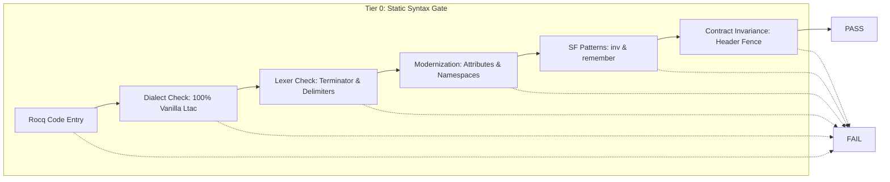
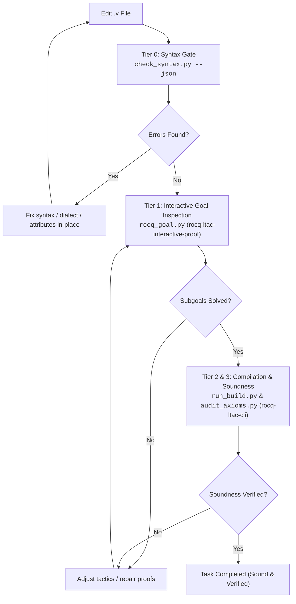

# Rocq Ltac Syntax & Discipline Guide

This skill provides the definitive syntax specification, lexical disciplines, and an automated static verification tool (`scripts/check_syntax.py`) for formal software verification, programming language semantics, and type systems in Rocq (formerly Coq) using **Pure Vanilla Ltac**.

In Rocq, lexical analysis, vernacular commands, and tactic execution are tightly coupled. Lexical errors (such as missing whitespace after period terminators, misplaced dots on focus bullets, unclosed comments or strings, unclosed pattern matches, or dialect mixing) abort compilation before the proof engine can inspect proof goals. Adhere strictly to this specification to produce syntactically robust, modern, and mechanically sound Rocq code.

---

## 0. Environment & Version Compatibility

| Component            | Target / Supported              | Notes                                                                                        |
| :------------------- | :------------------------------ | :------------------------------------------------------------------------------------------- |
| **Rocq Prover**      | `9.0+` (Default target)         | Uses `From Corelib` / `From Stdlib Require Import ...` and unified `rocq` CLI.               |
| **Coq (Legacy)**     | `8.20` (Compatibility baseline) | Uses `From Coq Require Import ...`. Versions $\le 8.17$ are unsupported.                     |
| **Language Dialect** | **Pure Vanilla Ltac 100%**      | **SSReflect/MathComp syntax is strictly prohibited.** Ltac2 dynamic generation is forbidden. |
| **Python**           | `>= 3.10`                       | Standard library only (`re`, `json`, `sys`, `pathlib`, `argparse`). No third-party packages. |

### Critical Version-Specific Adjustments (Rocq 9.0+)

- **Namespace Migration (`Corelib` / `Stdlib` vs `Coq`)**: In Rocq 9.0+, standard libraries are split and reorganized. Foundational prelude items reside in `Corelib`, while general standard libraries reside in `Stdlib`. Writing `From Coq` triggers `deprecated-from-Coq` warnings or errors. In legacy Coq 8.20, `From Stdlib` fails to resolve; manage logical paths via `_CoqProject`.
- **Environment Variables**: `COQPATH` is deprecated in favor of `ROCQPATH`.
- **Bracketed Attribute Syntax (`#[...]`)**: Attribute syntax is strictly standardized. Bare modifier prefixes (`Local Definition`, `Global Hint`, `Export Instance`) are deprecated. Always use explicit bracketed attributes: `#[local]`, `#[global]`, `#[export]`, or `#[deprecated(...)]`.
- **Universe Polymorphism Syntax**: The legacy syntax `Type@{s;l}` triggers `deprecated-type-sort-poly-syntax`. Modern Rocq 9.0+ requires `Univ@{s;l}`.
- **Removed Tactics**: The legacy decision procedures `omega`, `romega`, and `sos` are completely removed. Always import `Lia` and use `lia.` (or `nia.` for non-linear integer arithmetic, pairing with `zify` when necessary).
- **Proof Delimiters**: Always place `Proof.`, `Qed.`, `Defined.`, and `Abort.` on dedicated standalone lines. Never concatenate tactics onto the same line as `Proof.`.

---

## 1. Absolute Syntax Disciplines (Zero Tolerance)



### 1.1. Pure Vanilla Ltac 100% (No SSReflect Contamination)

Rocq verification code must be written strictly in Vanilla Ltac. SSReflect tokens (`move=>`, `by []`, `have:`, `//`, `congr`) without importing `ssreflect` cause immediate fatal parser crashes (`Syntax error: [ident] expected`).

| **Operation**                | **❌ FORBIDDEN (SSReflect)** | **✅ MANDATORY (Vanilla Ltac)**        | **Rationale**                                |
| ---------------------------- | ---------------------------- | -------------------------------------- | -------------------------------------------- |
| **Hypothesis Introduction**  | `move=> x y H.`              | `intros x y H.`                        | Moves binders into local context.            |
| **Destructuring Intro**      | `move=> [x [y H]].`          | `intros [x [y H]].`                    | Pattern-matches conjunctions/existentials.   |
| **Terminal Discharge**       | `by [].` / `done.`           | `now auto.` / `reflexivity.` / `easy.` | Solves trivial goals immediately.            |
| **Forward Assertion**        | `have H: P by ...`           | `assert (H : P) by ...`                | Introduces an intermediate assertion.        |
| **Backward Sufficiency**     | `suff: P by ...`             | `enough (H : P) by ...`                | Proves target via stronger prerequisite.     |
| **Branch Trivial Discharge** | `//`                         | `; try easy.` / `; auto.`              | Solves side goals across branches.           |
| **Simplification**           | `/=`                         | `simpl.` / `cbn.`                      | Computes definitional reductions.            |
| **Outer Congruence**         | `congr f.`                   | `f_equal.`                             | Strips identical outermost function symbols. |
| **Inductive Step**           | `elim: n => [\| n' IH].`     | `induction n as [\| n' IH].`           | Applies structural induction.                |
| **Reverting to Target**      | `move: x.`                   | `revert x.`                            | Pushes hypothesis back into target formula.  |

### 1.2. Lexer Specifications: Sentence Terminators, Comments & Strings

#### A. Sentence Terminator (`.` followed by whitespace or EOF)

A period is recognized as a command/tactic terminator **if and only if it is immediately followed by whitespace ( , `\t`, `\n`, `\r`) or EOF**.

- ❌ **Broken**: `intros x.induction x.` (Parsed as single invalid token `x.induction`)
- ❌ **Broken**: `Theorem foo : 1 = 1.Proof.` (Parsed as invalid identifier `1.Proof`)
- ✅ **Correct**: `intros x. induction x.` or separated across lines.
- **Exceptions**: Periods in qualified identifiers (`Module.submodule`, `Record.field`), decimal numbers, or inside strings/comments do not terminate sentences.

#### B. Recursive Comment Nesting (`(* ... *)`)

Comments are delimited by `(*` and `*)` and support **arbitrary recursive nesting**.

- Opening `(*` increments depth; closing `*)` decrements depth.
- Unterminated comments (unmatched `(*` reaching EOF) trigger `Syntax Error: Lexer: Unterminated comment`.

#### C. String Literals & Escaping (`"..."`)

Strings are enclosed in double quotes `"..."` and can span multiple lines.

- Double quotes inside strings are escaped by **doubling them (`""`)**, NOT by backslash (`\"`).
- Unclosed strings reaching EOF trigger `Syntax Error: Lexer: Unterminated string`.

### 1.3. Focus Bullet Disciplines (`-`, `+`, `*`)

Bullets structure branching proofs. They are proof-engine selectors, not vernacular sentences.

- ❌ **Broken**: Placing a period immediately after a bullet: `-. reflexivity.` or `+. lia.`
- ❌ **Broken**: Declaring a sibling bullet before the current branch is closed (`Error: Wrong bullet -: Current bullet - is not finished.`).
- ✅ **Correct**: Bare bullets `-`, `+`, `*`, `--`, `++`, `**`.
- For deep branch hierarchies (> 3 levels), wrap subgoals in explicit curly braces `{ ... }` without trailing dots.

### 1.4. Modernization: Attributes, Namespaces & Tactics

- **Bracketed Attributes**: Always declare locality via `#[local]`, `#[global]`, or `#[export]`.
  - ❌ **Deprecated**: `Local Hint Resolve foo : core.` / `Global Instance bar : Baz.`
  - ✅ **Mandatory**: `#[local] Hint Resolve foo : core.` / `#[global] Instance bar : Baz.`
- **Modern Namespaces**:
  - ❌ **Deprecated (Rocq 9.0+)**: `From Coq Require Import Arith.`
  - ✅ **Mandatory (Rocq 9.0+)**: `From Stdlib Require Import Arith.`
  - ✅ **Foundational Modules**: `From Corelib Require Import ...`
- **Eliminate Legacy Tactics**:
  - ❌ **Removed**: `omega`, `romega`, `sos`.
  - ✅ **Mandatory**: `lia.` (linear integer arithmetic) or `nia.` (non-linear integer arithmetic).

### 1.5. Software Foundations Idioms: Destruction Macro & Inductive Hygiene

To prevent context pollution and lost hypotheses during proofs:

#### A. Standard Destructive Inversion Macro (`inv`)

Executing bare `inversion H.` floods the local environment with redundant variables, equalities, and stale hypotheses.

- Standardize the CompCert / Software Foundations destruction macro:
  ```Coq
  Ltac inv H := inversion H; subst; clear H.
  ```
- ❌ **Forbidden**: Bare `inversion H.` without immediate substitution and cleanup.
- ✅ **Mandatory**: Use `inv H.` (or `inversion H; subst; clear H.`).

#### B. Inductive Index Protection (`remember ... as ... eqn:...`)

When applying induction to an inductive predicate whose arguments contain compound terms or constants (e.g., `empty |- t \in T` or `step (t_app t1 t2) t'`), direct `induction` loses structural index equality.

- ❌ **Forbidden**: Direct `induction H.` when indices contain compound expressions.
- ✅ **Mandatory**: Bind compound terms with `remember <term> as <var> eqn:<Heq>` and `revert` / `generalize dependent` free parameters before calling `induction`.

#### C. Structural Pairing

- **`match ... with ... end`**: Every Gallina pattern-match and Ltac `match goal with` must be closed with an explicit `end`.
- **`Fixpoint` Decreasing Arguments**: Always supply `{struct <arg>}` when recursive functions have multiple arguments to prevent `Cannot guess decreasing argument of fix`.
- **Mode Isolation**: Never embed Ltac tactics inside Gallina term definitions (`:=`). Program definitions use Gallina expressions; lemmas and theorems use `Proof. ... Qed.`.

## 2. Contract Invariance (Header Fence) & Soundness

To ensure mechanical rigor and eliminate AI proof hallucination or specification weakening (Reward Hacking), adhere strictly to these rules:

1. **Header Fence (Goal Drift Prohibition)**:
   - The entire theorem header—from the declaration keyword (`Theorem`, `Lemma`, `Corollary`, `Proposition`, `Fact`, `Remark`) up to the colon `:` and the closing period `.` before `Proof.`—is an **immutable contract**.
   - NEVER alter binders, inject contradictory premises (e.g., `False ->`), alter return types, or rename declarations.
2. **Docstring Immutability**:
   - Specification comments (`(** [SPEC] ... *)`) are frozen. Never edit, delete, or relocate them.
3. **Soundness Leaks**:
   - `admit.` and `Admitted.` are strictly forbidden in final deliverables.
   - Introducing unapproved `Axiom`, `Conjecture`, or `Parameter` declarations is treated as an immediate soundness failure.

## 3. Fast Static Syntax Checker (`scripts/check_syntax.py`)

The skill bundles `scripts/check_syntax.py`, a zero-dependency script relying exclusively on the Python standard library. It performs robust Tier 0 linting before invoking heavy compiler binaries.

> **Script Path Resolution Note**:
> The bundled linter resides at `skills/rocq-ltac-syntax/scripts/check_syntax.py` (or `.roo/skills/rocq-ltac-syntax/scripts/check_syntax.py`).
> If not symlinked to the project root `scripts/`, invoke it directly via its relative skill path (e.g., `python3 skills/rocq-ltac-syntax/scripts/check_syntax.py <file.v>`) or symlink it: `mkdir -p scripts && ln -sf ../skills/rocq-ltac-syntax/scripts/check_syntax.py scripts/check_syntax.py`.

### 3.1. Lexical Sanitization Algorithm

To eliminate false positives, `check_syntax.py` executes a two-pass sanitization:

1. **String Masking**: Replaces double-quoted strings (`"(?:""|[^"])*"`) with spaces while preserving linebreaks. Unclosed strings raise `LEXER_UNTERMINATED_STRING`.
2. **Comment Masking**: Tracks recursive comment depth `(* ... *)` with a stack counter, converting all enclosed characters to spaces while maintaining exact line and column indices. Unclosed comments raise `LEXER_UNTERMINATED_COMMENT`.
3. **Sentence Tokenization**: Splits sentences using `SENTENCE_TERMINATOR_RE = re.compile(r'\.(\s|$)')` over the sanitized buffer (handling `' '`, `\t`, `\n`, `\r`, and EOF).

### 3.2. CLI Usage

```Bash
# Check a single Rocq source file
python3 skills/rocq-ltac-syntax/scripts/check_syntax.py theories/Semantics.v

# Read source code from standard input (pipeline mode)
cat theories/Semantics.v | python3 skills/rocq-ltac-syntax/scripts/check_syntax.py --stdin

# Verify an inline snippet directly
python3 skills/rocq-ltac-syntax/scripts/check_syntax.py -s "Theorem foo : 1 = 1. Proof. reflexivity. Qed."

# Output structured JSON for autonomous agent pipelines
python3 skills/rocq-ltac-syntax/scripts/check_syntax.py theories/Semantics.v --json

# Strict submission mode (rejects any temporary 'admit' tactics)
python3 skills/rocq-ltac-syntax/scripts/check_syntax.py theories/Semantics.v --strict --json
```

### 3.3. Static Rule Catalog

| **Rule ID**                  | **Severity**      | **Description & Target Pattern**                                                                           |
| ---------------------------- | ----------------- | ---------------------------------------------------------------------------------------------------------- |
| `FORBIDDEN_SSREFLECT`        | `error`           | SSReflect syntax detected (`move=>`, `by []`, `have:`, `suff:`, `//`, `congr`).                            |
| `SYNTAX_PERIOD_NO_SPACE`     | `error`           | Sentence terminator period missing trailing space, tab, newline, or EOF.                                   |
| `SYNTAX_INVALID_BULLET_DOT`  | `error`           | Focus bullet directly attached to a period (`-.`, `+.`, `*.`).                                             |
| `LEXER_UNTERMINATED_COMMENT` | `error`           | Unmatched `(*` reaching EOF without closing `*)`.                                                          |
| `LEXER_UNTERMINATED_STRING`  | `error`           | String literal missing closing quote `"` at EOF.                                                           |
| `BLOCK_MISMATCH_MATCH_END`   | `error`           | Count mismatch between `match` and `end` keywords.                                                         |
| `BLOCK_MISMATCH_SECTION`     | `error`           | Mismatch between `Section <name>` and `End <name>` identifiers.                                            |
| `DEPRECATED_TACTICS`         | `error`           | Deprecated tactic (`omega`, `romega`, `sos`). Replace with `lia` or `nia`.                                 |
| `DEPRECATED_BARE_ATTRIBUTES` | `warning`         | Legacy attribute prefix (e.g., `Local Hint`, `Global Instance`). Use `#[local]`, `#[global]`, `#[export]`. |
| `LEGACY_NAMESPACE`           | `warning`         | Legacy `From Coq` imported. In Rocq 9.0+, use `From Corelib` or `From Stdlib`.                             |
| `DEPRECATED_UNIV_SYNTAX`     | `warning`         | Legacy universe syntax `Type@{...}`. Use `Univ@{...}`.                                                     |
| `LINT_BARE_INVERSION`        | `warning`         | Bare `inversion H.` detected. Use `inv H.` or `inversion H; subst; clear H.`                               |
| `SOUNDNESS_AXIOM_DETECTED`   | `error`           | Unapproved `Axiom`, `Conjecture`, or `Parameter` declared.                                                 |
| `SOUNDNESS_ADMIT_DETECTED`   | `error`/`warning` | Residual `admit.` or `Admitted.` (Always fatal under `--strict`).                                          |

### 3.4. Structured JSON Output Schema

```JSON
{
  "file": "theories/Semantics.v",
  "status": "fail",
  "error_count": 2,
  "warning_count": 2,
  "diagnostics": [
    {
      "line": 15,
      "column": 1,
      "rule": "LEGACY_NAMESPACE",
      "severity": "warning",
      "message": "Use of 'From Coq' is deprecated. In Rocq 9.0+, use 'From Corelib' or 'From Stdlib'."
    },
    {
      "line": 42,
      "column": 5,
      "rule": "SYNTAX_INVALID_BULLET_DOT",
      "severity": "error",
      "message": "Focus bullet must not be followed by a period. Change '-.' to '-'."
    },
    {
      "line": 65,
      "column": 3,
      "rule": "LINT_BARE_INVERSION",
      "severity": "warning",
      "message": "Bare 'inversion H.' causes context pollution. Use 'inv H.' (inversion H; subst; clear H)."
    },
    {
      "line": 88,
      "column": 3,
      "rule": "DEPRECATED_TACTICS",
      "severity": "error",
      "message": "Tactic 'omega' was removed in modern Rocq. Use 'lia' instead."
    }
  ]
}
```

## 4. Fast Prover Syntax Checklist

Before running file compilation or sub-goal stepping, verify code against this checklist:

### Stage A: Lexical & Dialect Integrity

- [ ] **Pure Vanilla Ltac**: Zero occurrences of `move=>`, `by []`, `have:`, `suff:`, or `//`.
- [ ] **Terminator Spacing**: Every vernacular statement and Ltac tactic ends with a period followed by whitespace or newline (`.` or `.\n`).
- [ ] **Balanced Delimiters**: All comments `(* ... *)`, string literals `"..."` (escaped via `""`), and `match ... with ... end` blocks are properly closed.
- [ ] **Clean Bullets**: No bullets have trailing periods (`-.`). All branch subgoals are fully closed before starting a sibling bullet.

### Stage B: Modernization & Attribute Rules

- [ ] **Modern Namespaces**: Imports use `From Stdlib Require Import ...` or `From Corelib Require Import ...` (avoiding legacy `From Coq` in Rocq 9.0+).
- [ ] **Bracketed Attributes**: All `Hint`, `Instance`, or locality flags use `#[local]`, `#[global]`, or `#[export]`.
- [ ] **Modern Arithmetic**: All integer linear arithmetic uses `lia.` (no `omega`, `romega`, or `sos`).
- [ ] **Modern Universes**: Any polymorphic universe specification uses `Univ@{...}` instead of `Type@{...}`.

### Stage C: Software Foundations Proof Hygiene

- [ ] **Clean Destruction**: Use `inv H` instead of bare `inversion H` to avoid context pollution.
- [ ] **Protected Induction**: Predicates with compound indices use `remember ... as ... eqn:...` before `induction`.
- [ ] **Decision Automation**: Arithmetic uses `lia.`, uninterpreted equality uses `congruence.`, and proposition logic uses `tauto.` / `intuition.` before falling back to `eauto`.

### Stage D: Contract Invariance & Soundness Gates

- [ ] **Header Fence Intact**: The original lemma/theorem declaration signature before `Proof.` has not been altered (no Goal Drift).
- [ ] **Docstrings Preserved**: Existing `(** [SPEC] ... *)` docstrings are completely untouched.
- [ ] **No Soundness Leaks**: Zero occurrences of `admit.`, `Admitted.`, or unapproved `Axiom` / `Parameter` declarations.

## 5. Verification & Editing Workflow

Always follow this multi-tiered verification sequence:



1. **Draft/Edit**: Apply tactics adhering strictly to Pure Vanilla Ltac rules.
2. **Execute Tier 0 Check**: Run `python3 skills/rocq-ltac-syntax/scripts/check_syntax.py <file.v> --json`. If diagnostics contain errors, repair them immediately without launching compiler processes.
3. **Interactive Step Verification**: Dispatch to `rocq-ltac-interactive-proof` (`rocq_goal.py`) to verify proof state transitions and subgoal discharges.
4. **Build & Soundness Audit**: Run `rocq-ltac-cli` (`run_build.py` and `audit_axioms.py`) to execute full compilation and ensure the theorem is verified under `Closed under the global context`.

## 6. Progressive Reference Guides

When encountering specific syntax traps or migration hurdles, consult the specialized guides under `references/`:

| **Topic**                     | **Key Focus & Techniques**                                                             | **Guide**                                                                   |
| ----------------------------- | -------------------------------------------------------------------------------------- | --------------------------------------------------------------------------- |
| **Gallina & Ltac Grammar**    | Inductive types, records, pattern matching, core forward/backward Ltac tactics         | [syntax_rules.md](./references/syntax_rules.md)                             |
| **Lexical Gotchas & Traps**   | Nested comment invariants, string escapes (`""`), period collisions, bullet structures | [syntax_gotchas.md](./references/syntax_gotchas.md)                         |
| **Rocq 9.0+ Migration**       | `From Stdlib`/`Corelib` mapping, bracketed attributes (`#[...]`), `lia` vs `omega`     | [coq_to_rocq_version_diff.md](./references/coq_to_rocq_version_diff.md)     |
| **Header Fence & Soundness**  | Immutability protocols, Goal Drift prevention, docstring preservation rules            | [header_fence_and_integrity.md](./references/header_fence_and_integrity.md) |
| **SSReflect to Vanilla Ltac** | Comprehensive translation dictionary converting SSReflect tokens to Vanilla Ltac       | [ssreflect_to_vanilla_ltac.md](./references/ssreflect_to_vanilla_ltac.md)   |
