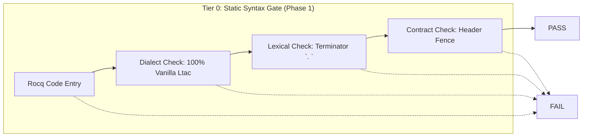
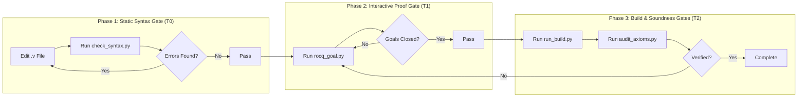

# Rocq Ltac Syntax & Discipline Guide

This skill provides the definitive syntax specification, lexical disciplines, and an automated static verification tool (`scripts/check_syntax.py`) for formal program and semantics verification in Rocq (formerly Coq) using **Pure Vanilla Ltac**.

In Rocq, lexical analysis, vernacular commands, and tactic execution are tightly coupled. Minor syntactic faults—such as missing spaces after periods, misplaced dots on focus bullets, unclosed pattern matches, or dialect mixing—abort compilation before the proof engine can evaluate steps. Adhere strictly to this specification to produce syntactically clean and mechanically sound Rocq code.

---

## 0. Environment & Version Compatibility

| Component            | Target / Supported              | Notes                                                                                        |
| :------------------- | :------------------------------ | :------------------------------------------------------------------------------------------- |
| **Rocq Prover**      | `9.0+` (Default target)         | Uses `From Stdlib Require Import ...` and unified `rocq` CLI.                                |
| **Coq (Legacy)**     | `8.20` (Compatibility baseline) | Uses `From Coq Require Import ...`. Versions $\le 8.17$ are unsupported.                     |
| **Language Dialect** | **Pure Vanilla Ltac 100%**      | **SSReflect/MathComp syntax is strictly prohibited.** Ltac2 dynamic generation is forbidden. |
| **Python**           | `>= 3.10`                       | Standard library only (`re`, `json`, `sys`, `pathlib`, `argparse`). No third-party packages. |

### Critical Version-Specific Adjustments

- **Namespace Renaming (`Stdlib` vs `Coq`)**: In Rocq 9.0+, standard libraries reside under `From Stdlib Require Import ...`. Writing `From Coq` triggers `deprecated-from-Coq` warnings. In Coq 8.20, `From Stdlib` fails to resolve; stick to project-level configuration (`_CoqProject`) standards.
- **Attributes (`#[...]`)**: Attributes are fully standardized in Rocq 9.0+. Always annotate hint locality explicitly: `#[local] Hint Resolve ...` or `#[export] Hint Resolve ...`. Bare `Hint` commands outside sections are rejected or trigger deprecation errors.
- **Arithmetic Decisions**: `omega` was completely removed in Coq 8.14. Always import `Lia` and use `lia.`.
- **Top-Level Keywords & Proof Delimiters**: Always place `Proof.`, `Qed.`, `Defined.`, and `Abort.` on dedicated individual lines. Never attach tactics directly onto the same line as `Proof.`.

---

## 1. Absolute Syntax Disciplines (Zero Tolerance)



### 1. Pure Vanilla Ltac 100% (No SSReflect Contamination)

Rocq proof scripts for software verification, type systems, and operational semantics must be formulated strictly in Vanilla Ltac. Mixing SSReflect tokens (`move=>`, `by []`, `have:`, `//`) without loading `ssreflect` causes instant parser crashes (`Syntax error: [ident] expected`).

| Operation                      | ❌ FORBIDDEN (SSReflect) | ✅ MANDATORY (Vanilla Ltac)            |
| :----------------------------- | :----------------------- | :------------------------------------- |
| **Hypothesis Introduction**    | `move=> x y H.`          | `intros x y H.`                        |
| **Destructuring Introduction** | `move=> [x [y H]].`      | `intros [x [y H]].`                    |
| **Immediate Terminal Solve**   | `by [].` / `done.`       | `now auto.` / `reflexivity.` / `easy.` |
| **Forward Assertion**          | `have H: P by ...`       | `assert (H : P) by ...`                |
| **Backward Sufficiency**       | `suff: P by ...`         | `enough (H : P) by ...`                |
| **Branch Trivial Discharge**   | `//`                     | `; try easy.` / `; auto.`              |
| **Simplification**             | `/=`                     | `simpl.` / `cbn.`                      |
| **Outer Congruence**           | `congr f.`               | `f_equal.`                             |
| **Inductive Decomposition**    | `elim: n => [\| n' IH].` | `induction n as [\| n' IH].`           |
| **Reverting to Target**        | `move: x.`               | `revert x.`                            |

### 2. Sentence Terminator Spacing (`. ` or `.\n`)

In Rocq's lexer, a period is recognized as a sentence terminator **ONLY** if it is followed immediately by whitespace, a tab, a newline, or EOF.

- ❌ **Broken**: `intros x.induction x.` (Parsed as a single invalid token `x.induction`)
- ❌ **Broken**: `Theorem foo : 1 = 1.Proof.` (Parsed as invalid identifier `1.Proof`)
- ✅ **Correct**: `intros x. induction x.` or separate across newlines.

### 3. Bullet Selector Disciplines (`-`, `+`, `*`)

Bullets structure branching proofs. They are proof-engine selectors, not vernacular sentences.

- ❌ **Broken**: Placing a period immediately after a bullet: `-. reflexivity.` or `+. lia.`
- ❌ **Broken**: Transitioning to a sibling bullet while previous subgoals remain open (`Error: Wrong bullet -: Current bullet - is not finished.`).
- ✅ **Correct**: Bare bullets `-`, `+`, `*`, `--`, `++`, `**`. For deep nesting (> 3 levels), wrap subgoals in explicit curly braces `{ ... }` without trailing dots.

### 4. Structural Pairing & Termination

- **`match ... with ... end`**: Every Gallina `match` and Ltac `match goal with` must have an explicit closing `end`.
- **`Fixpoint` Decreasing Arguments**: Always provide `{struct <arg>}` whenever a recursive function takes multiple arguments, preventing `Cannot guess decreasing argument of fix`.
- **Mode Separation**: Never place Ltac tactics inside Gallina term assignments (`:=`). Program terms use Gallina expressions; lemmas and theorems use `Proof. ... Qed.`.

---

## 2. Contract Invariance (Header Fence) & Soundness

To prevent autonomous agents from hallucinating proofs or weakening target specifications to achieve false passes (Reward Hacking), adhere strictly to these integrity gates:

1. **Header Fence (Goal Drift Prohibition)**:
   - The theorem signature—starting from `Theorem`, `Lemma`, `Corollary`, `Proposition`, `Fact`, or `Remark` up to the colon `:` and the closing period `.` before `Proof.`—is an **immutable contract**.
   - NEVER alter binders, add contradictory premises (e.g., `False ->`), change conclusion terms, or rename declarations.
2. **Docstring Scoping**:
   - Existing specification docstrings (`(** [SPEC] ... *)`) are frozen. Never modify, weaken, or delete them.
3. **Soundness Leaks**:
   - `Admitted.` and `admit.` are strictly rejected in final deliverables.
   - Introducing new `Axiom`, `Conjecture`, or `Parameter` declarations to bypass verification is treated as a fatal failure.

---

## 3. Fast Static Syntax Checker (`scripts/check_syntax.py`)

A zero-dependency Python script (`scripts/check_syntax.py`) provides Tier 0 linting before invoking the compiler. It parses nested comments `(* ... *)` and string literals `""` into a column-preserving sanitized buffer to eliminate false positives.

### CLI Usage

```bash
# Check a single Rocq source file
python3 skills/rocq-ltac-syntax/scripts/check_syntax.py theories/Semantics.v

# Pipe code via standard input
cat theories/Semantics.v | python3 skills/rocq-ltac-syntax/scripts/check_syntax.py --stdin

# Verify an inline snippet directly
python3 skills/rocq-ltac-syntax/scripts/check_syntax.py -s "Theorem foo : 1 = 1. Proof. reflexivity. Qed."

# Structured JSON output for automated agent pipelines
python3 skills/rocq-ltac-syntax/scripts/check_syntax.py theories/Semantics.v --json

# Strict submission mode (rejects any temporary 'admit' tactics)
python3 skills/rocq-ltac-syntax/scripts/check_syntax.py theories/Semantics.v --strict --json

```

### Diagnostics Rules & JSON Schema

| Rule ID                            | Severity            | Violation Condition                                                    |
| ---------------------------------- | ------------------- | ---------------------------------------------------------------------- |
| `FORBIDDEN_SSREFLECT`              | `error`             | SSReflect syntax detected (`move=>`, `by []`, `have:`, `suff:`, etc.). |
| `SYNTAX_PERIOD_NO_SPACE`           | `error`             | Period terminator lacking trailing whitespace or newline.              |
| `SYNTAX_INVALID_BULLET_DOT`        | `error`             | Focus bullet directly attached to a period (e.g., `-.` or `+.`).       |
| `BLOCK_MISMATCH_MATCH_END`         | `error`             | Mismatch between `match` opening and `end` closing keywords.           |
| `BLOCK_MISMATCH_SECTION`           | `error`             | Mismatched `Section <name>` and `End <name>` identifiers.              |
| `DEPRECATED_OMEGA`                 | `error`             | Deprecated `omega` detected. Replace with `lia`.                       |
| `DEPRECATED_HINT_WITHOUT_LOCALITY` | `error`             | Hint declaration missing `#[local]` or `#[export]`.                    |
| `SOUNDNESS_AXIOM_DETECTED`         | `error`             | Unapproved `Axiom` or `Parameter` declared.                            |
| `SOUNDNESS_ADMIT_DETECTED`         | `error` / `warning` | Residual `admit` or `Admitted.` (Error under `--strict`).              |

```json
{
  "file": "theories/Semantics.v",
  "status": "fail",
  "error_count": 1,
  "warning_count": 0,
  "diagnostics": [
    {
      "line": 42,
      "column": 5,
      "rule": "SYNTAX_INVALID_BULLET_DOT",
      "severity": "error",
      "message": "Focus bullet must not be followed by a period. Change '-.' to '-'."
    }
  ]
}
```

---

## 4. Verification & Editing Workflow

When generating or editing Rocq proofs, always follow this verification sequence:



1. **Draft/Edit**: Apply tactics adhering strictly to Vanilla Ltac rules.
2. **Run Tier 0 Check**: Run `python3 skills/rocq-ltac-syntax/scripts/check_syntax.py <file.v> --json`. If diagnostics contain errors, repair them immediately without calling compiler binaries.
3. **Step-by-Step Goal Tracking**: Once Tier 0 passes, dispatch to `rocq-ltac-interactive-proof` (`rocq_goal.py`) to verify proof state transitions.
4. **Final Compilation & Audit**: When all goals are closed, run `rocq-ltac-cli` to execute project builds and verify kernel-level soundness via `Print Assumptions`.

---

## 5. Specialized Reference Routing

When encountering specific syntax traps or version incompatibilities, consult the dedicated documentation under `references/`:

- **Gallina & Vanilla Ltac Core Grammar**:
  `references/syntax_rules.md` — Complete syntax patterns for inductive types, records, pattern matching, and standard forward/backward Ltac tactics.
- **Lexical Gotchas & Formatting Traps**:
  `references/syntax_gotchas.md` — Deep dive into period collisions, nested comments, bullet tree invariants, and dependent return types (`match ... return ...`).
- **Coq 8.x to Rocq 9.x Compatibility**:
  `references/coq_to_rocq_version_diff.md` — Import migration paths (`From Coq` to `From Stdlib`), attribute modernizations, and CLI mapping (`coqc` to `rocq compile`).
- **Header Fence & Anti-Cheating Invariants**:
  `references/header_fence_and_integrity.md` — Formal integrity specifications, Goal Drift detection mechanisms, and sound assertion practices.
- **SSReflect to Vanilla Ltac Translation**:
  `references/ssreflect_to_vanilla_ltac.md` — Comprehensive translation dictionary converting SSReflect/MathComp idioms into idiomatic Pure Vanilla Ltac.
