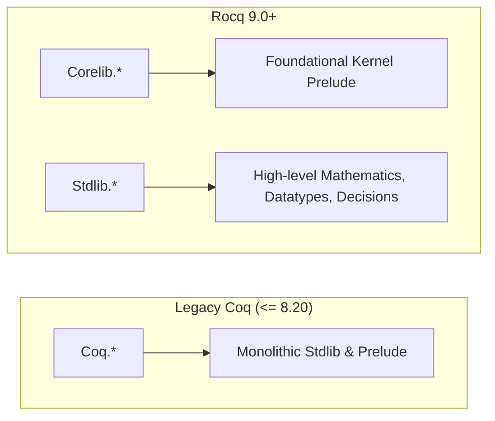

# Coq 8.x to Rocq 9.0+ Migration and Version Compatibility Guide

This reference document provides an exhaustive breakdown of the architectural, syntactic, and command-line transitions between legacy Coq (8.18 / 8.20) and **Rocq 9.0+**. Autonomous proving agents must reference this guide when configuring build files, updating library imports, eliminating compiler warnings, or diagnosing version-dependent syntax errors.

---

## 0. Version Matrix & Support Policy

| Environment        | Status                     | Standard Library Import                                                | CLI Entrypoint                 | Locality Syntax                                           |
| :----------------- | :------------------------- | :--------------------------------------------------------------------- | :----------------------------- | :-------------------------------------------------------- |
| **Rocq 9.0+**      | **Default Target**         | `From Stdlib Require Import ...`<br/>`From Corelib Require Import ...` | `rocq compile`<br/>`rocq repl` | Strict bracketed attributes: `#[local]`, `#[export]`      |
| **Coq 8.20**       | **Compatibility Baseline** | `From Coq Require Import ...`                                          | `coqc`<br/>`coqtop`            | Bracketed attributes supported; bare modifiers deprecated |
| **Coq $\le$ 8.17** | **Unsupported**            | `Require Import ...` / `From Coq`                                      | Legacy CLI only                | Legacy syntax permitted                                   |

---

## 1. Root Namespaces & Standard Library Split

### 1.1. Corelib vs. Stdlib Architecture

In Rocq 9.0+, the monolithic standard library was split into two separate logical packages:

1. **`Corelib`**: Minimal prelude, foundational logic (`Corelib.Init`), calculus primitives, and basic types needed by the kernel.
2. **`Stdlib`**: High-level arithmetic (`Arith`, `ZArith`), datatypes (`Lists`, `Vectors`), algebra, sorting, and decision procedures (`Lia`, `Micromega`).



### 1.2. Module Import Translation Table

| Component / Module    | Legacy Coq (8.20)                         | Modern Rocq 9.0+                             | Notes                              |
| :-------------------- | :---------------------------------------- | :------------------------------------------- | :--------------------------------- |
| **Linear Arithmetic** | `From Coq Require Import Lia.`            | `From Stdlib Require Import Lia.`            | Required for `lia.`                |
| **Natural Numbers**   | `From Coq Require Import Arith.`          | `From Stdlib Require Import Arith.`          | `Nat.add`, `Nat.mul`, etc.         |
| **Integers**          | `From Coq Require Import ZArith.`         | `From Stdlib Require Import ZArith.`         | `Z.add`, `Z.mul`, etc.             |
| **Lists**             | `From Coq Require Import List.`           | `From Stdlib Require Import List.`           | `List.map`, `List.fold_left`, etc. |
| **Strings**           | `From Coq Require Import Strings.String.` | `From Stdlib Require Import Strings.String.` | String scopes and notations        |
| **Logic & Equality**  | `From Coq Require Import Logic.Eqdep.`    | `From Stdlib Require Import Logic.Eqdep.`    | Dependent equality properties      |
| **Program Framework** | `From Coq Require Import Program.Wf.`     | `From Stdlib Require Import Program.Wf.`     | `Program Fixpoint`, `measure`      |
| **Low-Level Prelude** | `Coq.Init.Prelude`                        | `Corelib.Init.Prelude`                       | Implicitly opened by system        |

### 1.3. Compiler Warnings & Backward Compatibility

- **Warning Flag**: `deprecated-from-Coq`
- When compiling with Rocq 9.0+, writing `From Coq Require Import ...` triggers:
  ```text
  Warning: "From Coq" has been replaced by "From Stdlib". [deprecated-from-Coq]
  ```
- **Project-Level Suppress / Compatibility Mode**:
  If a project must remain buildable under both Coq 8.20 and Rocq 9.0+, maintain `From Coq` in `.v` files and add this flag to `_CoqProject`:
  ```text
  -arg -w -arg -deprecated-from-Coq
  ```

---

## 2. CLI Toolchain & Command Unification

Rocq 9.0 replaces fragmented standalone binaries (`coqc`, `coqtop`, `coq_makefile`, `coqdep`) with a unified multi-call dispatcher binary: `rocq`.

### 2.1. Command Translation Table

| Task                    | Legacy Coq (<= 8.20)                      | Rocq 9.0+ Standard                         | Short Alias (9.0+)  |
| :---------------------- | :---------------------------------------- | :----------------------------------------- | :------------------ |
| **Compile single file** | `coqc -q File.v`                          | `rocq compile -q File.v`                   | `rocq c -q File.v`  |
| **Interactive REPL**    | `coqtop -q`                               | `rocq repl -q`                             | `rocq top -q`       |
| **Generate Makefile**   | `coq_makefile -f _CoqProject -o Makefile` | `rocq makefile -f _CoqProject -o Makefile` | `rocq makefile ...` |
| **Dependency scanning** | `coqdep -f _CoqProject File.v`            | `rocq dep -f _CoqProject File.v`           | `rocq dep ...`      |
| **Print version**       | `coqc --version`                          | `rocq --version`                           | `rocq -v`           |

### 2.2. Autonomous Agent Dispatch Pattern (Python Subprocess)

Scripts such as `rocq_goal.py` and `run_build.py` must support dynamic toolchain resolution:

```python
import os
import shutil


def resolve_rocq_binary(subcommand: str) -> list[str]:
    """
    Returns the appropriate CLI invocation command based on host environment.
    Example: resolve_rocq_binary("compile") -> ["rocq", "compile"] or ["coqc"]
    """
    if shutil.which("rocq") is not None:
        return ["rocq", subcommand]

    # Fallback to legacy Coq 8.x binaries
    legacy_map = {
        "compile": "coqc",
        "repl": "coqtop",
        "top": "coqtop",
        "makefile": "coq_makefile",
        "dep": "coqdep",
    }
    fallback = legacy_map.get(subcommand, f"coq{subcommand}")
    if shutil.which(fallback) is not None:
        return [fallback]

    raise FileNotFoundError("Neither 'rocq' nor legacy 'coq' binaries found in PATH.")
```

### 2.3. Environment Variables

- `COQPATH` $\rightarrow$ `ROCQPATH`: Specifies physical directories to search for `.vo` files. Setting `COQPATH` in Rocq 9.0+ triggers `deprecated-coq-env-var`.
- `COQLIB` $\rightarrow$ `ROCQLIB`: Specifies the root directory of the Rocq installation.

---

## 3. Bracketed Attributes (`#[...]`) vs. Legacy Modifiers

### 3.1. Deprecation of Bare Modifiers

In legacy Coq, locality flags were placed as bare keywords before commands (e.g., `Local Hint Resolve`, `Global Instance`). Rocq 9.0 strictly standardizes on bracketed attributes (`#[locality]`).

- **Warning Flag**: `deprecated-hint-without-locality`, `deprecated-attributes`
- In modules or at file-toplevel (outside sections), bare `Hint` commands trigger deprecation errors or warnings.

### 3.2. Migration Dictionary for Modifiers

| Target Command       | ❌ Deprecated / Legacy (8.x)           | ✅ Mandatory in Rocq 9.0+                    |
| :------------------- | :------------------------------------- | :------------------------------------------- |
| **Hint in Module**   | `Local Hint Resolve my_lemma : core.`  | `#[local] Hint Resolve my_lemma : core.`     |
| **Exported Hint**    | `Hint Resolve my_lemma : core.`        | `#[export] Hint Resolve my_lemma : core.`    |
| **Global Typeclass** | `Global Instance my_inst : Class T.`   | `#[global] Instance my_inst : Class T.`      |
| **Section Instance** | `Instance my_inst : Class T.`          | `#[local] Instance my_inst : Class T.`       |
| **Deprecated Item**  | `(* no standardized syntax *)`         | `#[deprecated(since="9.0", note="Use bar")]` |
| **Warning Override** | `Set Warnings "-deprecated-from-Coq".` | `#[warnings="-deprecated-from-Coq"]`         |

---

## 4. Tactic Removals & Syntax Modernizations

### 4.1. Absolute Removal of `omega`

- `omega` was deprecated in Coq 8.12 and completely deleted in Coq 8.14.
- In Rocq 9.0, executing `omega` triggers `The reference omega was not found in the current environment`.
- **Replacement**:

  ```coq
  (* ❌ Legacy (Broken) *)
  Require Import Coq.omega.Omega.
  omega.

  (* ✅ Modern (Rocq 9.0+) *)
  From Stdlib Require Import Lia.
  lia.
  ```

- For non-linear integer expressions involving multiplication, use `nia.` (with `From Stdlib Require Import Micromega.Psatz.`).

### 4.2. Universe Polymorphism: `Type@{...}` to `Univ@{...}`

- **Warning Flag**: `deprecated-type-sort-poly-syntax`
- Legacy Coq allowed specifying explicit universe instances using `Type@{s;l}`.
- Rocq 9.0 modernizes universe specification to `Univ@{s;l}` to eliminate parser ambiguities between sort types and universe level bindings.

  ```coq
  (* ❌ Deprecated *)
  Definition my_id@{s;l} (A : Type@{s;l}) (x : A) : A := x.

  (* ✅ Modern (Rocq 9.0+) *)
  Definition my_id@{s;l} (A : Univ@{s;l}) (x : A) : A := x.
  ```

---

## 5. Build System Configurations

### 5.1. `_CoqProject` Standard

The `_CoqProject` file controls include paths and compilation flags for both `rocq makefile` and `coq_makefile`.

#### Pure Rocq 9.0+ Project:

```text
-Q theories MyProject
-arg -warn-error -arg +default
theories/Basics.v
theories/OperationalSemantics.v
theories/Soundness.v
```

#### Dual 8.20 / 9.0+ Cross-Compatibility Project:

```text
-Q theories MyProject
-arg -w -arg -deprecated-from-Coq
-arg -w -arg -deprecated-coq-env-var
theories/Basics.v
theories/OperationalSemantics.v
theories/Soundness.v
```

### 5.2. Dune Build Configuration (`dune-project`)

When building Rocq projects with Dune, the Coq plugin syntax reflects the library split:

#### Dune for Rocq 9.0+:

```lisp
(lang dune 3.12)
(using rocq 0.1) ; Or modern coq extension

(coq.theory
 (name MyProject)
 (package my-project)
 (theories Stdlib Corelib))
```

#### Dune for Coq 8.20:

```lisp
(lang dune 3.10)
(using coq 0.8)

(coq.theory
 (name MyProject)
 (package my-project)
 (theories Coq))
```

---

## 6. Deprecation Warnings & Quick-Fix Reference

| Warning Identifier                          | Root Cause                                      | Immediate Agent Automated Action                                |
| :------------------------------------------ | :---------------------------------------------- | :-------------------------------------------------------------- |
| `deprecated-from-Coq`                       | `From Coq Require Import ...` used in Rocq 9.0+ | Replace `From Coq` with `From Stdlib` (or `From Corelib`).      |
| `deprecated-coq-env-var`                    | Shell environment defines `COQPATH` or `COQLIB` | Unset `COQPATH` and set `ROCQPATH`.                             |
| `deprecated-hint-without-locality`          | `Hint` command outside section has no locality  | Add `#[export]` or `#[local]` before `Hint`.                    |
| `deprecated-type-sort-poly-syntax`          | `Type@{...}` used for universe polymorphism     | Replace `Type@{` with `Univ@{`.                                 |
| `The reference omega was not found`         | Invocation of removed `omega` tactic            | Import `Stdlib.Lia` and replace tactic with `lia.`.             |
| `Syntax Error: Lexer: Unterminated string`  | Missing closing double quote at EOF             | Close string literal; verify double quotes are escaped as `""`. |
| `Syntax Error: Lexer: Unterminated comment` | Unbalanced `(*` and `*)` delimiters             | Balance comment opening and closing tags.                       |
