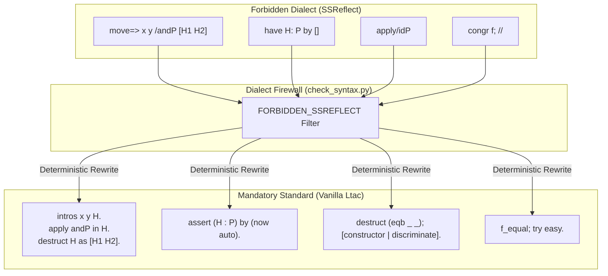
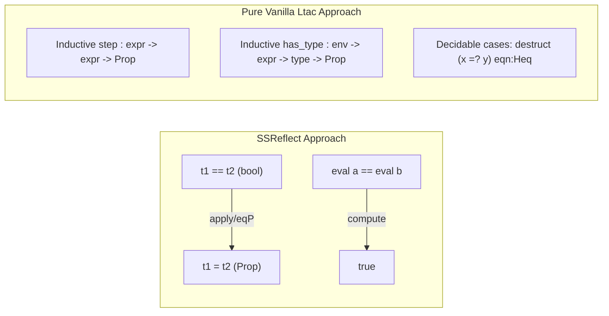

# SSReflect to Vanilla Ltac Translation Guide

This reference document provides an exhaustive conversion manual and architectural rationale for translating **SSReflect (Mathematical Components)** syntax into **Pure Vanilla Ltac** in Rocq 9.0+ and Coq 8.20.

---

## 1. Dialect Separation Rationale

In formal programming language semantics, compiler verification (e.g., CompCert), and software foundations, relations are predominantly formalized as inductive families in `Prop` (e.g., small-step reduction `step t t'`, typing `has_type Gamma t T`).

SSReflect was engineered for pure mathematics and small-scale boolean reflection over `bool`. Large Language Models (LLMs) frequently blend tokens from both ecosystems when proof steps stall, producing fatal parser crashes (`Syntax error: [ident] expected`). Within `rocq-skills`, **Vanilla Ltac is mandatory (100%)** and SSReflect is forbidden.



---

## 2. Comprehensive Translation Dictionary

| SSReflect Construct      | Vanilla Ltac Equivalent                | Category         | Description                                                                      |
| :----------------------- | :------------------------------------- | :--------------- | :------------------------------------------------------------------------------- |
| `move=> x.`              | `intro x.` / `intros x.`               | Binding          | Moves outer universal quantifier or implication premise into local context.      |
| `move=> [x y].`          | `intros [x y].`                        | Destructuring    | Unpacks a pair, conjunction, or single-constructor inductive term upon entry.    |
| `move=> [H1 \| H2].`     | `intros [H1 \| H2].`                   | Branching Intro  | Dispatches disjunction into two subgoals upon entry.                             |
| `move=> /V H.`           | `intros H. apply V in H.`              | View Application | Applies view lemma/conversion function `V` to incoming hypothesis.               |
| `move=> _`               | `intros _` / `clear.`                  | Discard          | Ignores and discards binder from goal.                                           |
| `move: x.`               | `revert x.`                            | Generalization   | Moves local hypothesis back into the goal conclusion.                            |
| `move: (H x).`           | `generalize (H x).`                    | Instantiation    | Pushes specialized hypothesis or term onto the goal.                             |
| `by [].` / `done.`       | `now auto.` / `easy.` / `reflexivity.` | Terminal         | Discharges trivial equalities, hypotheses, or direct contradictions.             |
| `have H: P := pf.`       | `pose proof (pf) as H.`                | Forward Proof    | Introduces proven fact term `pf` with statement `P`.                             |
| `have H: P by tac.`      | `assert (H : P) by tac.`               | Forward Proof    | Introduces intermediate goal $P$ proven via tactic block.                        |
| `have H: P.`             | `assert (H : P).`                      | Forward Proof    | Opens a new subgoal for $P$, placing $H : P$ in the context of the current goal. |
| `suff H: P by tac.`      | `enough (H : P) by tac.`               | Backward Proof   | Replaces target $G$ with prerequisite $P$ such that $P \to G$ holds.             |
| `suff H: P.`             | `enough (H : P).`                      | Backward Proof   | Opens two subgoals: first prove target assuming $P$, then prove $P$.             |
| `//`                     | `; try easy.` / `; auto.`              | Combinator       | Tries to discharge trivial subgoals generated by preceding tactic.               |
| `/=`                     | `simpl.` / `cbn.`                      | Reduction        | Computes $\beta\iota$-reduction on the goal.                                     |
| `//=`                    | `simpl; try easy.`                     | Reduction        | Computes simplification and discharges resulting trivial subgoals.               |
| `congr f.`               | `f_equal.`                             | Congruence       | Strips identical outermost function symbol from both sides of an equality.       |
| `case.`                  | `destruct 1.`                          | Case Analysis    | Case splits on the outermost premise of the goal.                                |
| `case: x.`               | `destruct x.`                          | Case Analysis    | Performs inductive case split on local variable `x`.                             |
| `case: x => [\| n].`     | `destruct x as [\| n].`                | Case Analysis    | Destructures `x` with explicit intro patterns for each branch.                   |
| `elim: n.`               | `induction n.`                         | Induction        | Applies standard structural induction on variable `n`.                           |
| `elim: n => [\| n' IH].` | `induction n as [\| n' IH].`           | Induction        | Applies induction with explicit binder and induction hypothesis names.           |
| `apply/idP.`             | `apply reflect_iff.`                   | Reflection       | Bridges between boolean evaluation `b = true` and proposition `P`.               |

---

## 3. In-Depth Patterns & Equivalences

### 3.1. Hypothesis Introductions and Views

#### Pattern: View Decomposition (`/andP`, `/eqP`)

SSReflect relies on small-scale reflection views to translate booleans into `Prop`. In Vanilla Ltac, hypotheses in `Prop` should be destructed directly, or converted using explicit lemma application.

- ❌ **Forbidden (SSReflect)**:
  ```coq
  Lemma test_and : forall a b : bool, a && b -> a.
  Proof.
    move=> a b /andP [Ha Hb].
    exact: Ha.
  Qed.
  ```
- ✅ **Mandatory (Vanilla Ltac)**:

  ```coq
  From Stdlib Require Import Bool.

  Lemma test_and : forall a b : bool, a && b = true -> a = true.
  Proof.
    intros a b H.
    apply andb_true_iff in H.
    destruct H as [Ha Hb].
    exact Ha.
  Qed.
  ```

#### Pattern: Nested Destructuring Bindings

- ❌ **Forbidden (SSReflect)**:
  ```coq
  move=> x y [H1 [H2 H3]].
  ```
- ✅ **Mandatory (Vanilla Ltac)**:
  ```coq
  intros x y [H1 [H2 H3]].
  ```
  _(Note: Pure Vanilla Ltac supports identical nested bracket patterns via `intros [ ... ]`.)_

---

### 3.2. Forward & Backward Assertions (`have` / `suff`)

#### Pattern: Local Lemma Inlining (`have: ... by ...`)

- ❌ **Forbidden (SSReflect)**:
  ```coq
  have Hstep: step t1 t2 by apply: step_eval.
  ```
- ✅ **Mandatory (Vanilla Ltac)**:
  ```coq
  assert (Hstep : step t1 t2) by apply step_eval.
  ```

#### Pattern: Multi-line Forward Subproofs

- ❌ **Forbidden (SSReflect)**:
  ```coq
  have Hval: value t.
  { apply: val_abs. }
  ```
- ✅ **Mandatory (Vanilla Ltac)**:
  ```coq
  assert (Hval : value t).
  { apply val_abs. }
  ```

#### Pattern: Backward Sufficiency (`suff: ...`)

- ❌ **Forbidden (SSReflect)**:
  ```coq
  suff Hle: x <= z by lia.
  ```
- ✅ **Mandatory (Vanilla Ltac)**:
  ```coq
  enough (Hle : x <= z) by lia.
  ```

---

### 3.3. Trivial Goal Discharge & In-line Combinators (`//`, `by []`)

#### Pattern: Tactical Combinators for Trivial Branches

SSReflect appends `//` to strip trivial goals produced by case splits. Vanilla Ltac uses tactical composition `; try easy.` or `; auto.`.

- ❌ **Forbidden (SSReflect)**:
  ```coq
  destruct x; //=.
  by [].
  ```
- ✅ **Mandatory (Vanilla Ltac)**:
  ```coq
  destruct x; cbn; try easy.
  now auto.
  ```

#### Pattern: Terminal Proof Closing

- ❌ **Forbidden (SSReflect)**:
  ```coq
  by rewrite H.
  by done.
  ```
- ✅ **Mandatory (Vanilla Ltac)**:
  ```coq
  rewrite H; reflexivity.
  easy.
  ```

---

### 3.4. Structural Induction & Inversion

#### Pattern: Induction with Binders

- ❌ **Forbidden (SSReflect)**:
  ```coq
  elim: l => [| x xs IHxs].
  ```
- ✅ **Mandatory (Vanilla Ltac)**:
  ```coq
  induction l as [| x xs IHxs].
  ```

#### Pattern: CompCert / Software Foundations Destruction Cleanliness

SSReflect often relies on destructive matching inside binders. In Vanilla Ltac, always adhere to the standard `inv` destruction macro:

```coq
Ltac inv H := inversion H; subst; clear H.
```

- ❌ **Anti-Pattern (Unsanitized inversion)**:
  ```coq
  inversion Hstep. (* Floods environment with stale equalities H0, H1, etc. *)
  ```
- ✅ **Mandatory Pattern**:
  ```coq
  inv Hstep. (* Leaves a clean, minimal local hypothesis context *)
  ```

---

### 3.5. Equality & Congruence

#### Pattern: Outer Function Peeling

- ❌ **Forbidden (SSReflect)**:
  ```coq
  congr S.
  congr (cons _).
  ```
- ✅ **Mandatory (Vanilla Ltac)**:
  ```coq
  f_equal.
  ```

#### Pattern: Rewrite Direction Notation

- ❌ **Forbidden (SSReflect / Ambiguous)**:
  ```coq
  rewrite -Heq. (* Minus prefix rewrite *)
  ```
- ✅ **Mandatory (Vanilla Ltac)**:
  ```coq
  rewrite <- Heq. (* Explicit backward arrow *)
  rewrite Heq.    (* Standard forward rewrite *)
  ```

---

## 4. Boolean Reflection vs. Prop in Program Verification

SSReflect equates decisions to `bool` functions (`==`, `&&`, `||`). Computer Science verification (e.g., Software Foundations, CompCert, Iris) structures semantics in `Prop`.



When case analysis on decidable equality is needed in Vanilla Ltac, avoid SSReflect reflection lemmas (`/idP`, `/eqP`). Instead, perform case analysis on the boolean equality test function directly, capturing the resulting equation via `eqn:`:

```coq
From Stdlib Require Import Arith.

Lemma nat_compare_example : forall n m : nat,
  (if n =? m then 0 else 1) <= 1.
Proof.
  intros n m.
  destruct (n =? m) eqn:Heq.
  - (* n =? m = true *)
    apply Nat.eqb_eq in Heq. (* Explicitly derive Prop equality if needed *)
    lia.
  - (* n =? m = false *)
    apply Nat.eqb_neq in Heq. (* Explicitly derive Prop inequality if needed *)
    lia.
Qed.
```

---

## 5. Diagnostic Signatures & Error Remediation

When SSReflect constructs inadvertently leak into source code without `Require Import ssreflect.`, the Rocq compiler issues characteristic errors:

| Error Message Signature                                        | Leaked SSReflect Token | Root Cause                                                | Immediate Remediation                                        |
| :------------------------------------------------------------- | :--------------------- | :-------------------------------------------------------- | :----------------------------------------------------------- |
| `Syntax error: [ident] expected after [intros]`                | `move=>` or `=>`       | Rocq parsed `move` as identifier or failed to parse `=>`. | Replace `move=>` with `intros`.                              |
| `The reference by was not found in the current environment.`   | `by [...]` / `by tac`  | `by` is not recognized as a tactic keyword.               | Replace with `now auto.`, `easy.`, or `assert (...) by ...`. |
| `The reference have was not found in the current environment.` | `have: ...`            | `have` is not a Vanilla vernacular keyword.               | Replace with `assert (...) by ...`.                          |
| `The reference suff was not found in the current environment.` | `suff: ...`            | `suff` is not a Vanilla vernacular keyword.               | Replace with `enough (...) by ...`.                          |
| `Syntax error: [tactic] expected after [semicolon]`            | `//`                   | `//` is parsed as an invalid token after `;`.             | Replace with `; try easy.` or `; auto.`.                     |
| `The reference elim was not found in the current environment.` | `elim: x`              | `elim` requires SSReflect argument syntax.                | Replace with `induction x.`                                  |
| `The reference case was not found in the current environment.` | `case: x`              | `case` requires SSReflect argument syntax.                | Replace with `destruct x.`                                   |
